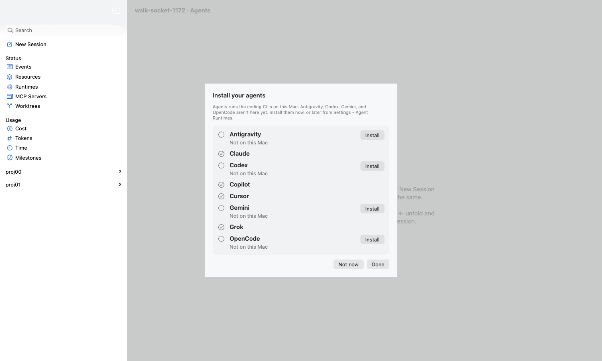
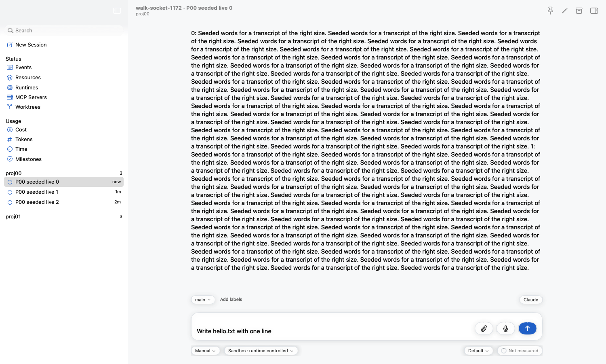
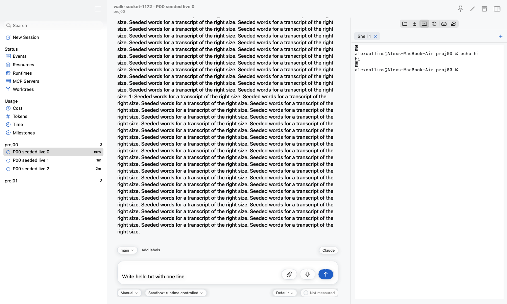
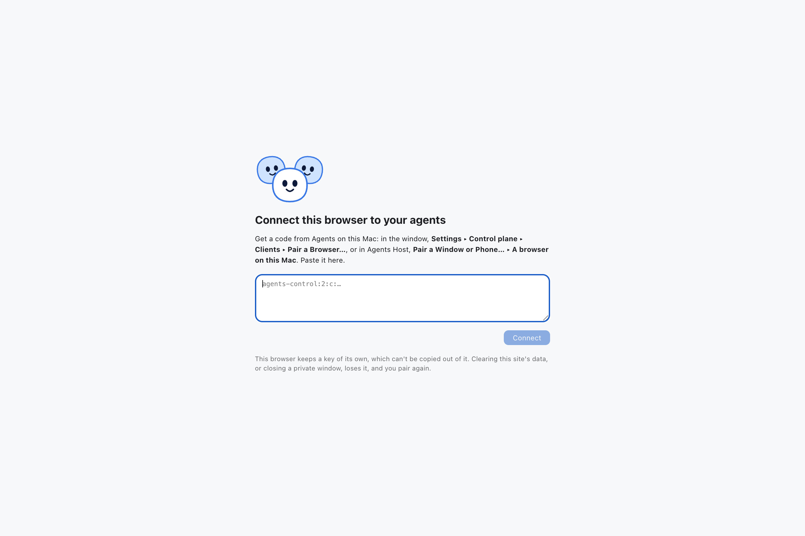
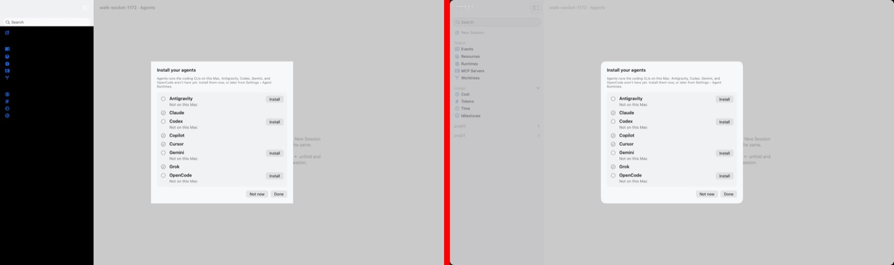
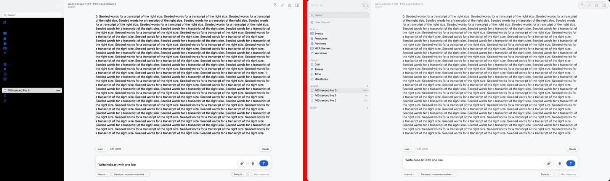
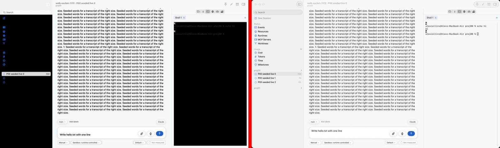

# Walk socket spike (#1172)

2026-10-16, macOS 26 (27.0), on Alex's MacBook Air with the screen **locked** the whole time
(`CGSSessionScreenIsLocked` true before every shot). A scratch window (`launch.sh --seeded`,
two projects of three sessions) walked by `walk.py` only: no window server capture, no AX
server, no HID, no focus. `NSApp.isActive` and the window's `isKeyWindow` stayed false after
every click and key.

## Result: the locked picture is usable

| Shot | What it shows |
| --- | --- |
|  | The first-run sheet ("Install your agents") over the window, dimmed behind it |
|  | A project unfolded, a session selected, its transcript, text typed into the prompt (Send lit) |
|  | The inspector's Terminal: `echo hi` typed, and the shell's answer |
|  | The web page in headless Chrome, also on the locked screen |

Unlocked `shot.sh` pictures of the same walk, for comparison: see the end.

## How it draws

`cacheDisplay` alone is **not** enough on macOS 26:

- a scroll view (the sidebar List, the transcript, every SwiftUI `ScrollView`) draws its clip
  view blank, though the clip view alone draws right;
- SwiftUI draws most of a page (the composer, the transcript's text) as plain `CALayer`s
  with no view, which `cacheDisplay` leaves out: the session's whole detail came out white.

What works: every view draws into its layer (`needsDisplay`, `displayIfNeeded`), then the
frame view's layer tree is rendered with `CALayer.render(in:)`. Drawn again over that, in
place:

| Gap in the layer render | Fill |
| --- | --- |
| Glass (`NSGlassEffectView`, the sidebar) shows its content through a portal: blank | its content views' layers, over it |
| A scroll view's edge effect does the same: the List's rows missing | each clip view's content, cut to the visible part |
| The selected sidebar row is an `NSVisualEffectView`: black | the grey of a window that is not key (a scratch window never is), and the row's cells over it |
| SwiftTerm's terminal draws only in `draw(_:)`: no text | `cacheDisplay` of the terminal |
| Window buttons | not drawn (cosmetic) |

Materials and glass come out as plain fills. Nothing was Metal: the terminal is SwiftTerm's
Core Graphics view.

## How it reads and presses

- SwiftUI builds its accessibility elements only once an assistive app asks. The server sets
  `AXEnhancedUserInterface` on `NSApp` at launch, as VoiceOver does.
- Children come from `accessibilityAttributeValue:` (the AX server's entry point), which alone
  gives a table's rows; labels and frames from the newer methods, which are all that SwiftUI's
  `AccessibilityNode` answers. Both are called by selector.
- A List puts back a selection or an expansion it was not told of as the person's
  (`AXSelected`, `selectRowIndexes`, `expandItem` all reverted, or held only now and then).
  `select` and `unfold` go through AppKit's own user paths (`_userSelectSingleRow:`,
  `_doUserExpandOrCollapseOfItem:…`); Debug only.
- `set` types through the field editor of the field under the element, after making it first
  responder in its own (not key) window. The first try typed into another field, which held
  the shared field editor; it now checks the editor's delegate.
- A SwiftUI tap gesture (a project's heading) took no in-process click; the chevron path above
  is what unfolds it. `click` and `key` reach AppKit views (the terminal took both).

## The web (step 4)

- Headless Chrome (`Web/test/walk/cdp.mjs`) loads and shoots the scratch web page on the locked
  screen: the web walk needs no unlock.
- `safaridriver`: `POST /session` timed out after 30 s on the locked screen. My notes from
  2026-10-01 say it also times out unlocked while Alex's Safari is open, which it was, so this
  does not settle Safari. A locked walk uses headless Chrome.

## Unlocked comparison

17:20, unlocked: the same walk, each shot taken by the window's own render (left) and by
`shot.sh` (right). The walk itself (press, unfold, select, set, click, key) behaved the same.

| | |
| --- | --- |
| Sheet |  |
| Session |  |
| Terminal |  |

The locked render (above) matches `shot.sh` but for the gaps listed (plain fills for glass,
the grey selection, no window buttons). The **unlocked** render does not: the sidebar comes
out black with its labels gone, and the terminal black. On screen, AppKit keeps those layers'
contents on the GPU, and `CALayer.render(in:)` reads them as black; off screen, the forced
drawing left them on the CPU. So `walk.py shot` takes `shot.sh`'s picture while the screen is
unlocked and the window's own render while it is locked (`--render` forces the render).
