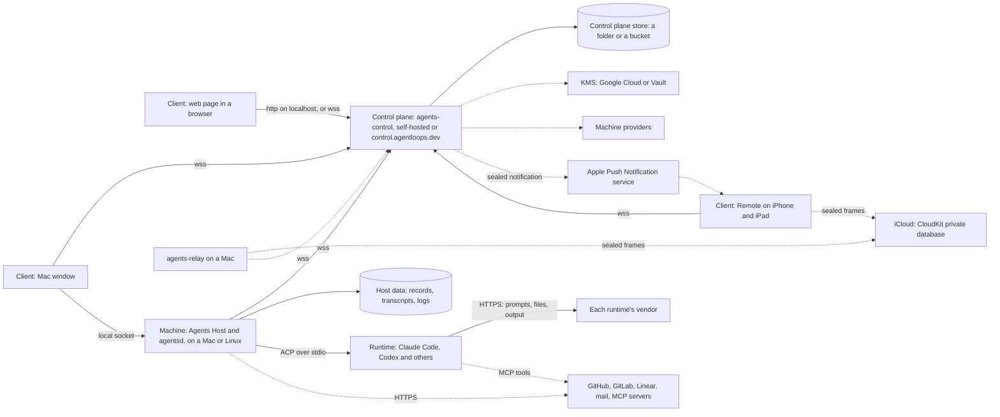

# Data flow

This page shows where data goes when you use Agents. The diagram has every part of Agents
and every outside service. The tables after it give the data on each line, and whether it
is encrypted in transit and at rest.

## The diagram

Each arrow points the way its connection is made. A dashed line is optional: it is there
only when you turn it on or connect that service.

The diagram is drawn as text so it can be checked against the code. The same parts are
drawn as C4 diagrams in [Architecture](../architecture.md).

## In transit

| Line | What goes on it | Encrypted in transit |
| --- | --- | --- |
| Remote, a window or a machine to the control plane | Every request and update: prompts you type, what agents say, files you open, terminals | TLS 1.2 or later. A control plane on a Mac makes a certificate of its own, and each client checks it against the pin in the pairing code. A control plane in the cloud has a Let's Encrypt certificate, ended by Caddy, and the last step to `agents-control` is plain HTTP on the machine's private Docker network. A pairing code names plain `http` only for a loopback address. |
| The Mac window to this Mac's machine | The same as above, for this Mac's agents | A local socket, so it never leaves the Mac. Only a window of the same macOS user is let in. |
| A browser to the control plane on the same Mac | The same as above | Plain HTTP and WebSocket on `localhost` only. It never leaves the Mac. |
| A machine to the runtime | Prompts, tool calls and answers, over ACP | stdio between processes on the same machine. |
| A runtime to its vendor | Your prompts, the files and command output the runtime reads, and its answers | HTTPS, made by the runtime. Agents does not keep or copy this traffic. |
| A runtime to the app's own tools | Calls to `mcp__agents__*` | HTTP on `127.0.0.1` only, with a token for each session. |
| A machine to GitHub, GitLab, Linear and MCP servers | Issues, pull requests, checks, events; what an agent sends to a tool | HTTPS. A stdio MCP server runs on the machine. |
| A machine to a mail server | One mailbox, read over IMAP | As the mail server allows. Agents never sends mail. |
| A server to the control plane, for a backup | The backup, in parts of 8 MiB | Inside the machine's connection (TLS, as above). The control plane seals each part when it arrives. |
| The control plane to Apple Push Notification service | A notification, and Live Activity updates | HTTPS to Apple. The words of a notification are sealed with the device's own key (HPKE: P-256, HKDF-SHA256, AES-256-GCM), and the visible alert says only "An agent needs you". A Live Activity update is not sealed. It carries only the turn's phase and times. |
| A phone away from home, through iCloud | Requests and updates, when **Relay for my devices** is on | Each frame is sealed (HPKE, P-256 and AES-256-GCM) between the device's key and the relay's key on your Mac, then posted to your own iCloud private database. Apple sees only sealed frames. The relay on your Mac opens them and passes them on to the control plane over its own connection. |
| The control plane to a machine provider | Calls that start, stop and make machines, with the credentials you give | HTTPS, an MCP server or a provider's CLI, run by the control plane. |
| The control plane to KMS | Calls to seal and open the control plane's key | HTTPS to Google Cloud KMS or HashiCorp Vault. |

### A borrowed sign-in

A Linux server can borrow the Claude or Codex sign-in of its user's Mac. The runtime on
the server then talks to a gate on its own loopback address. Each connection goes as a
tunnel through the control plane to the Mac. TLS ends on the Mac, so the server and the
control plane see only ciphertext. The Mac puts its own sign-in on the request and sends it
on to Anthropic (`api.anthropic.com`) or OpenAI (`chatgpt.com`). The Mac's log of this,
`machine-relay.log`, says only what was asked and how it was answered, and rolls at 1 MB.

## At rest

| Where | What | Encrypted at rest |
| --- | --- | --- |
| Host data, on each machine | Agent records, transcripts, turn summaries, the app-tool log, events, usage and time history, workflows | No. Plain files in a folder only its user can read (mode 0700). Use the disk's own encryption, such as FileVault on a Mac. |
| Secrets on each machine | Connection tokens (GitHub, GitLab, Linear, mail), MCP sign-ins, the person's secrets from the control plane | On a Mac, connection tokens are in the Keychain. MCP sign-ins and secrets from the control plane are plain files of mode 0600 in `~/.agents-secrets`, on a Mac too. On Linux, all of them are files of mode 0600 there. See [Security overview](security-overview.md#where-secrets-live). |
| A local backup | A `.tar.gz` of the agents and their history | No. Files of mode 0600 in the folder you choose. |
| The control plane's store | Clients, machines, people, groups, codes, settings, usage reports, audit events, prompts kept for a stopped workspace | Most records are plain JSON. A folder store keeps them in files of mode 0600. A bucket is as its machine stores it. |
| | A person's secrets set on the control plane | Yes, sealed (AES-256-GCM, with a data key wrapped by KMS or a local `secrets-key`). A control plane with neither refuses to keep secrets. |
| | A server's backups | Yes, each part sealed with AES-256-GCM under a key made from the control key. The index beside each backup (machine, date, size, number of agents) is plain. |
| | The control key, on a control plane in the cloud | Yes, sealed by KMS. On a Mac it is in the Keychain, or in a file of mode 0600. |
| The hosted service's store | Each account's records | As above, under `accounts/<id>/`, with the account's own control key sealed by Google Cloud KMS. |
| iCloud | Relay frames and mailbox records | Frames are sealed, as above. A mailbox record holds a sealed headline, ids and flags. |

## Related

- [Sub-processors](sub-processors.md)
- [Security overview](security-overview.md)
- [Data and retention](data-and-retention.md)
- [The control plane](../control-plane.md)
- [How the phone and iPad reach your agents](../phone-and-ipad.md)
