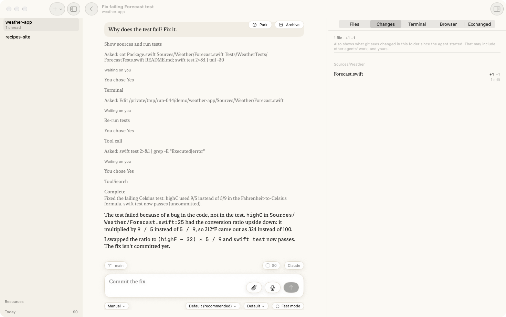
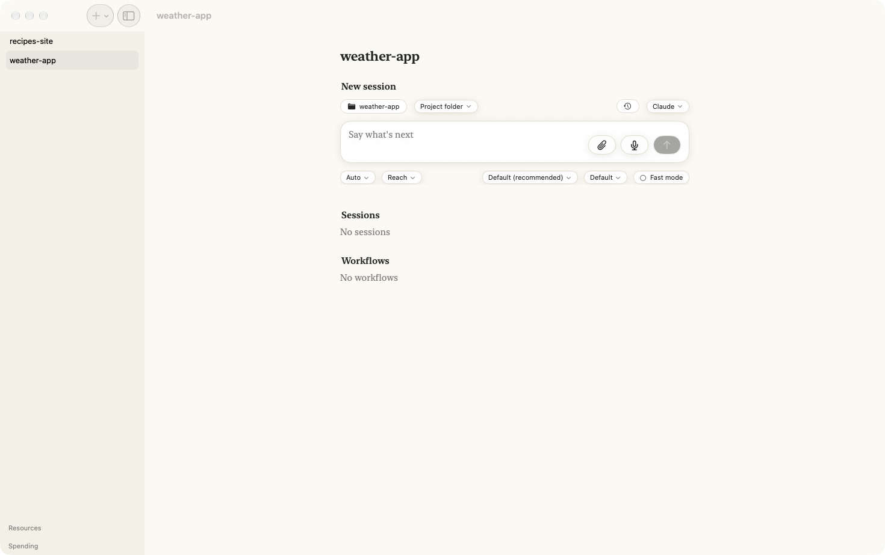
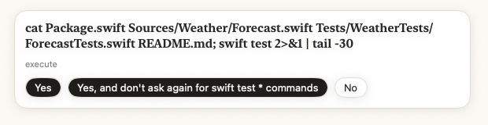
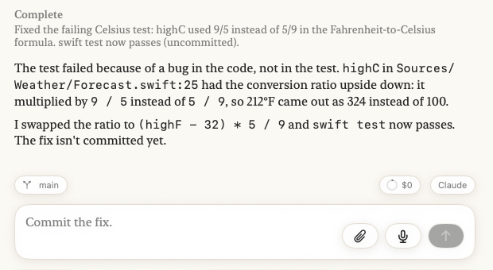
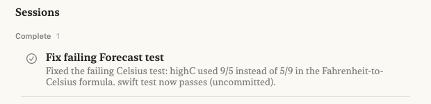

# Your first agent

In this tutorial you install Agents on your Mac, give it a small folder with a failing
test, and ask an agent to fix it. You answer the agent's questions as it works, and at the
end you read what it changed. It takes about fifteen minutes.

**What you'll have at the end:** a finished agent, its fix in your folder, and a feel for
how every agent in the app works.



## Before you start

- A Mac, and an invitation to the Agents alpha on TestFlight.
- One coding agent signed in on this Mac. This tutorial uses **Claude Code**, signed in
  with `claude` and `/login` in Terminal. The app talks to Claude through a small adapter:
  it runs it with your own Node if you have one, and otherwise installs its own copy in
  step 1. Codex, Antigravity, Grok, Copilot and Cursor work too; see
  [Runtimes](../reference/runtimes.md) for what each needs.

## 1. Install and open Agents

On a Mac, Agents is two apps: **Agents** is the window you work in, and **Agents Host**
runs your agents.

1. Open the invitation to the Agents alpha in **TestFlight**, and click **Install**. Open
   Agents.
2. The window opens on **Where should your agents run?** Under **Set one up on this Mac**,
   click **Get Agents Host…**. Download Agents Host, drag it into `~/Applications`, and
   open it. [Set up Agents on this Mac](../how-to/set-up-on-this-mac.md) says more about
   this step.
3. Agents Host asks **Where should this Mac's agents report?** Click **Run It Here**.
   Agents Host starts this Mac's agents and its control plane, and keeps them running with
   its window closed.

After a moment the window says **Agents Host is running on this Mac**. Click **Pair**:
Agents Host shows a code, and the window asks for it. Type or paste the code and click
**Connect**.

You should see the Agents window, with a **Get started** card at the top of the sidebar.
It is a checklist from here to your first agent, and each step ticks itself when it is
done:

1. **Pair this window with Agents Host**: done already.
2. **Install an agent runtime**: if it is not ticked, click **Install**. A sheet lists every
   runtime the app knows and whether it is on this Mac. If Claude's row says **Not on this
   Mac**, click **Install** on it and wait for it to finish. You need none of the others for
   this tutorial. The same rows are in **Settings ▸ Agent Runtimes**.
3. **Add a folder**: steps 2 and 3 of this tutorial.
4. **Start your first agent**: step 4.
5. **Pair a phone or browser**: optional, and not part of this tutorial.

Click **×** on the card to put it away before you are done; it does not come back.

## 2. Make a folder to work on

A folder is a directory you work in. For this tutorial, make a small one with a bug in it:
a weather forecast that converts Fahrenheit to Celsius the wrong way round. In Terminal:

```sh
mkdir -p ~/Demo/weather-app/Sources/Weather ~/Demo/weather-app/Tests/WeatherTests
cd ~/Demo/weather-app

cat > Package.swift <<'EOF'
// swift-tools-version:5.9
import PackageDescription

let package = Package(
    name: "Weather",
    targets: [
        .target(name: "Weather"),
        .testTarget(name: "WeatherTests", dependencies: ["Weather"]),
    ]
)
EOF

cat > Sources/Weather/Forecast.swift <<'EOF'
public struct Forecast {
    public var day: String
    public var highF: Double
    public var lowF: Double

    public init(day: String, highF: Double, lowF: Double) {
        self.day = day
        self.highF = highF
        self.lowF = lowF
    }

    /// The high in Celsius.
    public var highC: Double {
        (highF - 32) * 9 / 5
    }
}
EOF

cat > Tests/WeatherTests/ForecastTests.swift <<'EOF'
import XCTest
@testable import Weather

final class ForecastTests: XCTestCase {
    func testHighInCelsius() {
        let monday = Forecast(day: "Monday", highF: 212, lowF: 50)
        XCTAssertEqual(monday.highC, 100, accuracy: 0.01)
    }
}
EOF

git init -q && git add -A && git commit -qm "First version"
```

## 3. Add it to Agents

In the Agents window, click **Add Folder…** on the **Get started** card or in the empty
folder list (once you have folders, it is **File ▸ Add Folder…**), and pick
`weather-app` in your `Demo` folder.

You should see `weather-app` in the list on the left, and beside it an empty new session:
the folder's name in the middle, and the prompt at the bottom.



## 4. Start the agent

The runtime is on the right, above the prompt. It should say **Claude**. If you have not
signed Claude Code in on this Mac yet, do it now in Terminal: run `claude`, type `/login`,
and follow what it asks. To check, click **Claude** above the prompt and choose **Sign in,
sign out, providers…**: the sheet names the account you are signed in with. Then come back
here.

Click in the prompt, where it says **What do you want to do?**, type:

```text
Why does the test fail? Fix it.
```

and press Return.

You should see the conversation open, with your question at the top and the agent's first
steps appearing under it.

## 5. Answer its questions

Before the agent runs a command or changes a file, it asks you. A card appears above the
prompt, naming what it wants to do.



Click **Yes**. It will ask two or three times: to read the files and run the tests, to
edit `Forecast.swift`, and to run the tests again. Click **Yes** each time.

While it waits for you, the folder in the list says **Needs you**. That is how
you know an agent wants you, even when you are looking at something else.

## 6. Read what it did

When the agent has finished, it says **Complete** with a one-line summary, then explains
what was wrong and what it changed.



On the right, **Changes** lists the one file it edited. Click `Forecast.swift` to see
the line it changed. Above the prompt, the agent suggests what you might say next, such
as *Commit the fix.* You can take it, change it, or ignore it.

## 7. Find it again

Click the back arrow at the top of the conversation.

You should see the agent on the folder's page under **Done**, named for what it
did, with its summary under the name.



That is the whole loop: ask, answer, read. Every agent in the app works this way,
whether it runs for a minute or an afternoon.

## 8. Start the next one with a persona

Press Command-N (**File ▸ New Session**). The new session page for `weather-app` opens
again, as in step 3.

Look at the three Blobs above the folder's name. Click in the prompt and move the pointer:
they look at it. Keep the pointer still, or type, and they look down at the prompt. They go
away when your first prompt starts the session. With **Reduce motion** on in System
Settings, their eyes stay still.

The folder's name is a menu. Click it to start the session in another folder instead.

A persona is a kind of session that you can start again and again. It sets the runtime,
model, effort, mode and labels of the new session in one go, and gives the agent a prompt
of its own. Make one for this folder. In Terminal:

```sh
mkdir -p ~/Demo/weather-app/.agents/personas

cat > ~/Demo/weather-app/.agents/personas/reviewer.md <<'EOF'
---
name: Reviewer
description: Reads a change and says what is wrong with it.
labels: [review]
---

You review changes. Say what you would change before you change anything.
EOF
```

Go back to the window and press Command-N again. Under the folder's name there is now a
menu that says **No persona**. Click it and choose **Reviewer**.

You should see the persona's description under the menu, and the label `review` with the
prompt's labels. This persona names no runtime, so the session still uses Claude. Type a
prompt such as *Review the last commit.* and press Return to start it, or leave the page.

[Personas](../reference/personas.md) lists every key a persona file can have, and where
else you can keep one.

## Where next

- [Follow your agents from your iPhone](follow-from-iphone.md), the next tutorial.
- [Start an agent in its own worktree](../how-to/start-in-a-worktree.md), so two agents
  in one folder do not change the same files.
- [Read an agent's changes](../how-to/read-an-agents-changes.md), file by file and word by
  word.
- [Why agents keep working when the window is closed](../explanation/window-and-daemon.md).
