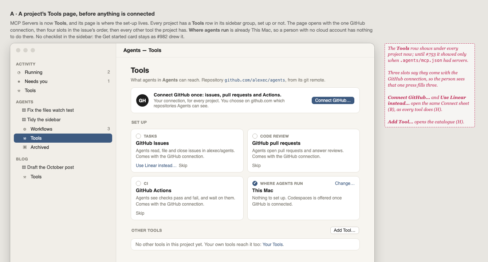
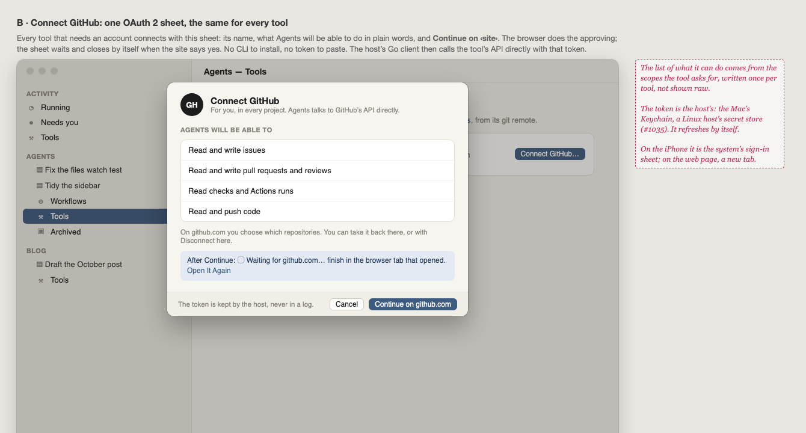
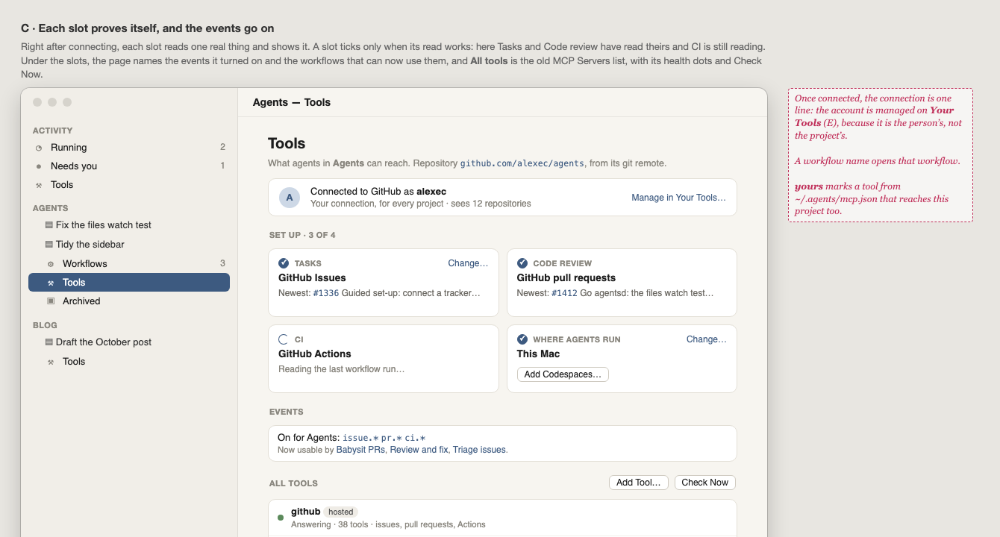
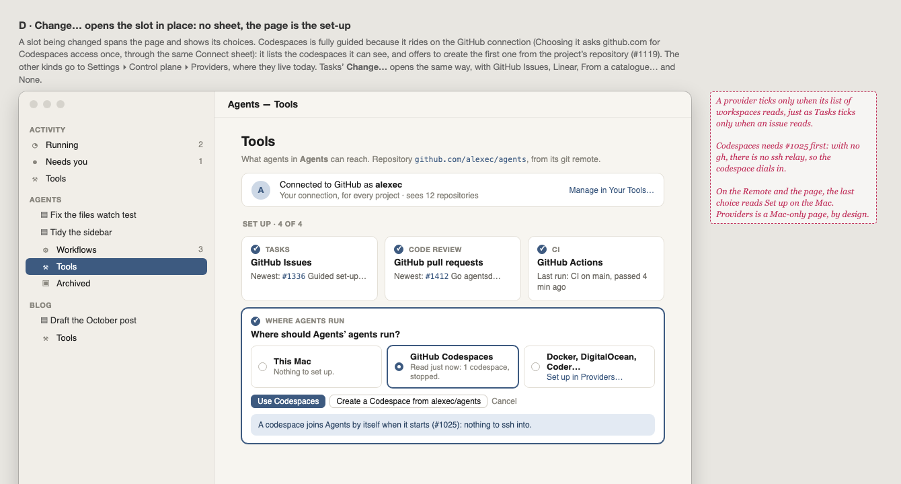
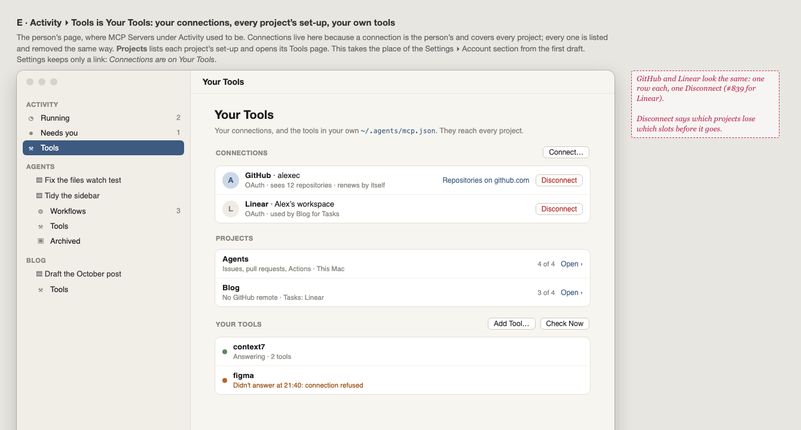
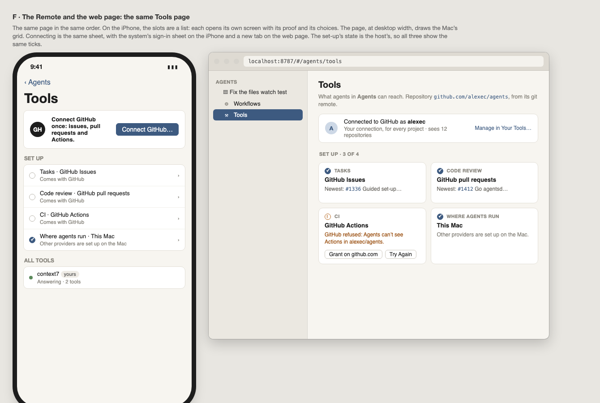
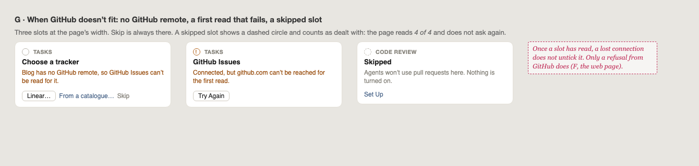
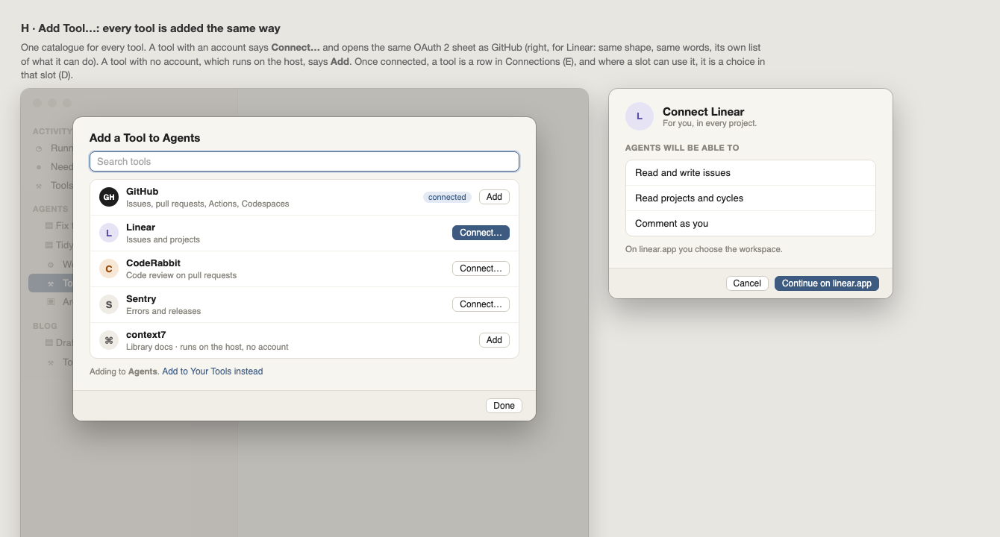

# 1336 · Wireframes: Connect your tools, on the Tools page

**Approved by Alex, 2026-10-17: frames A–H (draft 3).** This was the look gate for #1336.

Draft 1 put the set-up in the sidebar as a second Get started group. Alex asked for three changes
(2026-10-17):

- **MCP Servers are called Tools.**
- **The set-up gets a full page**, not a milestone-like checklist at the top left.
- **No `gh`.** The host's Go client talks to each tool's API directly. **Every tool is added the
  same way, with OAuth 2.**

So the set-up now lives on the Tools page, which replaces the MCP Servers page. **Your Tools**
sits under Activity, as MCP Servers did. Each project has its own **Tools** page in its sidebar
group. The Get started card stays as #982 drew it.

Source: [wireframes.html](wireframes.html). Open it with `#a` to `#h` to see one frame.

| Frame | What it shows |
|---|---|
| [A](wireframes.html#a) | A project's Tools page with nothing connected. At the top, one **Connect GitHub…**. Then four slots: Tasks, Code review, CI and Where agents run (already This Mac). Then the project's other tools, with **Add Tool…**. |
| [B](wireframes.html#b) | **Connect GitHub**: the one OAuth 2 sheet. It shows the tool, what Agents will be able to do in plain words, and **Continue on github.com**. It waits for the browser, then closes by itself. |
| [C](wireframes.html#c) | After connecting, each slot shows the one thing it read (newest issue, newest PR, last run). Below the slots: **Events** (what was turned on, and which workflows can use it) and **All tools**, which is the old MCP Servers list with its health dots and Check Now. |
| [D](wireframes.html#d) | **Change…** opens a slot in place, with its choices. Codespaces is guided: it rides on the GitHub connection (asking once for Codespaces access), reads the codespace list and can create one. The codespace joins by itself (#1025), so no ssh relay is needed. The other provider kinds go to Providers. |
| [E](wireframes.html#e) | Activity ▸ **Your Tools**: **Connections** (GitHub and Linear, one row each, each with Disconnect), each project's set-up (*4 of 4*, *Open ›*), and your own tools. |
| [F](wireframes.html#f) | The iPhone (the slots as a list, each opening its own screen) and the web page (the Mac's grid). |
| [G](wireframes.html#g) | When GitHub doesn't fit: no GitHub remote, a first read that fails, and a skipped slot. |
| [H](wireframes.html#h) | **Add Tool…**: one catalogue. A tool with an account says **Connect…** and opens the same sheet as GitHub (drawn here for Linear). A tool with no account, run on the host, says **Add**. |

## The rules the frames follow

1. **A tick is a read.** A slot ticks only when its read works, and it shows what it read. Once a
   slot has read, a lost connection does not untick it. Only a refusal from GitHub does.
2. **One press, three ticks.** Tasks, Code review and CI each say they come with the GitHub
   connection.
3. **Every tool connects the same way.** One OAuth 2 sheet, one row in Connections, one
   Disconnect. No CLI to install, and no token to paste. The host keeps the token (the Mac's
   Keychain, or a Linux host's secret store) and refreshes it.
4. **Skip is always there, and it counts.** A skipped slot shows a dashed circle and is not asked
   about again.
5. **A connection is the person's; the repository and events belong to the project.** Connections are
   managed on Your Tools. A project's page shows the connection as one line.
6. **The page is the set-up.** Changing a slot opens it in place, with no wizard and no sheet. The
   only sheet is Connect.
7. **The same page on all three clients.** The one difference is that on the Remote and the web
   page, the other providers say "set up on the Mac", because Providers is a Mac-only page by
   design.

## Decided while drawing (Alex can overrule)

- **Every project has a Tools row**, even when it has no tools yet. Until now the row showed
  only when `.agents/mcp.json` had servers (#753).
- **Connections live on Your Tools**, not a section in Settings ▸ Account. Settings keeps only a link.
- **Nothing in the sidebar nags.** The Tools row has no mark while the set-up is not done.
- **Codespaces can create its first workspace from the slot**, after #1119 (open question 2).
- **The rename "MCP Servers" → "Tools"** in every client and in the docs is its own issue,
  since it touches far more than this page.

## Still open after the gate

0. **Which OAuth 2 grant?** Draft 3 draws the browser flow (authorization code with PKCE), because
   every tool supports it, and the MCP spec's own authorization is OAuth 2.1. #1335 had chosen the
   device flow, which GitHub supports but Linear does not. Recommended: authorization code with
   PKCE everywhere, with the control plane taking the redirect.

1. A newcomer finds the page only through the Tools row. Should a project with a GitHub remote
   and nothing connected also show one line on the project page, such as *Connect your tools ›*?
2. In technical places (a tool's detail, the docs), is "MCP" still said, for example
   "Tools (MCP servers)"? Or is it Tools everywhere?
