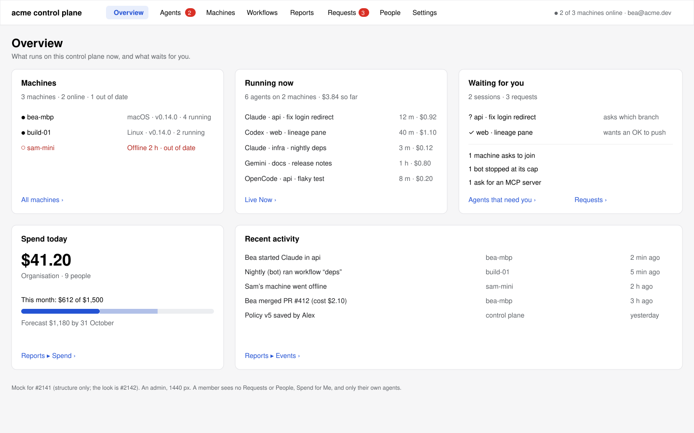
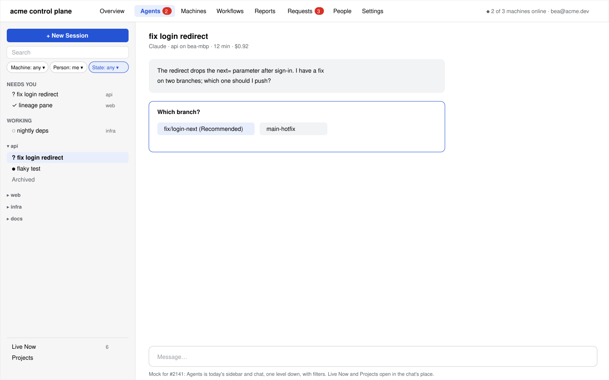
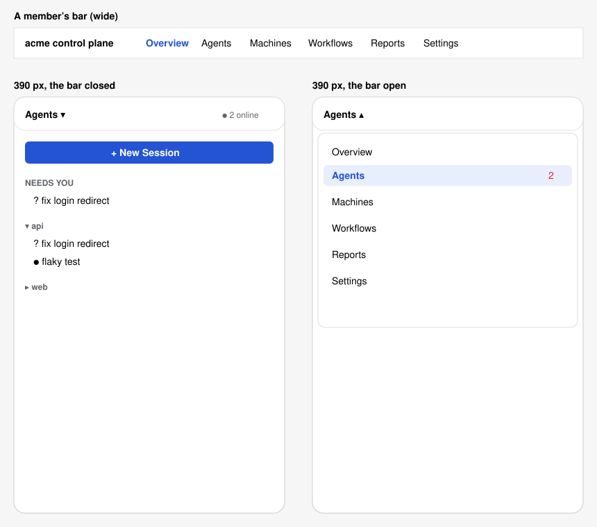

# Control plane web: one site, structured around the system (#2141)

Web only. No milestone. #2142 (the look) comes after this, in its own lane.

## Why

The web page grew from the web Remote (071). It is built around one person's chats:
folders ▸ sessions ▸ chat. The Console and Reports are two more apps in a switcher above
it (Workspace | Console | Reports, #1804). It does not read as the control plane of a
system of machines and agents (Alex, 2026-10-21).

Alex's answers (2026-10-21): **one site**. Do not make a second site. Do not remove the
agent workspace. Change **the structure** (this spec) and **the look** (#2142).

## What changes

1. **One navigation for the whole site**, a bar of sections at the top of every page. It
   replaces the Workspace | Console | Reports switcher.
2. **An Overview** that the page opens on: machines and their health, agents that run now,
   what waits for you, spend today, and recent activity.
3. **Chat is one level down,** in Agents: the list of agents (today's sidebar) and the
   chat. The list gets filters for machine, person and state.
4. **Each page of the Console, Reports and the sidebar's Activity block moves into a
   section.** No page is removed; each gets a new address.

The look stays as it is: the same CSS, the same controls. #2142 changes the look.

## The sections

The bar shows these sections, left to right. The sections that only an admin can use are
not shown to a member (#1804's role check, `people/list`'s `admin`). The control plane
still checks the role of each call.

| Section | Pages in it (the section's list, on the left) | Member | Admin | From |
|---|---|---|---|---|
| **Overview** | One page (below) | yes | yes | New. Replaces Console ▸ Overview |
| **Agents** | The list and the chat; **Live Now**; **Projects**; **Archived** | list, Projects | all | Workspace (the sidebar and the chat); Console ▸ Live Now; Console ▸ Projects |
| **Machines** | **Machines**; **Runtimes**; **Resources**; **Worktrees**; **MCP Servers** | yes | yes | Console ▸ Machines; Activity ▸ Runtimes, Resources, Worktrees, MCP Servers |
| **Workflows** | **Workflows** (every folder's); **Team Workflows** | Workflows | all | The Workflows fold of each folder (one list, not a copy: the fold stays); Console ▸ Team Workflows |
| **Reports** | **Spend**, **Outcomes**, **Time**, **Value**, **Runtimes**, **Adoption**, **Workflows**, **Usage**, **Milestones**, **Saved Views**; under Records, **Events** and **Audit** | yes | yes | Reports; Activity ▸ Spending, Tokens, Time (one Usage page, three tabs), Milestones, Events; Console ▸ Audit |
| **Requests** | One page, its count in the bar | no | yes | Console ▸ Requests |
| **People** | **People and Groups**; **Sign-In** | no | yes | Console ▸ People and Groups, Sign-In |
| **Settings** | **Settings** (today's page); **Policy**, **Model Access**, **Report Policy**, **Catalogue**, **Read API** | Settings | all | Settings; Console ▸ Policy, Model Access, Report Policy, Catalogue, Read API |

A member sees six sections: Overview, Agents, Machines, Workflows, Reports, Settings. An
admin sees eight.

- **A member's Machines page** lists the machines the page knows (`store.hosts`): their
  own and the ones shared with them. An admin's lists every machine (`console/fleet`), as
  Console ▸ Machines does today.
- **A member keeps People** in Settings ▸ People, as today. The People section is the
  admin's place to change people, groups and sign-in.
- **A member's Policy** stays in Settings, read only, as today. An admin's Settings list
  adds the pages that change the organisation's rules.
- **A page that a member opens by its address** (a link from an admin) says that it is
  for admins, as the Console says today.

### Decisions on the issue's open questions

- Decided: **a member sees Overview, Agents, Machines, Workflows, Reports and Settings**,
  because these are the pages whose calls a member may make today; People, Requests and
  the organisation's rules are the Console's, which is for admins (#1804).
- Decided: **the page a Mac's own control plane serves on localhost gets the same
  structure**, because it is one web client (the issue's recommendation), and one person
  on their own control plane is its admin, so they see every section.
- Decided: **pins, smart groups and Search stay in Agents' list**, because they sort
  chats, which is what that list is for. **The sidebar's Activity block (Status and
  Usage) goes**: its pages are in Machines and Reports, and the Overview shows the same
  numbers at a glance. Settings ▸ Sidebar keeps turning each smart group on or off.

## The bar

- At the top of every page, in place of the switcher: the control plane's name (the
  Overview's link), then the sections, then this browser's state at the right (the
  hosts' strip and Forget This Browser move here from the sidebar's foot).
- **A count beside a section** says what waits there: Agents, the sessions that need you
  (questions and OKs); Requests, `requestCount`. No other counts.
- **The open section is marked** (`aria-current="page"`). The bar is a `nav` with the
  label "Sections".
- **Keys:** g then o, a, m, w, r, q, p, s goes to each section (Overview, Agents,
  Machines, Workflows, Reports, reQuests, People, Settings), only when focus is not in a
  text field. ↑ ↓ → ← in Agents' list do what they do today.
- **Below 760 px wide** the bar is one button with the open section's name and a ▾. It
  opens the list of sections. The section's own list is the root page, as the sidebar is
  today, and what it opens takes its place, with ‹ back.

## Each section's page

Every section but Overview and Agents is drawn as the Console is today (`SubAppPage`):
its list of pages on the left, the open page on the right. The pages themselves do not
change.

**Agents** is drawn as the Workspace is today: the list of agents on the left, the chat
(or New Session, a workflow, a pinned page, Review) on the right, the files pane a third
column from 1440 px. Above the list:

- **New Session**, as today.
- **Filters:** Machine (any, or one of `store.hosts`), Person (admins only: any, me, or a
  person from `people/list`), State (any, Needs You, Working, Done). A filter changes
  which rows show. It does not change the groups: one group per folder, then its
  sessions. A project filter is the folder's group, so it is not a filter of its own.
  The filters are kept in the address (`?m=…&u=…&st=…` after the route) so a link keeps
  them.
- **Live Now, Projects and Archived** are rows at the foot of the list, as Archived is
  in a folder today. They open their page in the chat's place.

A person filter shows another person's agents only to an admin, and only in Live Now's
words (runtime, machine, state, cost). It never opens their chat: the control plane does
not read a conversation (`consoleFoot`).

Starting an agent from a browser only (0.8) works as today: New Session in Agents.

## The Overview

The page the site opens on (`#/`). Five cards in a grid, each with a link to the section
that has all of it. Each card reads what the page already has; no new call except where
said.

| Card | Shows | Opens | Data |
|---|---|---|---|
| **Machines** | "3 machines · 2 online · 1 out of date"; the offline and out-of-date ones by name, at most 3 | Machines | `store.hosts`; an admin's from `console/fleet` |
| **Running now** | How many agents work now and on how many machines; the 5 that started last: runtime, folder, machine, how long | Agents (State: Working), or Live Now for an admin | `store.agents`; an admin's from `console/live`, with cost so far |
| **Waiting for you** | The sessions that need you (questions, OKs), each a row that opens its chat; for an admin, the Requests count by kind | Agents (State: Needs You); Requests | The Needs You smart group's rows; `requestCount` |
| **Spend today** | Today's cost, and this month's against the budget with the forecast when there is a budget | Reports ▸ Spend | `reports/usage`, day and month, Me scope; an admin's, the organisation's |
| **Recent activity** | The last 10 events: who, what, which machine, when | Reports ▸ Events | The events the Events page reads |

- A card with nothing to show says so in one line ("Nothing waits for you."). It does
  not hide: the grid keeps its shape.
- The Overview reloads a card when its data changes, as the page it opens does. It never
  polls more than once a minute (Console ▸ Machines' rate).
- **While the control plane is down** each card shows what it had, quieted, as the
  sidebar does today, and the banner says why.

## Addresses

| Place | Address | Old address, which goes to it |
|---|---|---|
| Overview | `#/` | none: `#/` was the Workspace with nothing chosen |
| Agents, nothing chosen | `#/agents` | — |
| A chat, a workflow, a folder's pages | `#/h/<host>/p/<folder>/s/<session>` and the rest, unchanged | unchanged, so every notice and link still works |
| Live Now, Projects, Archived | `#/agents/live`, `#/agents/projects`, `#/h/…/p/…/ar/1` | `#/console/live`, `#/console/projects` |
| Another section's page | `#/<section>/<page>`: `#/machines/runtimes`, `#/reports/spend`, `#/settings/policy` | `#/console/<page>` and `#/a/<page>`, each to its new place; `#/reports/<page>` is unchanged; `#/settings` is Settings' first page |

The old addresses are read and replaced (`history.replaceState`), so a bookmark keeps
working and Back does not go to the old one. A later release can remove the old addresses (v0.x takes
breaking changes).

## Mock

## Clients

- **web:** this spec.
- **mac:** by design (#2141): the window stays a native app built around this Mac's
  folders. It keeps its sidebar's Activity block.
- **remote:** by design (#2141), the same.

## Parity

The web column of `specs/071-web-remote/walks/parity/` changes as follows, in the same
branch as the code:

- `console-and-reports.md`: the first row (the switcher) becomes "the bar of sections,
  the Overview". Each Console row's path changes from Console ▸ X to its section ▸ X. The
  verdicts stay **by design** (Mac + web).
- `sidebar-and-project-list.md`, `events-and-resources.md`,
  `pool-runtimes-and-spending.md`, `worktrees-and-files.md`: each Activity row's web cell
  names its new page (Machines ▸ Runtimes, Reports ▸ Usage, …). Its verdict stays
  **same** where the page is the same; the place on the page is the web's by design
  (#2141).
- A new row in `console-and-reports.md`: **Overview**, web only, **by design** (#2141).
- `scripts/parity-counts.py` gives the same totals but for the new row.

## Build

One PR, after Alex approves this spec and the mock. It is a UI enhancement, so it
waits for Alex's OK on its screenshots (#2811).

- `Web/src/route.ts`: `Route.section` names a section and its page in place of
  `app`/`activity`; the old addresses are read as above.
- `Web/src/model/nav.ts` (new; replaces `apps` and `appTitle` in `model/console.ts`): the
  sections, their pages, who sees each, and their counts.
- `Web/src/views/Nav.tsx` (new; replaces `AppSwitcher`) and `Web/src/views/Overview.tsx`
  (new; replaces the Console's Overview).
- `Web/src/views/Columns.tsx`: Agents draws the sidebar and the chat; every other
  section draws `SubAppPage`, which takes a section in place of an app.
- `Web/src/views/Sidebar.tsx`: the filters at its top; Live Now and Projects rows at its
  foot; the Activity block and the hosts' strip leave it.
- Unit tests: `route` (every old address to its new place and back), `nav` (a member's
  and an admin's sections), the Overview's words for each card. A walk in headless
  Chrome on a scratch control plane, as a member and as an admin.
