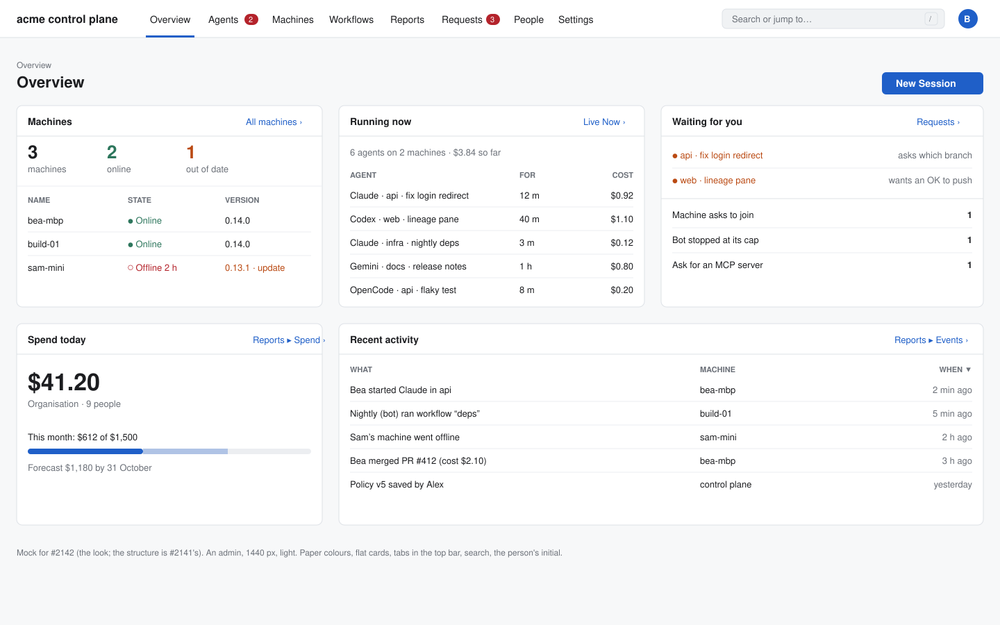
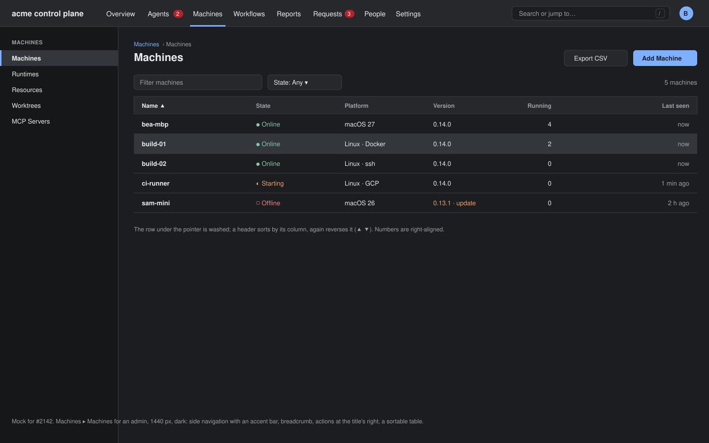
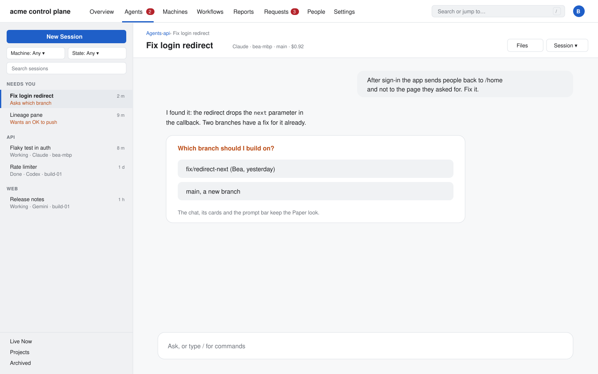
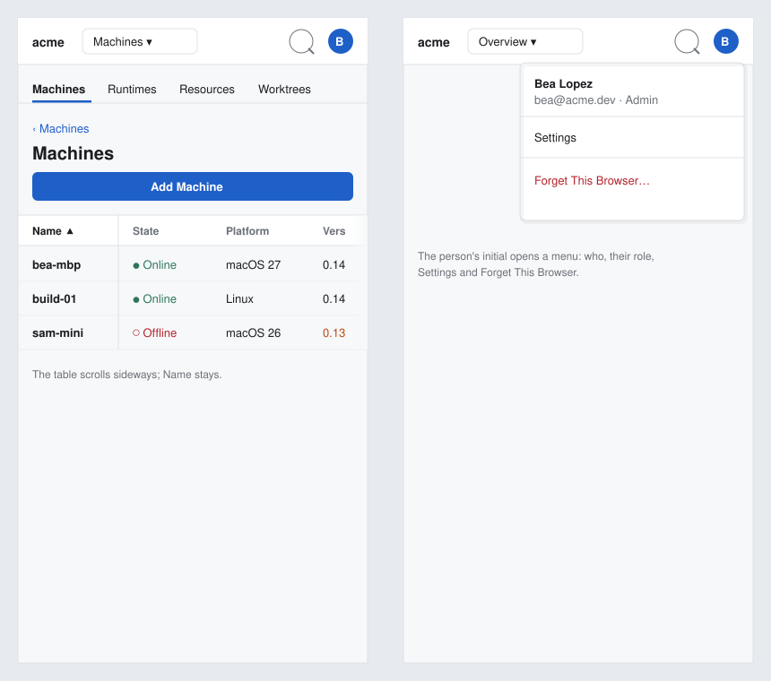

# Control plane web: a web console look (#2142)

Web only. No milestone. Builds on #2141's structure (PR #2967, `specs/2141-control-plane-web/`):
the sections, the Overview and the addresses do not change. This spec changes only how they
look.

## Why

The web page still draws the Mac and iPhone look: the Paper ground, iOS segmented
switchers (`.segmented`, 20 uses), Mac sidebar rows in each section's list of pages, and
cards where a console has tables. It does not look like a web console (Alex, 2026-10-21).

## What stays true

- The system's own fonts; nothing loaded from outside (FR-034).
- Light and dark, by the system's setting.
- Every size in rem, so the browser's font size and zoom work (#1034). The root stays
  112.5% (#2135).
- The structure of #2141: the bar of sections, the Overview, each section's list of pages,
  the addresses, the g-then-a-letter keys.

## Decisions on the issue's open questions

- Decided: **the web keeps the Paper colours**, because they are the product's colours on
  all three clients (the icon's cobalt, the three tints, the label hues) and are checked for
  contrast. What changes is how they are used: flat surfaces with hairlines, no shadows
  except on menus, and the accent only on the open tab, links, focus and the primary
  button. A console palette of its own is easy to add later as new values in
  `theme/paper.css`. Alex can overrule.
- Decided: **the chat keeps its Paper look inside the console frame**, because a chat is
  for reading and answering, not for scanning rows: the turns, the cards, the question
  cards and the prompt bar do not change. The frame around it takes the console look: the
  top bar, the breadcrumb header, the agents' list, the controls in the header. Alex can
  overrule.

## The top bar

One bar, 3rem high, on every page, in place of #2141's bar of buttons.

- **Left:** the control plane's name (the Overview's link), in bold.
- **Then the sections, as tabs:** text, with a 2px accent line under the open one
  (`aria-current="page"`). The counts are small red pills, as today.
- **Right:** **search**, then **the signed-in person**.
  - **Search** is a field ("Search or jump to… /"). `/` focuses it. It finds, by name, the
    sections' pages, the machines (`store.hosts`) and the sessions (the search the agents'
    list makes today, #165). ↑ ↓ and Return pick a result; Escape closes it. It makes no
    new call.
  - **The signed-in person** is a round initial (`store.person`). It opens a menu: name,
    email and role (Admin or Member), Settings, and **Forget This Browser…**, which moves
    here from the agents' list's foot. The hosts' strip and Help stay at the list's foot.
- **Below 760 px:** the name, the open section as a menu button (#2141's), a search
  button that opens the field over the bar, and the person's initial.

## A section's page

- **The list of pages on the left** is a web side navigation: 15rem wide, rows 2rem high
  in the body size, a group heading in small capitals, the open page marked by a 3px
  accent bar at its left and bold text. No rounded Mac selection.
- **The page's header** is a breadcrumb over the title: `Machines › Runtimes`, the last
  part not a link. A page one level down adds its part: `Agents › api › Fix login
  redirect`, `Workflows › api › nightly deps`, `Reports › Events › an event`. The section
  part goes to the section's first page. Below 760 px the breadcrumb is the ‹ back link.
- **The page's actions** (Add Machine, Save, Export) are buttons at the right of the
  title, not at the foot.

## Tables

Every list of things that a person scans is a table, with one shared component
(`Web/src/views/DataTable.tsx`):

| Page | Columns (sortable ones in bold) |
|---|---|
| Machines ▸ Machines | **Name**, **State**, **Platform**, **Version**, **Running**, **Last seen** |
| Machines ▸ Runtimes | **Runtime**, **Machine**, **Version**, **State** |
| Machines ▸ Worktrees | **Folder**, **Branch**, **Machine**, **Size**, **Age** |
| Machines ▸ MCP Servers | **Name**, **Machine**, **Folder**, **State** |
| Agents ▸ Live Now | **Agent**, **Runtime**, **Folder**, **Machine**, **Person**, **Started**, **Cost** |
| Agents ▸ Projects | **Project**, **Folders**, **Agents**, **Cost this month** |
| Workflows ▸ Team Workflows | **Workflow**, **Runs on**, **Last run**, **State** |
| Requests | **Kind**, **From**, **What**, **Asked** (and the row's buttons) |
| People ▸ People and Groups | **Name**, **Email**, **Role**, **Groups**, **Last seen** |
| Reports ▸ Events, Audit | **When**, **Who**, **What**, **Machine** |

- Rows 2.25rem high, text in the body size, numbers right-aligned in tabular figures,
  hairlines between rows, a wash under the pointer. No cards.
- A column's header sorts by it; again reverses it (`aria-sort`, ▲ ▼). Each table has a
  default order (the table above's first column, or newest first for times). The order is
  kept for the tab (sessionStorage), as #2141's filters are.
- The header row stays at the top while the page scrolls.
- A row that opens something (a machine's agents, an agent's chat, an event) is a link
  across the whole row.
- **Below 760 px** a table scrolls sideways, its first column fixed.
- An empty table says so in one line in its body ("No machines yet."), with its header.

Reports' charts and the Overview's cards are not tables: they keep their shape, in the
console's flat cards.

## Controls

The iOS segmented control goes. Each of its 20 uses becomes one of these:

- **Tabs**, where it switches what the page shows ("Show": Usage's Cost | Tokens | Time,
  Events' panes, a workflow's panes, Review, a diff, a chart, Mermaid, the agent config's
  files): text with an accent line under the open one, a hairline under them all
  (`role="tablist"`).
- **A select**, where it picks a value for what is shown (Reports' Range, By and Scope; the
  charts' Range): a native `<select>` drawn as a web button, "Last 7 days ▾".
- **Radio buttons**, in a form (Providers' Kind, a connector's Connect with): one per line.
- **New Session's persona** becomes a select, as its overflow menu already is.

Buttons: 2rem high, 6px corners. **Primary** (one per page at most) is the accent filled;
**secondary** has a hairline border on the raised surface; **danger** is the failure tint's
text and border. A menu is a raised list with a hairline border, a small shadow and rows
2rem high.

## Type

The body of every page outside the chat is 0.8125rem (about 14.6 px at the browser's
default, with #2135's root). A page's title is 1.25rem, a card's or a group's heading
0.875rem bold, a table's header 0.75rem in the quiet ink. The chat keeps its sizes.

## Agents

The agents' list keeps its rows, which read as an inbox, with the side navigation's type
and selection (the 3px accent bar). New Session is a primary button; the filters are
selects. The chat's header becomes the breadcrumb (`Agents › api › Fix login redirect`),
with its menu and the files button at the right.

## The Overview

The five cards of #2141, flat: a hairline border, 8px corners, no shadow, a header row with
the card's title on the left and its link on the right, a hairline under it. Running now and
Recent activity draw their rows as small tables.

## Mock

## Clients

- **web:** this spec.
- **mac:** by design (#2142): the window stays a native Mac look.
- **remote:** by design (#2142): the Remote stays a native iOS look.

## Parity

No row's verdict changes: the look of the web page was by design already. The
`console-and-reports.md` row for the bar names the top bar's search and person menu, web
only, **by design** (#2142). Forget This Browser's row names the person menu.

## Build

One PR, after Alex approves this spec and its mocks. It is a UI enhancement, so it waits
for Alex's OK on its screenshots (#2811).

- `Web/src/theme/console.css` (new): the console's surfaces, buttons, tabs, selects, side
  navigation and tables, from the Paper values.
- `Web/src/views/Nav.tsx`: the top bar's tabs, search and person menu; the side
  navigation; the breadcrumb header in `Framed`.
- `Web/src/views/DataTable.tsx` (new) and `Web/src/model/sort.ts` (new): the table and its
  sort, used by each page in the table above.
- `Web/src/views/Tabs.tsx` (new): the tabs, in place of `.segmented` where it shows panes;
  `<select>` and radio buttons in the other places. `.segmented` is removed from
  `app.css`.
- `Web/src/model/search.ts` (new): the top bar's results from the pages, machines and
  sessions.
- Unit tests: `sort` (each column type, reversing, the kept order), `search` (pages,
  machines and sessions by name), the breadcrumb's parts for each place. A walk in
  headless Chrome on a scratch control plane, light and dark, 1440 and 390 px.
