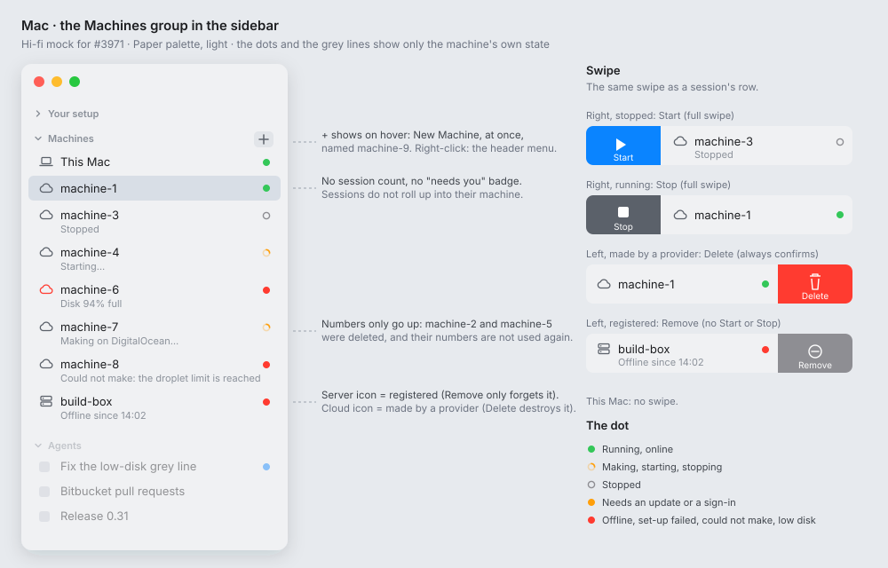
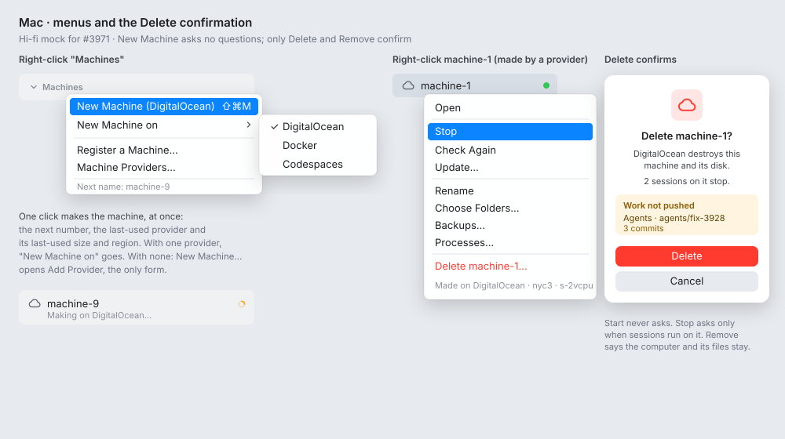
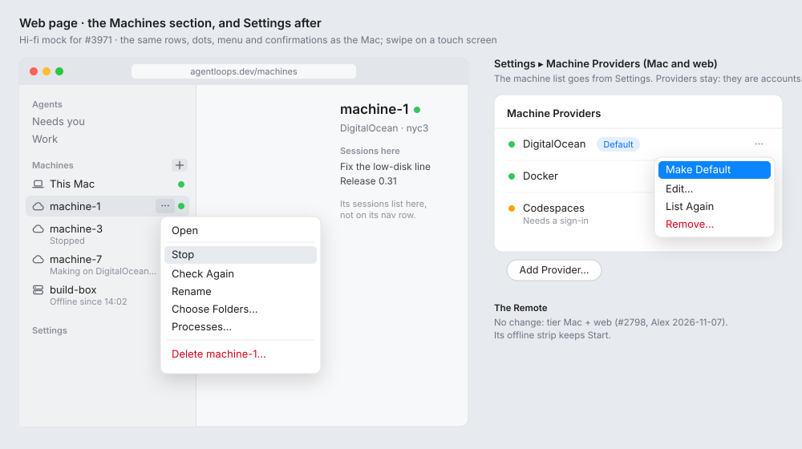

# Wireframe: machines in the sidebar, managed like sessions (#3971)

**Status:** draft for Alex. **Clients:** the Mac window and the web page (tier mac+web, #2798). **Feature:** `feature:machines`.

## First part: keep it simple (Alex, 2026-11-07)

The first part builds only this. The mock shows the whole design; the rest comes after, in one follow-up issue.

**In the first part**
- New Machine (the `+` and the header menu) on the **default provider**: the first provider added. Its options are the provider's defaults (the first choice of each field). The name is `machine-N`.
- Each row: the icon (cloud or server), the dot, and the grey line.
- Swipes: Start or Stop, and Delete or Remove.
- A row's menu: Open, Start or Stop, Rename, Delete or Remove.
- Confirmations: Delete always asks and says how many sessions stop. Remove asks. Stop asks when sessions run on the machine.
- A make that fails: a red row with the provider's reason. Its menu has only Delete.
- The Mac first, then the web page with the same set.

**Later (the follow-up issue)**
- "New Machine on ▸", the last-used provider and options, and Make Default.
- The names of the worktrees with work not pushed, in the Delete dialog.
- Try Again on a make that failed.
- The other menu items (Check Again, Update…, Choose Folders…, Backups…, Processes…, Link to Provider…). Until then they stay in Settings ▸ Machines.
- Removing the machine list from Settings (#3975).

## Hi-fi mock

In the app's Paper palette, light mode. These boards replace the ASCII sketches below where they differ.







## The idea

A machine provider is to its machines as an agent (runtime) is to its sessions. You make, start, stop and delete sessions in the sidebar. Do the same with machines:

| Sessions | Machines |
|---|---|
| A runtime (Claude, Codex…) runs them | A provider (DigitalOcean, Docker, Codespaces…) makes them |
| New Session: no form, a default name | New Machine: a sheet with the defaults chosen, Make confirms it (#4634; it was no form) |
| A status dot and a grey line | A status dot and a grey line |
| Swipe: Pin, Archive | Swipe: Start or Stop, Delete or Remove |
| Right-click: the session menu | Right-click: the machine menu |
| Not in Settings | Not in Settings (only the providers stay there) |

A machine **hosts** sessions, but their state does **not roll up** into it (Alex, 2026-11-07). The machine's dot and grey line say only how the machine is: making, running, stopped, offline, a low disk. A session that needs you shows on the session's row, never on its machine's row. The machine's row has no count of sessions and no "needs you" badge. Sessions are not listed under a machine in the sidebar; the machine's page lists them.

There are two kinds of machine:

- **Made by a provider: ephemeral.** It can start, stop and be deleted. Delete destroys it at the provider.
- **Registered** (ssh, a one-use code command, another Mac): **not ephemeral.** We cannot start or delete it. Remove only forgets it; the computer and its disk stay.
- **This Mac** is always the first row. It cannot be stopped, deleted or removed.

## 1. The Machines group (Mac)

```
┌ Sidebar ───────────────────────────────┐
│ ▸ Your setup                           │
│ ▾ Machines                        [+]  │  ← [+] shows on hover; right-click the header too
│   💻 This Mac                     ●    │  green: online
│   ☁️ machine-1                    ●    │  green: running
│   ☁️ machine-2                    ○    │  grey: stopped
│      Stopped                           │
│   ☁️ machine-3                    ◐    │  amber, turns: starting
│      Starting…                         │
│   🖥 build-box                     ●    │  red: offline (registered)
│      Offline since 14:02               │
│ ▾ Agents  …                            │
└────────────────────────────────────────┘
```

- **Icon:** ☁️ (SF Symbol `cloud`) for a machine made by a provider, 🖥 (`server.rack`) for a registered one, and the laptop or desktop for This Mac. Ephemeral and lasting machines then look different at a glance.
- **Status dot**, the same dot and colours as a session's:

  | State | Dot | Grey line (`MachineNeed` words) |
  |---|---|---|
  | Making | amber, turns | `Making on DigitalOcean…` |
  | Starting / Stopping | amber, turns | `Starting…` / `Stopping…` |
  | Running / online | green | nothing |
  | Stopped | grey, hollow | `Stopped` |
  | Offline | red | `Offline since 14:02` |
  | Setup failed / needs update / sign-in | red / amber | as today |
  | Low disk | red | `Disk 94% full` (#3928) |

- **The inline Start button goes.** Swipe and the menu do this now. The folded group's foot line (`SidebarFoot`) keeps Start.
- **Click** opens the machine's page, as today (`MachinePage`). That page lists the sessions the machine hosts.
- **Double-click on the name** renames it, as for a session.

## 2. New Machine

**Changed (Alex, 2026-11-10, #4634):** New Machine no longer makes a machine at once. The `+`, New Machine, New Machine on ▸ and File ▸ New Machine… open a sheet: the provider (a picker with two or more), the name (`machine-N`, editable) and every field of the provider's form, each on the value below, with a choice's cost when the provider gives one. **Make** makes it and closes the sheet, and the Making row takes over; Cancel makes nothing. A make the provider refuses opens the sheet again on the same choices, with the reason. `providers/options` returns the values and the name, so every client starts on the same ones. The agent tool `make_machine` still makes with no questions. The menus and the rules below for the name, the provider and the options are unchanged.

```
 right-click "Machines"                  right-click with two or more providers
┌───────────────────────────┐          ┌──────────────────────────────────────┐
│ New Machine          ⌘⇧M  │          │ New Machine (DigitalOcean)     ⌘⇧M   │
│ ───────────────────────── │          │ New Machine on               ▸ ┌────────────────┐
│ Register a Machine…       │          │ ──────────────────────────────  │ DigitalOcean ✓ │
│ Machine Providers…        │          │ Register a Machine…             │ Docker         │
└───────────────────────────┘          │ Machine Providers…              │ Codespaces     │
                                       └──────────────────────────────── └────────────────┘
```

Make on the sheet makes the machine. The row appears at once in the Making state:

```
│   ☁️ machine-4                    ◐    │
│      Making on DigitalOcean…           │
```

- **Name:** `machine-N`, with N a number that only goes up (Alex, 2026-11-07). The control plane keeps one counter per person; each new machine takes the next number, and a number is never used again, also after its machine is deleted or renamed. When the provider already has that name, it takes the next number. The person can rename it later.
- **Provider:** the one used last; with no last one, the first one added.
- **Options** (size, region, image): the ones used last on that provider; with no last ones, the provider's defaults (the first choice of each field).
- **Clone these folders:** nothing. You add a folder to a machine later, as today.
- **With no provider yet:** the menu shows `New Machine…` with three dots. It opens Add Provider, the one form we cannot skip (an account and a token). After that, the machine is made with no more questions.
- **When the make fails** (quota, token): the sheet opens again on the same choices with the provider's reason (#4634).
- **Register a Machine…** opens today's Add a Machine sheet, without the provider tab: ssh, a code command, or another Mac. Registering needs an address or a code, so it has a form.

## 3. Swipe

The same `SwipeAction` as a session's row (`SessionSidebarRow`).

```
 leading swipe (to the right)                trailing swipe (to the left)
┌──────────┬─────────────────────────┐     ┌─────────────────────────┬──────────┐
│  ▶ Start │ ☁️ machine-2         ○  │     │ ☁️ machine-1         ●  │ 🗑 Delete │  red
└──────────┴─────────────────────────┘     └─────────────────────────┴──────────┘
┌──────────┬─────────────────────────┐     ┌─────────────────────────┬──────────┐
│  ■ Stop  │ ☁️ machine-1         ●  │     │ 🖥 build-box          ●  │ ⊖ Remove │  grey
└──────────┴─────────────────────────┘     └─────────────────────────┴──────────┘
```

| Row | Leading | Trailing |
|---|---|---|
| Made by a provider, stopped | Start (full swipe) | Delete (red) |
| Made by a provider, running | Stop (full swipe) | Delete (red) |
| Registered | none | Remove (grey) |
| This Mac | none | none |

A full swipe to the left does not delete: it shows the confirmation (section 5).

## 4. The machine's menu (right-click a row)

```
 made by a provider                      registered
┌──────────────────────────────┐        ┌──────────────────────────────┐
│ Open                         │        │ Open                         │
│ ──────────────────────────── │        │ ──────────────────────────── │
│ Stop                    ⌘.   │        │ Check Again                  │
│ Check Again                  │        │ Update…                      │
│ Update…                      │        │ ──────────────────────────── │
│ ──────────────────────────── │        │ Choose Folders…              │
│ Rename                       │        │ Backups…                     │
│ Choose Folders…              │        │ Processes…                   │
│ Backups…                     │        │ Rename                       │
│ Processes…                   │        │ Link to Provider…            │
│ ──────────────────────────── │        │ ──────────────────────────── │
│ Delete machine-1…            │  red   │ Remove build-box…            │
└──────────────────────────────┘        └──────────────────────────────┘
```

These are the items of today's `···` menu in Settings ▸ Machines (`ControlSettingsView.swift:383-465`), moved here. Start replaces Stop when the machine is stopped. Unlink from ‹workspace› stays on the machine's page only (it is rare).

## 5. Confirmations

Start never asks. Stop asks only when sessions run on the machine (a consequence of the action, not a roll-up of their state) (today's `confirmRunning`). Delete always asks, because it cannot be undone. Remove asks.

```
┌ Delete machine-1? ─────────────────────────────────────────┐
│ DigitalOcean destroys this machine and its disk.           │
│ 2 sessions on it stop. 1 worktree has work not pushed:     │
│   Agents · agents/fix-3928  (3 commits)                    │
│                                                            │
│                              [ Cancel ]  [ Delete ]  red   │
└────────────────────────────────────────────────────────────┘

┌ Remove build-box? ─────────────────────────────────────────┐
│ Agents forgets this machine. The computer and its files    │
│ stay. To use it again, register it again.                  │
│                              [ Cancel ]  [ Remove ]        │
└────────────────────────────────────────────────────────────┘
```

## 6. Settings

```
 before                                   after
┌ Settings ──────────────────┐           ┌ Settings ──────────────────┐
│ …                          │           │ …                          │
│ Machines                   │  ──────▶  │ Machine Providers          │
│   This Mac, machine-1, …   │           │   DigitalOcean   ✓ default │
│   [Add a Machine…]         │           │   Docker                   │
│ Machine Providers          │           │   [Add Provider…]          │
└────────────────────────────┘           └────────────────────────────┘
```

- The list of machines goes from Settings. The sidebar is the one place to manage machines.
- **Machine Providers** stays in Settings: a provider is an account with a token, as a runtime's sign-in is.
- The provider row shows which one is the default for New Machine. "Make Default" in its `···` menu changes it.

## 7. The web page

The web's **Machines** section in the nav (`Web/src/views/Nav.tsx`) gets the same rows, dots, grey lines, menu and confirmations:

- **Right-click, or `···` on hover,** opens the menu of section 4. The section header has `+` (New Machine) and the same header menu.
- **Swipe** on a touch screen: the same actions as section 3.
- **Settings ▸ Machines** (`Web/src/views/settings/Machines.tsx`) goes, as on the Mac.

## 8. The Remote

It stays as today, tier mac+web (#2798): no Machines group; the offline strip keeps Start. See open question 1 in #3971.

## Decisions

Decided: each one below, because it is the recommended option and easy to undo. Alex can overrule.

- The **last-used provider and options** are what the New Machine sheet starts on (#4634). When there are two or more providers, a submenu opens the sheet on another.
- A **failed make** stays as a red row with Try Again and Delete, so the reason does not get lost.
- **Full swipe** starts or stops, but never deletes. Delete always confirms.
- **The icon** (cloud or server) shows ephemeral or registered.
- **Unpushed work** on delete: the dialog shows it and lets you continue. It does not refuse (open question 2).
- **Settings keeps Machine Providers only.**

## What changes in the code (for the lanes)

- **Daemon / control plane (task):** `machines/make` with no name and no options. The control plane picks `machine-N` from a per-person counter that only goes up, the default provider and the last-used options, and stores the last-used options for each provider. A `default` flag on a provider. The `make_machine` agent tool can leave `name` out too.
- **Mac (story):** `MachineRow` gets the status dot, the icon, the menu and the swipes; the Machines header gets `+` and its menu; rename in place.
- **Mac (story):** Settings ▸ Machines goes; Machine Providers gets Make Default.
- **Web (stories):** the same, in `Nav.tsx` and `settings/Machines.tsx`.
- **Parity:** the rows in `specs/071-web-remote/walks/parity/sidebar-and-project-list.md` and `hosts-connection-and-pairing.md`.
- **Approval:** every story adds a control or a layout, so each one waits for Alex (#2811).
