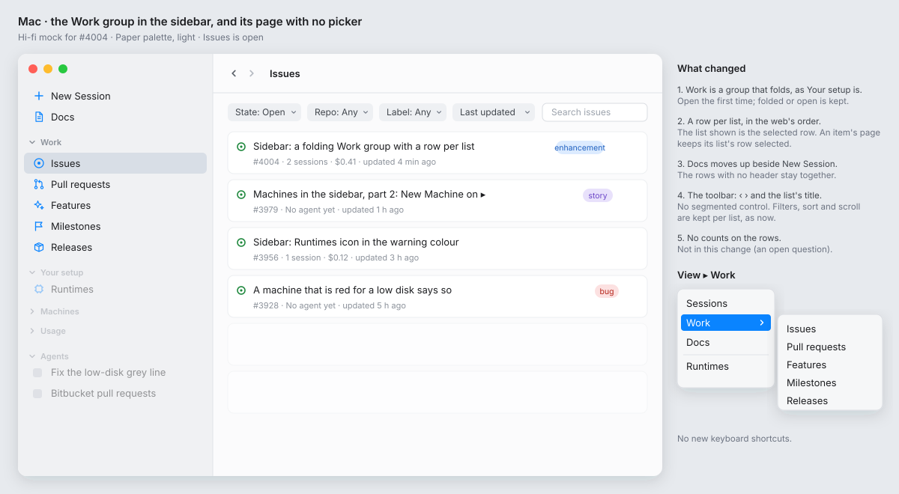
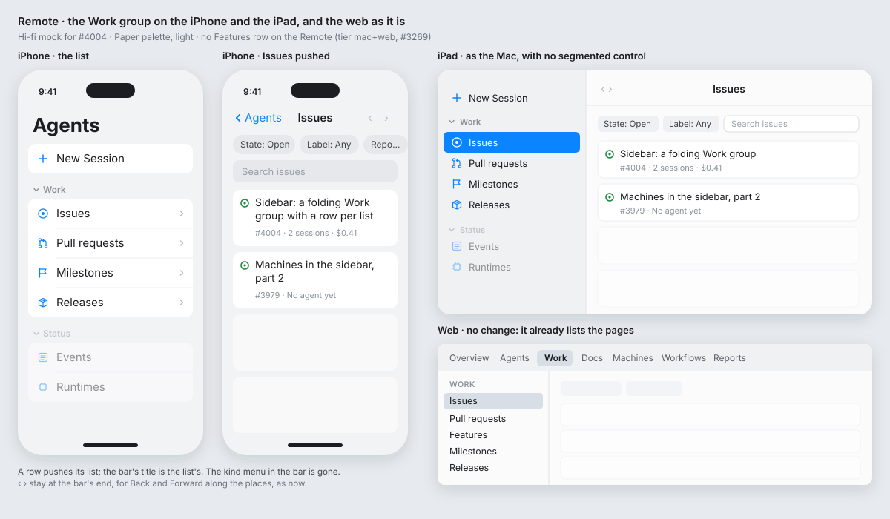

# Wireframe: a folding Work group in the sidebar (#4004)

**Status:** draft for Alex. **Clients:** the Mac window, the Remote, the web page (Work is Core). **Feature:** `feature:work`.

## Hi-fi mock

In the app's Paper palette, light mode. Where they differ from the ASCII sketches below, these boards are correct.





## The idea

Today Work is one sidebar row. It opens one page with a segmented control in the toolbar: Issues | Pull requests | Features | Milestones | Releases.

Instead, **Work is a folding group, as Your setup and Machines are.** Each list is a row of its own. The segmented control goes.

The web page does this already: its Work section has a list on the left with the heading **Work** and a row for each page (`Web/src/model/nav.ts`). This change makes the Mac and the Remote the same as the web.

## 1. The Mac sidebar

Now:

```
┌ Sidebar ───────────────────────────────┐
│ ✚ New Session                          │
│                                        │
│ ☑ Work                                 │  ← one row
│ 📄 Docs                                │
│                                        │
│ ▾ Your setup                           │
│ ▾ Machines                             │
│ ▾ Usage                                │
│ ▾ <folders> …                          │
└────────────────────────────────────────┘
```

After:

```
┌ Sidebar ───────────────────────────────┐
│ ✚ New Session                          │
│ 📄 Docs                                │
│                                        │
│ ▾ Work                                 │  ← header folds, as Your setup does
│   ◎ Issues                             │
│   ⇄ Pull requests                      │
│   ✦ Features                           │
│   ⚑ Milestones                         │
│   📦 Releases                          │
│                                        │
│ ▾ Your setup                           │
│ ▾ Machines                             │
│ ▾ Usage                                │
│ ▾ <folders> …                          │
└────────────────────────────────────────┘
```

- **Rows,** in the order of the segmented control (and of the web): Issues, Pull requests, Features, Milestones, Releases.
- **Icons** (SF Symbols), in the accent as the other top rows: `smallcircle.filled.circle` Issues, `arrow.triangle.pull` Pull requests, `sparkles` Features, `flag` Milestones, `shippingbox` Releases.
- **Help** on each row, as the Work row has now. For example: *Every issue in your folders' repos, and what agents spent on each.*
- **Folded or open** is kept, as for Your setup (`showsWork`, the same store). Open the first time.
- **Selection:** the row of the list shown is selected. An item's page (an issue, a PR) keeps its list's row selected, so you can see where you are.
- **Docs** stays one row. It moves up beside New Session, so the top rows with no header stay together.

## 2. The Work page on the Mac

Now:

```
┌──────────────────────────────────────────────────────────────┐
│ ‹ ›     [ Issues | Pull requests | Features | Milestones | Releases ]   │
├──────────────────────────────────────────────────────────────┤
│ State: Open ▾  Repo: Any ▾  Label: Any ▾  Sort ▾   🔍 words   │
│ …rows…                                                       │
└──────────────────────────────────────────────────────────────┘
```

After:

```
┌──────────────────────────────────────────────────────────────┐
│ ‹ ›   Issues                                                 │  ← the list's title, no picker
├──────────────────────────────────────────────────────────────┤
│ State: Open ▾  Repo: Any ▾  Label: Any ▾  Sort ▾   🔍 words   │
│ …rows…                                                       │
└──────────────────────────────────────────────────────────────┘
```

- The toolbar has **‹ ›** (Back and Forward) and the **list's title** (`navigationTitle` = the kind's title). No segmented control.
- Back and Forward still go along the places. When a place is in another list, the sidebar selection moves to that list's row.
- Each list keeps its own filters, sort and scroll (`workLists`, as now).

## 3. The menu bar (Mac)

- **View ▸ Work** becomes a submenu: Issues, Pull requests, Features, Milestones, Releases.
- No new keyboard shortcuts. (A follow-up can add them if Alex wants.)

## 4. The Remote

Work is Core, so the Remote does the same, with no Features row (tier mac+web, #3269).

```
iPhone root list                 iPad sidebar
┌──────────────────────┐         ┌──────────────────────┐
│ ✚ New Session        │         │ ✚ New Session        │
│                      │         │                      │
│ ▾ Work               │         │ ▾ Work               │
│   ◎ Issues         › │         │   ◎ Issues           │
│   ⇄ Pull requests  › │         │   ⇄ Pull requests    │
│   ⚑ Milestones     › │         │   ⚑ Milestones       │
│   📦 Releases      › │         │   📦 Releases        │
│ ▾ Status             │         │ ▾ Status             │
└──────────────────────┘         └──────────────────────┘
```

- A row pushes its list. The bar's title is the list's title.
- **The iPhone's kind menu goes** (`workKindPickerStyle(compact:)` and the picker). On the iPad, the segmented control goes, as on the Mac.

## 5. The web page

No change. Its Work section already lists the five pages on the left, under the heading **Work**.

```
┌ Top bar: Overview  Agents  [Work]  Docs  Machines … ┐
├──────────────┬──────────────────────────────────────┤
│ WORK         │                                      │
│  Issues    ◀ │  State: Open ▾ …                     │
│  Pull requests│  …rows…                             │
│  Features    │                                      │
│  Milestones  │                                      │
│  Releases    │                                      │
└──────────────┴──────────────────────────────────────┘
```

## How it is built (for the lane)

- `SidebarItem.work` becomes `SidebarItem.work(WorkList.Kind)` (`Packages/AgentsKit/Sources/AgentsKitCore/Sidebar/SidebarItem.swift`). Selecting a row calls `model.showWork(WorkPlace(kind:))`. The selection follows `workPlace.kind`.
- Mac: `App/Sources/Folders/FolderListView.swift` gets a `Section(isExpanded: $showsWork)` with a row per kind. `App/Sources/Commands/AgentsCommands.swift` gets the submenu.
- Shared: `Shared/UI/Work/WorkView.swift` loses the `.principal` picker and `workKindPickerStyle`.
- Remote: `Remote/Sources/Sidebar/RemoteSidebar.swift` gets the same group, without Features.
- Update the Work row in `specs/071-web-remote/walks/parity/worktrees-and-files.md` ("a segmented Issues / Pull requests …", "on an iPhone the kind is a menu").
- This adds a layout (it moves a control into the sidebar), so the PR waits for Alex's approval (#2811), with screenshots of the Mac and the Remote.

## Decisions

- Decided: Docs stays one row and moves up beside New Session, because a group header between the top rows and Docs would leave Docs alone under the Work group. Alex can overrule.
- Decided: no count badges on the rows (for example, open issues), because the first part only moves the controls. Alex can overrule.
- Decided: the group is open the first time, because a folded group hides the lists that the one Work row showed before. Alex can overrule.

## Open questions

- Do the rows show a count (open issues, open PRs)? Not in this change.
- Do the rows get keyboard shortcuts (for example ⌘⌥1–5)? Not in this change.
