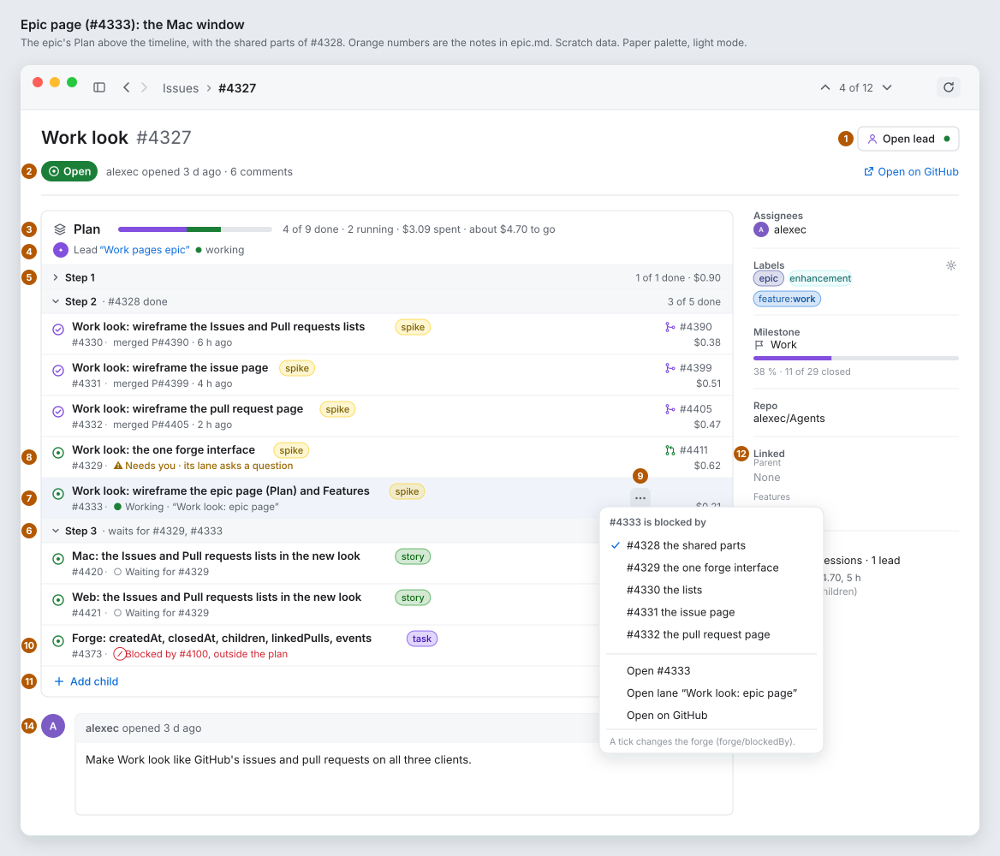
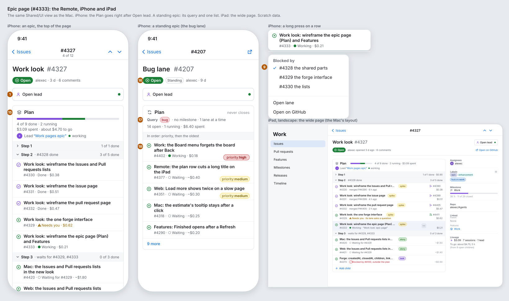
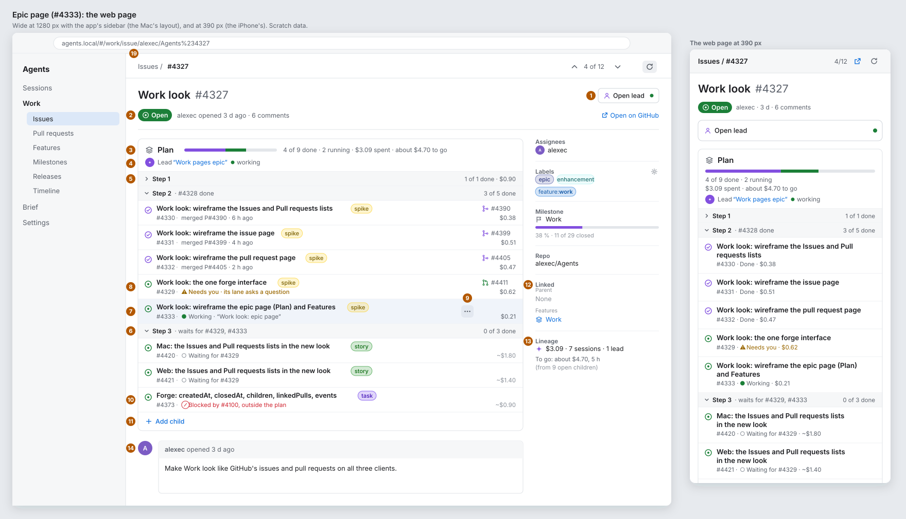
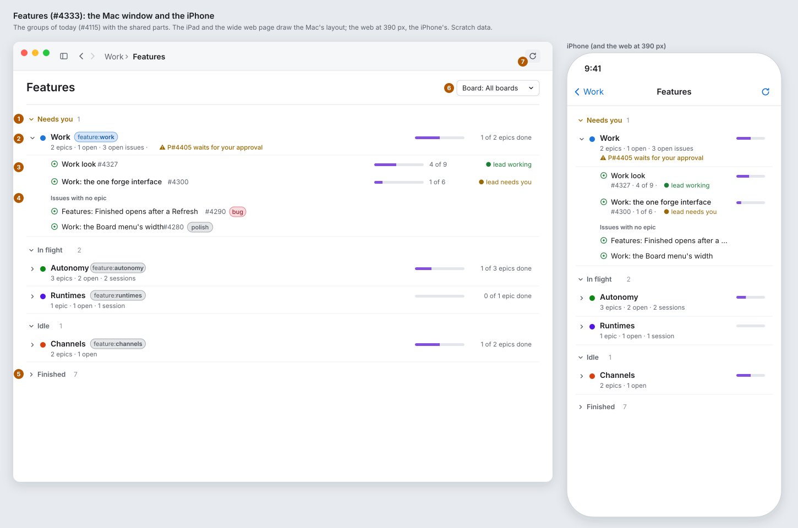
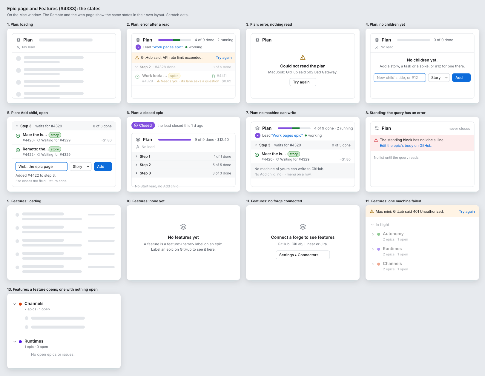

# Work look: the epic page (Plan) and Features (#4333)

**Status:** draft for Alex. **Epic:** #4327, step 2. **Builds on:** [parts.md](parts.md) (#4328), [issue.md](issue.md) (#4331). **Clients:** the Mac window, the Remote (iPhone and iPad), the web page (wide and 390 px). Work is Core. **Feature:** `feature:work`.

This spike makes no product code. An epic's page is the issue page of [issue.md](issue.md) with one more section, the **Plan**. This page says where the Plan goes, how it looks, and how Work ▸ **Features** looks with the shared parts of [parts.md](parts.md).

Today: `Shared/UI/Work/WorkPlanSection.swift`, `WorkFeaturesView.swift`, `Web/src/views/WorkPlan.tsx`, `WorkFeatures.tsx`; the words in `Packages/AgentsKit/Sources/AgentsKitCore/Model/WorkPlan.swift` and `WorkFeatures.swift`.

## The boards

Paper palette, light mode, scratch data. The orange numbers are the notes below.

## Today and after

| Today | After |
|---|---|
| The Plan is a section at the end of the page, after the body and the comments, under a divider. | The Plan is a box under the header, **above the timeline** (note 3). |
| **Start Agent** in the header row, and **Start lead** or **Open lead** in the Plan's header. | One action at the title's trailing end: **Start lead** or **Open lead** (note 1). |
| A row of text: the lead's words, "5/7 done · 1 running · $41.20", the lead button. | A progress bar, then "4 of 9 done · 2 running · $3.09 spent · about $4.70 to go"; the lead on its own line (notes 3, 4). |
| A row per child: a text glyph (✓ ◐ ⚠ ○ ⊘), the level as a word, the number, the title, then "● lane running · PR #3266 open", the cost and the estimate on one line. | The two-line row of parts.md §2: the state icon, the title, the level chip, the PR at the end; the number, the work and its words, the cost or estimate on line 2 (note 7). |
| A **Blocked by** button on every row (where the machine can write). | A **⋯** button on hover, and the same menu on a right-click or a long press (note 9). |
| Every step open. | A step whose children are all closed starts folded (note 5). |
| An **Add child** field, a level picker and a button, always under the steps. | An **Add child** row; a click turns it into the field (note 11). |
| Features: a grey line "The feature:<name> labels on the epics.", a **Refresh** link, the Board picker. | The title *Features*, **Board ▾** at the trailing end (Mac + web), Refresh in the toolbar (Features notes 6, 7). |
| Features: one line per feature; the counts at its end. | Two lines per feature: the title and its chip, the counts and what needs you under it, a bar of the epics done at the end (Features note 2). |

## The epic page, note by note

The numbers are the orange ones on `epic-mac.svg`, `epic-remote.svg` and `epic-web.svg`.

1. **Start lead or Open lead.** An epic's one action, at the title's trailing end, where an issue has Start Agent. With a lead, **Open lead** (bordered; the `person` glyph) opens the lead's chat, with a dot for the lead's state: green while it works, the attention colour when it needs you, grey when it stopped. With no lead and an open epic, **Start lead** (prominent; the `sparkle` glyph) opens the new-session form in the epic's folder, filled in for the lead skill, as today (`WorkPlan.leadStart`). On a phone it is a full-width button under the state line.
2. **The state line,** as the issue page (issue.md note 6).
3. **The Plan's header:** the `stack` glyph and *Plan*, a progress bar (purple: done; green: running; grey: the rest), then "4 of 9 done · 2 running · $3.09 spent · about $4.70 to go". *To go* is the sum of the open children's estimates (#3560); it goes when no child has one. On a phone the bar takes the width and the words go on two lines under it.
4. **The lead:** its avatar, *Lead*, the session's title as a link (it opens the chat), and the state in words (`WorkPlan.leadWords`: *working*, *needs you*, *waiting*, *stopped*). With none: *No lead*, grey.
5. **A step:** a band in the fill colour with a chevron, *Step 2*, then *· waits for #4329, #4333* while it waits (`WorkPlan.stepTitle`), and "3 of 5 done" at its trailing end. A step whose children are all closed starts folded, and its band adds its cost ("1 of 1 done · $0.90"). A click on the band folds or opens it. The Mac and the web keep what was folded until the page is read again; the Remote does the same.
6. **A step that waits:** the same band; its children show *Waiting for #4329* on line 2.
7. **A child:** the two-line row of parts.md §2, made for the Plan.
   - **Line 1:** the state icon (parts.md §1: open, done, not planned), the title (semibold, one line, cut at the end), the level as a label chip (*story*, *task*, *spike*, *bug*). At the trailing end, the pull request that lineage links to it: its glyph in its state's colour (open, merged, closed) and its number.
   - **Line 2:** the number, then what works on it, with its mark in colour: *● Working · "Work look: epic page"* (the lane's title; a link to its chat on the Mac and the web), *⚠ Needs you · its lane asks a question* or *· 1 failed check*, *○ Waiting for #4329*, *⊘ Blocked by #4100, outside the plan* (red), and for a closed child *merged P#4390 · 6 h ago*. At the trailing end: the cost; with no cost, the estimate in the tertiary colour (*~$0.60*, the range as its tooltip).
   - A click opens the child's page; Back returns to the epic with the Plan as it was.
   - Today's text glyphs go: the state icon says open or closed, and the mark on line 2 says the work. Each has an accessibility label (*Done*, *Working*, *Needs you*, *Waiting*, *Blocked outside the plan*), as `WorkPlan.Mark.words` has now.
8. **Needs you:** line 2 in the attention colour, semibold. It is the row a person looks for first, so it is the only line 2 that is not grey.
9. **The row's menu.** The Mac and the web: a **⋯** button at the row's trailing end on hover or keyboard focus, and the same menu on a right-click. The Remote: a long press (a context menu with the row as its preview). The menu: a **Blocked by** section with each other child and a tick on those that block it now (`forge/blockedBy`, as today), then **Open #4333**, **Open lane** (when a lane works on it), **Open on GitHub**. With no machine that can write, the Blocked by section goes.
10. **Blocked outside the plan:** line 2 in red with ⊘ and the blockers' numbers (`WorkPlan.blockedWords`).
11. **Add child:** a row with a `+` and *Add child*, in the accent colour, at the end of the box. A click turns it into the field (*New child's title, or #12*), the level menu (*Story*, *Task*, *Spike*, *Bug*, *No level*; off for *#12*, which keeps its labels) and **Add** (states board, 4 and 5). Return adds; Esc closes it. What the write did stays as a line under it (*Added #4422 to step 3.*), as now. Only on an open epic that a machine can write to.
12. **The side panel** (parts.md §5), as the issue page, with the epic's labels. **Linked** adds **Features**: the epic's `feature:` label as a link that opens Work ▸ Features with that feature open.
13. **Lineage:** what the whole epic spent (its children's lineage and the lead's), the sessions, and *To go: about $4.70, 5 h (from 9 open children)*.
14. **The timeline** follows the Plan: the body as its first box, the comments, the comment box (issue.md notes 8 to 11). An epic's body is often long (a Slices table), so it goes after the Plan, not before.

### The Remote

15. **iPhone:** the Plan comes right after **Open lead**, before the side panel's rows, because the plan is what a person opens an epic for. Then the panel's rows (Assignees, Labels, Milestone, Repo), then the timeline, then Linked and Lineage, as on the issue page. A child's row is the phone row of parts.md §2: the title on up to two lines, the level chip goes (the step says enough on a phone), line 2 is short (*#4333 · ● Working · $0.21*), the PR goes. The **iPad** uses the wide page when its detail is 700 pt or wider (landscape beside the sidebar), as the issue page.
16. **A standing epic** (#3662): a grey *Standing* capsule after the state pill. **Close issue** is not in its comment box, because it never closes.
17. **Its Plan:** the `loop` glyph, *Plan*, and *never closes* at the header's trailing end. A *Query* line: its labels as chips, then the rest in words (*· no milestone · 1 lane at a time*, `WorkPlan.queryWords`). Then *14 open · 1 running · $6.40 spent* (`WorkPlan.standingWords`, without its *Standing* word, which the capsule has).
18. **One list, no steps:** a band *In order: priority, then the oldest*, then the rows in that order, each with its `priority:` chip at line 2's end. No Add child, no Blocked by. The first 10 rows, then *9 more* (a link that shows the rest; `forge/plan` reads at most 100).

### The web page

19. **Wide:** the Mac's layout in the content beside the app's sidebar; the page's bar has *Issues / #4327*, ↑ *4 of 12* ↓ and Refresh (issue.md notes 1 to 3). The address is the item's (`#/work/issue/<ref>`), as now. **390 px:** the iPhone's layout; Open on GitHub and Refresh are icons in the bar.

## Features, note by note

The numbers are the orange ones on `epic-features.svg`.

1. **The groups** of today (#4115): **Needs you** (its head in the attention colour), **In flight**, **Idle**, then **Finished**. The head has a chevron and the count after it in the tertiary colour (*Needs you  1*, in place of *Finished (7)*). A click folds or opens it. Finished starts folded unless every feature is in it, as now.
2. **A feature:** two lines. Line 1: a chevron, the label's colour as a dot, the title (`WorkFeatures.title`), and on the Mac, the iPad and the wide web its label as a chip (parts.md §3). Line 2: the counts (`WorkFeatures.countWords`, and *2 sessions* in In flight), then for Needs you what waits, in the attention colour (*⚠ P#4405 waits for your approval*). At the trailing end: a bar of the epics closed of all, and *1 of 2 epics done*. On a phone, the bar alone. A click opens or folds it, as now.
3. **An open feature's epics:** a mini row each (parts.md §5): the state icon, the title, the number, a bar and *4 of 9* (the epic's children closed of all), and the lead in words and colour at the end (`WorkFeatures.leadWords`: *● lead working*, *● lead needs you* in the attention colour, *lead stopped*). On a phone the number, the counts and the lead go on a second line. A click opens the epic's page.
4. **Issues with no epic:** a small grey heading, then a mini row each: the state icon, the title, the number, the level chip. A click opens the issue.
5. **Finished,** folded, with its count.
6. **Board ▾** (#3282, Mac + web): a menu button in the filter bar's style (parts.md §4) at the trailing end of the page's title, *Board: All boards ▾*; a board picked shows in the accent colour. The Remote does not have it (tier Mac + web).
7. **Refresh** in the toolbar (⌘R) on the Mac, as on the lists (parts.md §4); pull to refresh and a bar button on the Remote; an icon button in the page's bar on the web.

The grey line *The feature:<name> labels on the epics.* goes from the top; the empty state says it (states board, 10).

## States

The boards show them on the Mac window. The Remote and the web page show the same states in their own layout.

| # | State | What it shows |
|---|---|---|
| 1 | **Plan: loading** | The page's header and side panel as the issue page (issue.md, States). In the Plan's box: *Plan*, a grey bar for its words, and four placeholder rows (`.redacted(reason: .placeholder)`; a CSS skeleton on the web). No spinner. |
| 2 | **Plan: error after a read** | A strip under the Plan's header: the warning glyph, the forge's words in one line, **Try again**. The last plan stays under it, dimmed. |
| 3 | **Plan: error, nothing read** | In the box: the warning glyph, *Could not read the plan*, the machine and the forge's words, **Try again**. The rest of the page still shows. |
| 4 | **Plan: no children yet** | An empty bar and *0 of 0 done*, *No children yet.*, a line on what to add, and the Add child field open. |
| 5 | **Plan: Add child, open** | The field, the level menu and **Add**; under them what the write did. |
| 6 | **Plan: a closed epic** | The purple *Closed* pill; a full bar and *9 of 9 done · $12.40*; every step folded. No Start lead (Open lead stays while the lead's session is there), no Add child, no ⋯ Blocked by. |
| 7 | **Plan: no machine can write** | The Plan as read; under its rows: *No machine of yours can write to GitHub.* No Add child, and the ⋯ menu has no Blocked by section. |
| 8 | **Standing: the query has an error** | A red strip with the error from the standing block (`ForgeStanding.error`) and a link to edit the epic's body on the forge. No list. |
| 9 | **Features: loading** | Five placeholder features: a dot, two bars, a bar at the end. |
| 10 | **Features: none yet** | The `stack` glyph, *No features yet*, *A feature is a feature:<name> label on an epic.* (`WorkFeatures.noFeatures`), and *Label an epic on GitHub to see it here.* |
| 11 | **Features: no forge connected** | *Connect a forge to see features*, the forges it reads, and **Settings ▸ Connectors** (parts.md §7). A machine too old: today's `noForgeHere`. |
| 12 | **Features: one machine failed** | The strip of parts.md §7 above the groups, one line per machine that failed; the features from the others stay, dimmed until Try again. |
| 13 | **Features: a feature opens; one with nothing open** | While its epics are read, two placeholder mini rows under it. With none: *No open epics or issues.* (`WorkFeatures.nothingOpen`). |

## Decisions

- Decided: **the Plan goes above the timeline**, under the header, because the plan is what a person opens an epic for, and an epic's body is often a long Slices table. Alex can overrule.
- Decided: **on an epic, Start lead or Open lead takes Start Agent's place** at the title's end, because an epic's work is done by its lead (#3265), and the header then has one action, as the issue page has. Alex can overrule.
- Decided: **a child is the shared two-line row**, and today's text glyphs (✓ ◐ ⚠ ○ ⊘) become the state icon plus a coloured mark and words on line 2, because the row then matches the lists and the Linked rows, and colour is never the only sign. Alex can overrule.
- Decided: **Blocked by goes into a ⋯ menu** (hover, right-click, long press) with Open, Open lane and Open on GitHub, because a Blocked by button on every row is noise on a plan that rarely changes. Alex can overrule.
- Decided: **a step that is all done starts folded**, because on a long epic the open steps are the ones a person reads. Alex can overrule.
- Decided: **Add child is a row that opens the field**, because the field takes a line on every epic but is used seldom. Alex can overrule.
- Decided: **on a phone the Plan goes before the side panel's rows**, which is the other way round from the issue page, for the same reason as the first decision. Alex can overrule.
- Decided: **a standing epic shows its first 10 rows, then *N more***, because its query can read 100 issues. Alex can overrule.
- Decided: **a feature's bar is its epics closed of all** (`epics` and `open`, on the wire now), not a new figure. Alex can overrule.
- Decided: **Features stays one page with features that open in place** (no page per feature), as now, because a feature page would be a new screen that the lead has not planned. Alex can overrule.

## Fields the page needs

| Part | Field | Issue |
|---|---|---|
| The Plan, its steps and rows | `ForgePlan`, `ForgePlanChild` (`blockedBy`, `blockedOutside`, `step`), `ForgeLead`, `ForgeStanding` | on the wire |
| The PR, the cost, the lane, the estimate | lineage (`lineage/walk`, `lineage/cost`, `lineage/estimate`), as now | on the wire |
| The level chip, a priority chip | `ForgeItem.level`, `labels` with `color` | #4362 |
| *merged P#4390 · 6 h ago* | `closedAt` of the PR | #4373 |
| A not-planned child's glyph | `ForgeItem.stateReason` | #4365 |
| Features: the bar, the counts, Needs you | `ForgeFeature.epics`, `open`, `issues`, `approvals` | on the wire |
| An open feature's epic: *4 of 9* | `ForgeItem.progress` | on the wire |
| Which actions show (Start lead, Add child, Blocked by) | `ForgeItemDetail.actions`, from the forge's capabilities | #4361 |

No new fields beyond #4328's list.

## Stories to file (for the lead)

Each changes what a client shows and adds a new layout and new controls (the ⋯ menu, the folded steps), so each waits for Alex's approval (#3474): `Approval: needed (new layout, new control: the row's ⋯ menu)`. Each is blocked by the issue page's story for its client (the Plan sits in that page) and by the parts' stories (the row, the chip).

1. **Mac: the epic page's Plan and Features in the new look.** `Shared/UI/Work/WorkPlanSection.swift`, `WorkFeaturesView.swift`, `WorkItemPage.swift` (the Plan's place and Start lead or Open lead in the header), and the Mac toolbar's Refresh for Features: the Plan's box, header and lead line; the steps that fold; the two-line child row with its mark and words; the ⋯ menu with Blocked by, Open, Open lane and Open on GitHub (hover and right-click); Add child as a row; the standing epic's capsule, query line and first 10 rows; Features' groups, two-line feature rows with the bar, the opened epics and loose issues, Board ▾ at the title's end; the states of this page. `remote: #<the Remote story>`, `web: #<the web story>`.
2. **Remote: the epic page's Plan and Features in the new look.** The same `Shared/UI` views on iOS: the Plan before the panel's rows on the iPhone, the phone row, the long-press menu, Open lead full width; the iPad's wide page in landscape; Features' phone rows, pull to refresh and the bar button; no Board (tier Mac + web, #3282). Blocked by the Mac story (one `Shared/UI` change at a time, #873). `mac: #<the Mac story>`, `web: #<the web story>`.
3. **Web: the epic page's Plan and Features in the new look.** `Web/src/views/WorkPlan.tsx`, `WorkFeatures.tsx`, `Work.tsx` and CSS: the same as the Mac at the same break points (700 px and 900 px), the ⋯ menu as a `<button>` that opens a list and on a right-click, the 390 px layout, Refresh in the page's bar. `mac: #<the Mac story>`, `remote: #<the Remote story>`.

## Clients

- **Mac:** `Shared/UI/Work/WorkPlanSection.swift`, `WorkFeaturesView.swift`, `WorkItemPage.swift`; the toolbar in `App/`.
- **Remote:** the same `Shared/UI` views; the navigation bar in `Remote/`.
- **Web:** `Web/src/views/WorkPlan.tsx`, `WorkFeatures.tsx`, `Work.tsx`.
- The parity rows for Work in `specs/071-web-remote/walks/parity/` change with the stories, not with this spike.
