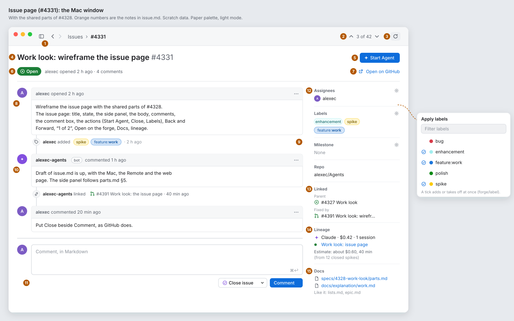
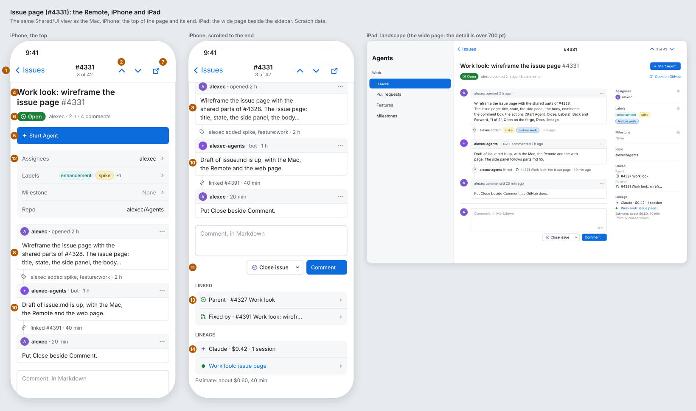
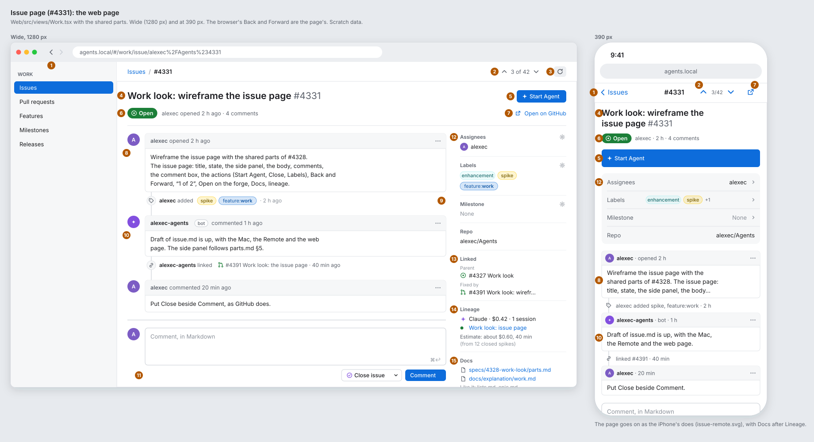
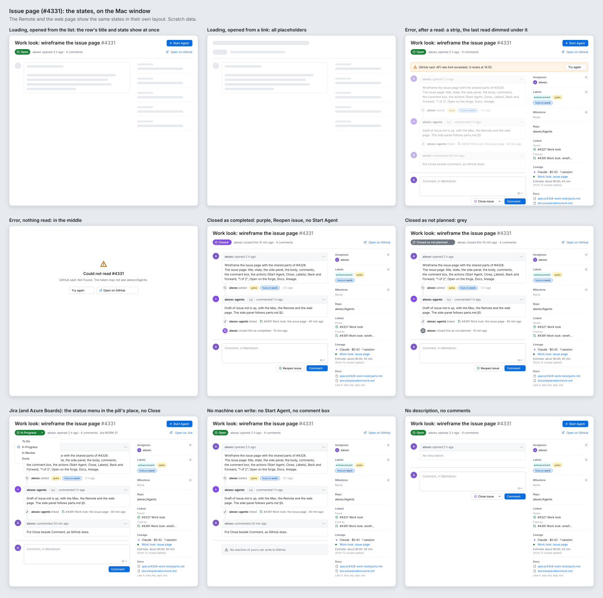

# Work look: the issue page (#4331)

**Status:** draft for Alex. **Epic:** #4327, step 2. **Clients:** the Mac window, the Remote (iPhone and iPad), the web page (wide and 390 px). Work is Core. **Feature:** `feature:work`.

This spike makes no product code. It puts the shared parts of [parts.md](parts.md) on an issue's page and says what the page adds. The pull request page is #4332, and an epic's Plan is #4333: this page says only where their sections go.

Today: `Shared/UI/Work/WorkItemPage.swift`, `WorkItemActions.swift` (`WorkCommentBox`), `Web/src/views/Work.tsx` (`WorkPage`), `WorkActions.tsx`.

## The boards

Paper palette, light mode, scratch data. The orange numbers are the notes below.

## Today and after

| Today | After |
|---|---|
| A row of links under the title: **All issues**, **Refresh**, ↑ *3 of 42* ↓ | Back goes to the list (**All issues** goes). ↑ *3 of 42* ↓ and Refresh go to the toolbar (Mac), the navigation bar (Remote) or the page's bar (web). |
| One grey line: the ref, the people, the milestone, the project; **Open on GitHub** after it | The state pill and *alexec opened 2 h ago · 4 comments* under the title; **Open on GitHub** at the trailing end of that line. The people, the labels, the milestone and the repo go to the side panel. |
| A row of buttons under the header: **Start Agent**, **Close**, **Labels** | **Start Agent** at the trailing end of the title. **Close issue** beside **Comment** under the comment box. **Labels** is the gear on the side panel's Labels heading. |
| The estimate line and the pipeline line under the header | In the side panel's **Lineage** section. |
| The body; a **Comments** heading; each comment as a grey line and Markdown | One timeline (parts.md §6): the body is its first comment, then comments and events in time order. |
| **Docs** at the end of the page (Mac + web) | The side panel's **Docs** section (Mac + web). |
| A spinner while the page reads; the error as one grey line | The states of parts.md §7, below. |

## The page, note by note

The numbers are the orange ones on the boards.

1. **Back and Forward.** The Mac: the toolbar's ‹ › and the place, *Issues › #4331*; *Issues* is a link to the list. The Remote: the navigation bar's back button, *‹ Issues*. The web: the browser's Back and Forward, and *Issues / #4331* in the page's bar. Back keeps the list's filters, sort and scroll (#3257).
2. **Previous and Next** (#3257): ↑ *3 of 42* ↓. The Mac: at the toolbar's end, ⌥⌘↑ and ⌥⌘↓ as today. The Remote: two buttons at the navigation bar's end, and *3 of 42* as the bar's subtitle under *#4331*. The web: in the page's bar, `k` and `j` as today; at 390 px it says *3/42*. None on a page opened from a link.
3. **Refresh:** the toolbar's `arrow.clockwise` (⌘R) on the Mac, as the list has it (parts.md §4). It spins while a read runs. The Remote: pull to refresh. The web: the same icon in the page's bar.
4. **The title** in the `.title` style, semibold, with its number after it in the regular weight and the secondary colour (as `titleLine` does now). It wraps; it is never cut.
5. **Start Agent:** the prominent button, with the `sparkle` glyph, at the title's trailing end. On a phone it is a full-width button under the state line. It shows when the read gives a `start` (today: an open issue in a folder), as now.
6. **The state line:** the state pill (parts.md §1: *Open*, *Closed*, *Closed as not planned*), then *alexec opened 2 h ago · 4 comments*. A closed issue says *alexec closed this 10 min ago*. A tracker's status (Jira, Azure Boards) is the status menu in the pill's place (states board).
7. **Open on GitHub** (*Open on Jira*, and so on): a link with the `arrow.up.right.square` glyph at the state line's trailing end. On the iPhone and at 390 px it is an icon at the bar's end.
8. **The body** is the first box on the timeline: the opener's avatar, *alexec opened 2 h ago*, the Markdown. An empty body says *No description.* in the secondary colour.
9. **Events** on the timeline (parts.md §6): labels added or taken off, a linked pull request, closed and reopened. They need `ForgeItemDetail.events` (#4373); until a forge gives them, the timeline has comments only, as now.
10. **A comment:** the avatar, the author, the *bot* capsule, *commented 1 h ago* (the exact time as its tooltip), the Markdown in a box. **Older comments** stays, as a button at the top of the timeline, under the body.
11. **The comment box** at the timeline's end: the person's avatar, a Markdown field (*Comment, in Markdown*), then **Close issue ▾** and **Comment** (⌘↩) at its trailing edge. **Close issue**'s menu has *Close as completed* and *Close as not planned*; with text in the field it says **Close with comment** and sends both. A closed issue has **Reopen issue** there. A tracker with a status menu has **Comment** only. What a write did (*Closed.*) or why not stays as a line under the buttons, as now.
12. **The side panel** (parts.md §5): **Assignees**, **Labels**, **Milestone**, **Repo**. The gear on the **Labels** heading opens the labels picker: a popover on the Mac and the web, a sheet on the Remote, with a filter field and a tick on each label it has (today's **Labels** menu; `forge/label`). On a phone the panel is a group of rows under Start Agent; a tap on Labels opens the same sheet.
13. **Linked:** the parent, the children, and the pull requests that close it, each a mini row (parts.md §5). A tap opens that item's page. It needs `ForgeItemDetail.children` and `linkedPulls` (#4373); until then it shows the parent alone.
14. **Lineage:** the runtime, the cost and the sessions, each session a link with a green dot while it runs. Then the estimate line of an open issue, or what a closed one spent (today's `estimateLine`); on the Mac and the web, the pipeline line (release, CI run, TestFlight) under it (#3588). The range is the estimate's tooltip on the Mac and the web; a tap shows it on the Remote, as now.
15. **Docs** (Mac + web, #3322): the docs it names, then *Like it:* the docs like it. Each opens the doc. The Remote does not have it (#2796).

### Narrow: the iPhone, the web at 390 px, a Mac window under 700 pt

- The title wraps to as many lines as it needs; the state line is shorter: *alexec · 2 h · 4 comments*.
- **Start Agent** is a full-width button under it.
- The side panel is a group of rows: *Assignees · alexec ›*, *Labels · [enhancement] [spike] +1 ›*, *Milestone · None ›*, *Repo · alexec/Agents*.
- The avatar goes into each box's header (20 pt), so the box takes the width. Events are one short grey line each.
- **Linked**, **Lineage** and (web) **Docs** go after the comment box, as grouped rows.
- The iPad uses the wide page when its detail is 700 pt or wider (landscape beside the sidebar); in portrait, with the sidebar shown, it uses the narrow page.

## States

The boards show them on the Mac window. The Remote and the web page show the same states in their own layout.

| State | What it shows |
|---|---|
| **Loading, opened from the list** | The row gave the title, the number and the state, so the header shows at once. The body box and the side panel are placeholders (`.redacted(reason: .placeholder)`; a CSS skeleton on the web). No spinner. |
| **Loading, opened from a link or an address** | All placeholders, the header too. |
| **Refresh** | The page stays; the Refresh icon spins. |
| **Error, after a read** | A strip under the header: the warning glyph, the forge's words in one line (*GitHub said: API rate limit exceeded. It resets at 14:05.*), **Try again**. The last read stays under it, dimmed. |
| **Error, nothing read** | In the middle: the warning glyph, *Could not read #4331*, the forge's words, **Try again** and **Open on GitHub**. |
| **Closed as completed** | The purple *Closed* pill, *alexec closed this as completed* on the timeline, **Reopen issue** beside **Comment**. No Start Agent (the read gives no `start`). |
| **Closed as not planned** | The same in grey, *Closed as not planned*. Needs `stateReason` (#4365); a forge with none says *Closed*, purple. |
| **A tracker's status (Jira, Azure Boards)** | The status menu in the pill's place, in its state's colour; its menu lists the moves its workflow allows (#3260). No Close or Reopen in the comment box. |
| **No machine of the person's can write to the forge** | No Start Agent and no comment box. In the comment box's place: *No machine of yours can write to GitHub.* The gears go. |
| **No description, no comments** | *No description.* in the body's box, then the comment box. |

## Decisions

- Decided: **Close goes beside Comment**, as on GitHub, with *Close as completed* and *Close as not planned* in its menu, because a close often comes with a word on why, and the header then has one action (Start Agent). Alex can overrule.
- Decided: **All issues goes**, because Back and the toolbar's *Issues ›* do the same. Alex can overrule.
- Decided: **Refresh is the toolbar's icon on the page too**, as on the list (parts.md §4), not a link. Alex can overrule.
- Decided: **only the Labels heading has a gear in the first stories.** Today no forge write sets an assignee or a milestone; the gears on Assignees and Milestone come with those writes (stories to file, below). Alex can overrule.
- Decided: **the estimate and the pipeline go into Lineage**, because they are lineage's answers and the header keeps the title, the state and the one action. Alex can overrule.
- Decided: **Open on GitHub is an icon in the bar on a phone**, because the state line has no room for it there. Alex can overrule.

## Fields the page needs

All from #4328's list; no new ones.

| Part | Field | Issue |
|---|---|---|
| *opened 2 h ago*, *closed this 10 min ago* | `ForgeItem.createdAt`, `closedAt` | #4373 |
| *Closed as not planned* | `ForgeItem.stateReason` | #4365 |
| Avatars | `authorAvatar`, `ForgeComment.avatar` | #4363 |
| Label colours | `ForgeLabel.color` | #4362 |
| *4 comments* | the comment count | #4364 |
| Linked | `ForgeItemDetail.children`, `linkedPulls` | #4373 |
| Events | `ForgeItemDetail.events` | #4373 |
| Which actions show (Start Agent, Close, Labels, the status menu) | `ForgeItemDetail.actions`, from the forge's capabilities | #4361 |

## Stories to file (for the lead)

Each changes what a client shows and adds a new layout, so each waits for Alex's approval (#3474). The three can run at the same time once #4361 and #4373 are in; until then each shows what the wire has (no events, the parent alone in Linked).

1. **Mac: the issue page in the new layout.** `Shared/UI/Work/WorkItemPage.swift`, `WorkItemActions.swift`, the Mac toolbar (`App/`): the toolbar's place, ↑ *3 of 42* ↓ and Refresh; the header with Start Agent; the timeline; the comment box with Close issue ▾ and Reopen issue; the side panel with the Labels popover, Linked, Lineage and Docs; the narrow page under 700 pt; the states. `remote: #<the Remote story>`, `web: #<the web story>`. Blocked by #4361 for which actions show.
2. **Remote: the issue page in the new layout.** The same `Shared/UI` views; this story does the Remote's own parts: the navigation bar's ↑ ↓ and *3 of 42* subtitle, Open on GitHub in the bar on the iPhone, the panel's rows and the Labels sheet, Linked and Lineage at the end, the iPad's wide page in landscape. No Docs (#2796). Blocked by the Mac story (one `Shared/UI` change at a time, #873).
3. **Web: the issue page in the new layout.** `Web/src/views/Work.tsx`, `WorkActions.tsx`, `WorkTimeline.tsx`, CSS: the same as the Mac at the same break points (700 px and 900 px), the page's bar, the labels popover, the 390 px page. `mac: #<the Mac story>`, `remote: #<the Remote story>`.

Tasks for the forge interface, not stories, and not needed by the three above:

4. **Forge writes: set the assignees and the milestone** (`forge/assign`, `forge/milestone`), a capability per forge (#4361), so the Assignees and Milestone headings get their gears.
5. **Close as not planned** (`forge/close` with `reason: not_planned`), where the forge has it (GitHub, GitLab); *Close as not planned* is not in the menu where it does not.

## Clients

- **Mac:** `Shared/UI/Work/WorkItemPage.swift`, `WorkItemActions.swift`; the toolbar in `App/`.
- **Remote:** the same `Shared/UI` views; the navigation bar in `Remote/`.
- **Web:** `Web/src/views/Work.tsx`, `WorkActions.tsx`, `WorkTimeline.tsx`.
- The parity row *Work* and *Work page actions* in `specs/071-web-remote/walks/parity/worktrees-and-files.md` change with the stories, not with this spike.
