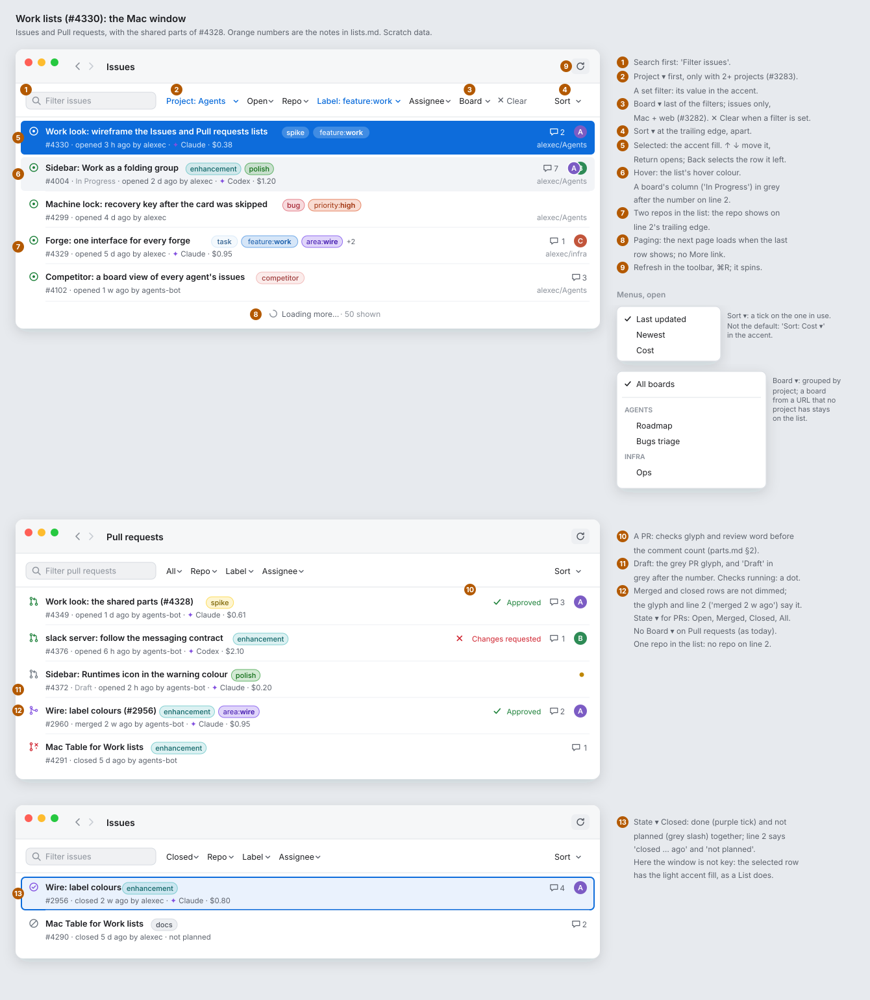
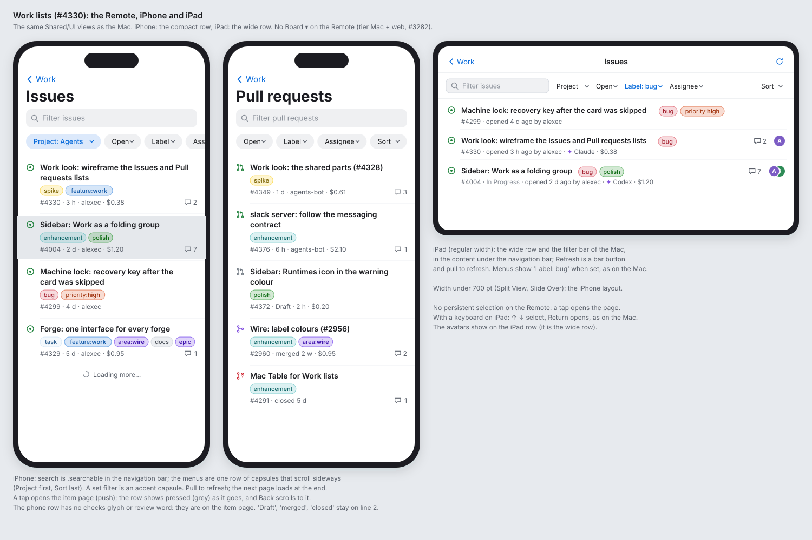
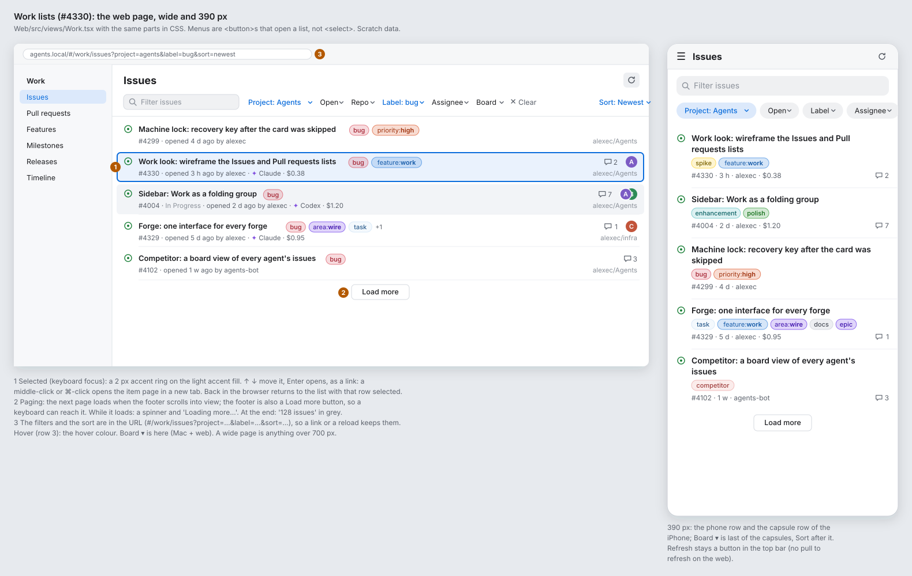
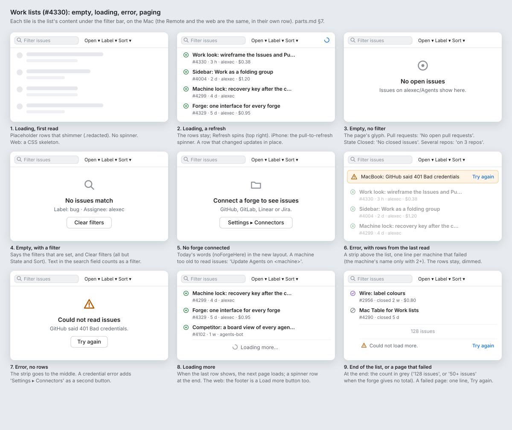

# Work look: the Issues and Pull requests lists (#4330)

**Status:** draft for Alex. **Epic:** #4327, step 2. **Builds on:** [parts.md](parts.md) (#4328). **Clients:** the Mac window, the Remote (iPhone and iPad), the web page (wide and 390 px). Work is Core. **Feature:** `feature:work`.

This spike makes no product code. It uses the parts of [parts.md](parts.md) (the state icon, the two-line row, the label chip, the filter bar, the empty and error states) and says only what the two lists add: the order of the filter bar, the Project and Board menus, sort, paging, the selected row, and the closed and merged rows. Today the lists are `WorkListPane` and `WorkRowView` in `Shared/UI/Work/WorkView.swift`, and `Web/src/views/Work.tsx`.

## Mock-ups

Paper palette, light mode, scratch data. An orange number on a board is a note below.

## Decisions

- **Decided: one pane, as today.** A click on a row opens the item page in the same pane, and Back returns to the list. No split view of list and page, on the Mac or the iPad. **Why:** Work already goes by places with Back and Forward on all three clients (#3257); a split view is a new layout that the item-page spike would have to agree with. Alex can overrule.
- **Decided: the next page loads by itself** when the last row shows. The **More** link goes. **Why:** the list is sorted and filtered on the client from the pages read so far, so a person who scrolls wants the next rows, not a button. The web keeps a **Load more** button in the footer, so that a keyboard can reach it. Alex can overrule.
- **Decided: Sort goes at the trailing edge of the filter bar,** apart from the filters. **Why:** it orders the list and does not make it shorter, and it then has the same place on every list. Alex can overrule.
- **Decided: a Clear button** (`xmark` and "Clear") after the last filter, only when a filter other than State is set. It clears the search text and every menu but State and Sort. **Why:** with five menus, a person must otherwise open each one to find what hides a row. Alex can overrule.

## 1. The filter bar

The order, from the leading edge:

| # | Control | Issues | Pull requests | Shows when |
|---|---|---|---|---|
| 1 | Search field, "Filter issues" / "Filter pull requests" | ✓ | ✓ | always |
| 2 | **Project ▾** (#3283) | ✓ | ✓ | 2 or more projects read something, or one is picked |
| 3 | **State ▾**, its value always shown ("Open ▾") | Open, Closed, All | Open, Merged, Closed, All | always |
| 4 | **Repo ▾** | ✓ | ✓ | 2 or more repos in the rows, or one is picked |
| 5 | **Label ▾** | ✓ | ✓ | a row has a label, or one is picked |
| 6 | **Assignee ▾** | ✓ | ✓ | a row has an assignee, or one is picked |
| 7 | **Board ▾** (#3282) | ✓ | — | Mac and web only; a machine knows a board, or one is picked |
| 8 | **✕ Clear** | ✓ | ✓ | a filter other than State is set |
| 9 | **Sort ▾**, at the trailing edge | ✓ | ✓ | always |

- A set filter shows its value in the accent colour: "Project: Agents ▾", "Label: bug ▾". Its menu has "Any" (Project: "All projects", Board: "All boards") at the top, with a tick on the value in use.
- **Sort ▾** has Last updated (the default), Newest and Cost, with a tick on the one in use. A sort that is not the default shows as "Sort: Cost ▾" in the accent.
- **Board ▾** groups the boards by project, under a small grey heading per project. A board that no project has (a URL from an old filter) stays at the end of the menu, as `WorkBoardPicker` does now.
- With a board picked, line 2 of each row shows the item's column on that board ("In Progress") in grey after the number. This is the tracker status of parts.md §1, so no new field.
- **Refresh** is in the toolbar (parts.md §4), not in the bar.

## 2. The Mac window

See `lists-mac.svg`.

1. The search field first, 200 pt wide.
2. **Project ▾** first of the menus.
3. **Board ▾** last of the menus, then **✕ Clear**.
4. **Sort ▾** at the trailing edge.
5. **The selected row** has the accent fill of a `List` selection; its text and chips go white. ↑ and ↓ move the selection; Return or a click opens the item page. When Back returns to the list, the row that was open is selected and scrolled to the middle (as `list.opened` does now). When the window is not key, the selected row has the light accent fill of an inactive `List`.
6. **Hover:** the list's hover colour.
7. **Repo:** at the trailing edge of line 2, only when the rows come from 2 or more repos (parts.md §2).
8. **Paging:** when the last row shows, the next page loads. A footer row says "Loading more…" with a small spinner and how many rows are shown ("· 50 shown").
9. **Refresh** in the toolbar, ⌘R; the icon spins while a read runs.
10. **A pull request** shows its checks glyph (tick, cross, or a yellow dot while checks run) and its review word (Approved, Changes requested) before the comment count (parts.md §2).
11. **A draft** has the grey PR glyph, and the word "Draft" in grey after the number on line 2.
12. **Merged and closed rows are not dimmed.** The glyph and line 2 ("merged 2 w ago", "closed 5 d ago") say the state.
13. **State: Closed** on Issues shows done (purple tick) and not planned (grey slash) together; line 2 ends with "not planned" for the second.

The bar fits one line from a window 900 pt wide. Below that, the search field gets shorter to 140 pt, then the menus with no value set go into a "More ▾" menu at the end, before Sort. Under 700 pt the window uses the phone layout (parts.md §5).

## 3. The Remote

See `lists-remote.svg`. The same `Shared/UI` views as the Mac.

**iPhone (compact width):**

- The page title is large ("Issues"), with Back to Work.
- The search field is `.searchable` in the navigation bar.
- The menus are one row of capsules that scroll sideways: Project, State, Repo, Label, Assignee, Sort. A set filter is an accent capsule ("Project: Agents"). No Board (tier Mac + web, #3282), no Clear: the empty state with a filter has **Clear filters** (section 5).
- The phone row of parts.md §2: the title on up to 2 lines, the chips wrapped, a short line 2 ("#4330 · 3 h · alexec · $0.38") and the comment count.
- A pull request's phone row has no checks glyph or review word: the item page has them. "Draft", "merged" and "closed" stay on line 2.
- A tap opens the item page (a push). The row shows pressed (grey) as it goes. Back scrolls to it. No persistent selection.
- Pull to refresh. The next page loads at the end, with a "Loading more…" row.

**iPad (regular width):**

- The wide row and the filter bar of the Mac, in the content under the navigation bar. Refresh is a bar button, and pull to refresh works too.
- With a hardware keyboard, ↑ and ↓ select a row and Return opens it, as on the Mac.
- Under 700 pt wide (Split View, Slide Over), the iPhone layout.

## 4. The web page

See `lists-web.svg`. `Web/src/views/Work.tsx` with the same parts in CSS.

**Wide (over 700 px):**

- Work's pages in the section's side navigation (Issues, Pull requests, Features, Milestones, Releases, Timeline), as the console look has them (#2142).
- The page title "Issues", and Refresh as an icon button at the top right.
- The filter bar of section 1, Board included. The menus are `<button>`s that open a list (parts.md §4), not `<select>`.
- **1. The selected row** (keyboard focus): a 2 px accent ring on the light accent fill. ↑ and ↓ move it; Enter opens. Each row is a link, so a middle-click or ⌘-click opens the item page in a new tab. Back in the browser returns to the list with that row selected.
- **2. Paging:** the next page loads when the footer scrolls into view. The footer is also a **Load more** button. While it loads, it shows a spinner and "Loading more…".
- **3. The filters and the sort are in the address** (`#/work/issues?project=agents&label=bug&sort=newest`), so a link or a reload keeps them.

**390 px:**

- The phone row and the capsule row of the iPhone. Board ▾ is the last capsule before Sort.
- Refresh stays an icon button in the top bar. The web has no pull to refresh.

## 5. Empty, loading, error and paging

See `lists-states.svg`. These are parts.md §7, with what the lists add.

| # | State | What it shows |
|---|---|---|
| 1 | Loading, first read | Placeholder rows that shimmer. No spinner. |
| 2 | Loading, a refresh | The rows stay; Refresh spins. A row that changed updates where it is. |
| 3 | Empty, no filter | The page's glyph, "No open issues" (or "No open pull requests", "No closed issues", …) and "Issues on alexec/Agents show here." With several repos: "on 3 repos". |
| 4 | Empty, with a filter | "No issues match", the filters that are set ("Label: bug · Assignee: alexec"), and **Clear filters**. Text in the search field counts as a filter. |
| 5 | No forge connected | "Connect a forge to see issues", the forges it can read, and **Settings ▸ Connectors**. A machine too old to read issues: "Update Agents on <machine>" (today's `noForgeHere`). |
| 6 | Error, with rows | A strip above the rows: one line per machine that failed ("MacBook: GitHub said 401 Bad credentials", the machine's name only with 2 or more machines), and **Try again**. The rows stay, dimmed. |
| 7 | Error, no rows | The strip goes to the middle: "Could not read issues", what the forge said, **Try again**. A credential error adds **Settings ▸ Connectors**. |
| 8 | Loading more | A row with a spinner and "Loading more…" at the end. |
| 9 | End of the list, or a page that failed | At the end: the count in grey ("128 issues"; "50+ issues" when the forge gives no total). A page that failed: one line, "Could not load more.", and **Try again**. The rows before it stay. |

## Fields

The lists need the fields of parts.md ("Fields the parts need"), and one more, for #4329:

| Field | For | Notes |
|---|---|---|
| `ForgeList.total` (optional) | "128 issues" at the end of the list | GitHub's search and GitLab give a count; Linear and Jira give one too. With none, the end says "50+ issues" while more pages are there, and the count of rows when the last page is read. |

The column on a board is `ForgeItem.status`, already on the wire.

## Clients and parity

- **Mac:** `Shared/UI/Work/WorkView.swift` (`WorkListPane`, `WorkRowView`, `WorkBoardPicker`), on the parts of parts.md.
- **Remote:** the same views. No Board ▾ (tier Mac + web, #3282).
- **Web:** `Web/src/views/Work.tsx`.
- The rows for Work in `specs/071-web-remote/walks/parity/` change in each story's branch, not here.

## Stories to file (for the lead)

One story per client. Each is blocked by the parts' stories that the lead files from parts.md (the row, the chip, the filter bar), and by #4329 for the new fields.

1. **Mac: the Issues and Pull requests lists in the new look.** `Shared/UI/Work/WorkView.swift`, macOS: the filter bar in the order of section 1 (Project first, Board last, ✕ Clear, Sort at the trailing edge), Refresh in the toolbar with ⌘R, a `List` with selection (↑ ↓, Return, the selection kept after Back, the inactive fill), paging when the last row shows with the "Loading more…" row, the PR row's checks and review, the closed and merged rows, the "More ▾" overflow under 900 pt, and the nine states of section 5. Approval: needed (new layout and new controls: Clear, keyboard selection). `remote: #<Remote story>`, `web: #<web story>`.
2. **Remote: the Issues and Pull requests lists in the new look.** The same views on iOS: `.searchable`, the capsule row (no Board, no Clear), the phone row, pull to refresh, paging at the end, the pressed row and Back to it; the iPad's wide layout and keyboard selection; the states of section 5. Approval: needed (new layout). `mac: #<Mac story>`, `web: #<web story>`.
3. **Web: the Issues and Pull requests lists in the new look.** `Web/src/views/Work.tsx`: the filter bar of section 1 with `<button>` menus, Refresh at the top right, rows as links with keyboard selection (↑ ↓ Enter, a new tab on ⌘-click), the filters and the sort in the hash route, paging with the Load more footer, the 390 px layout, and the states of section 5. Approval: needed (new layout and new controls). `mac: #<Mac story>`, `remote: #<Remote story>`.
4. **Task (forge interface, if #4329 does not take it):** `ForgeList.total`, filled by each forge that gives a count.
