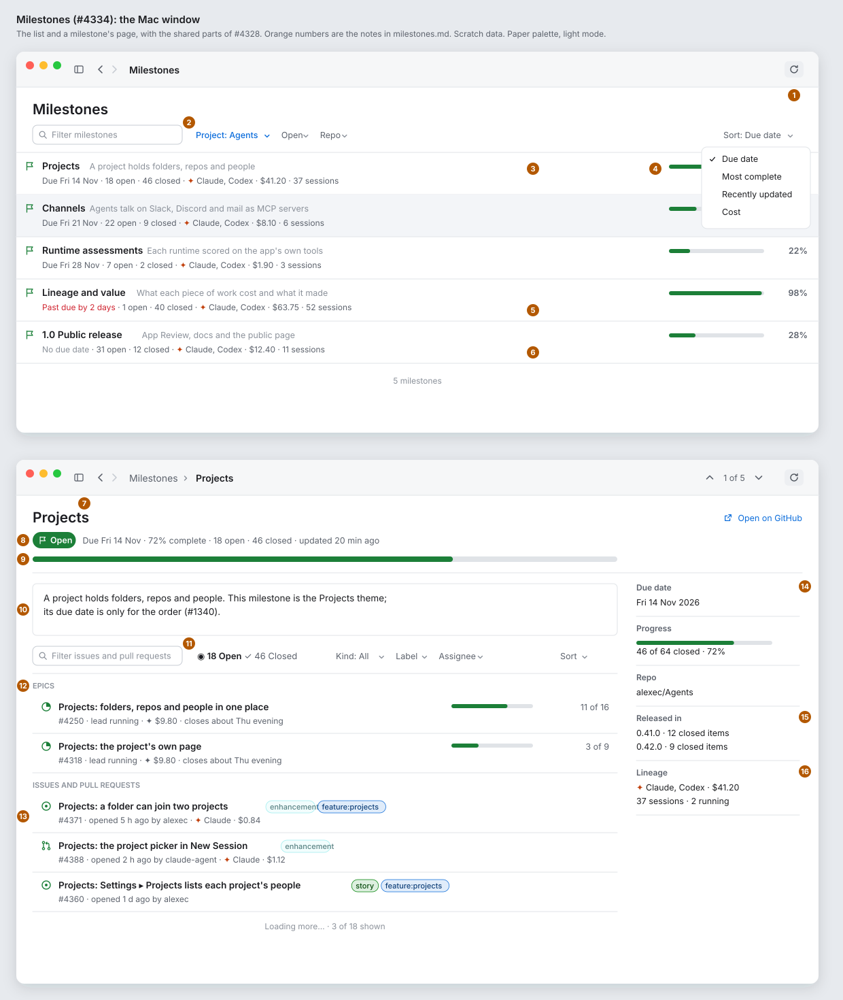
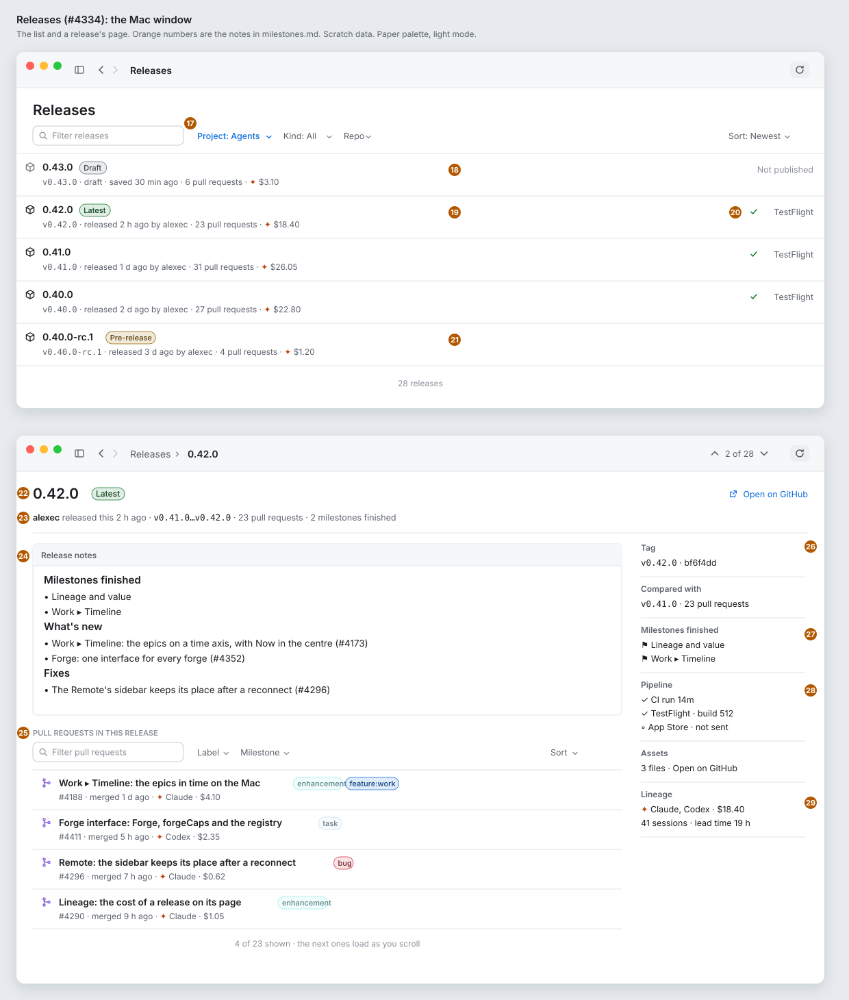
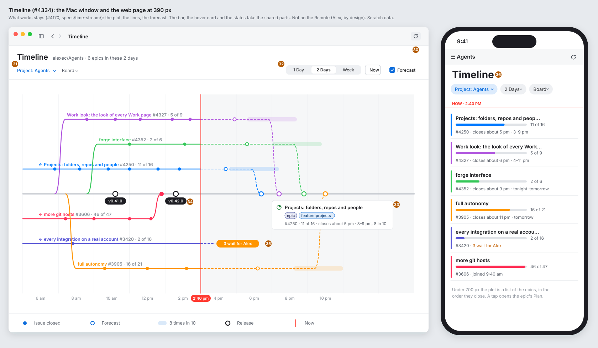
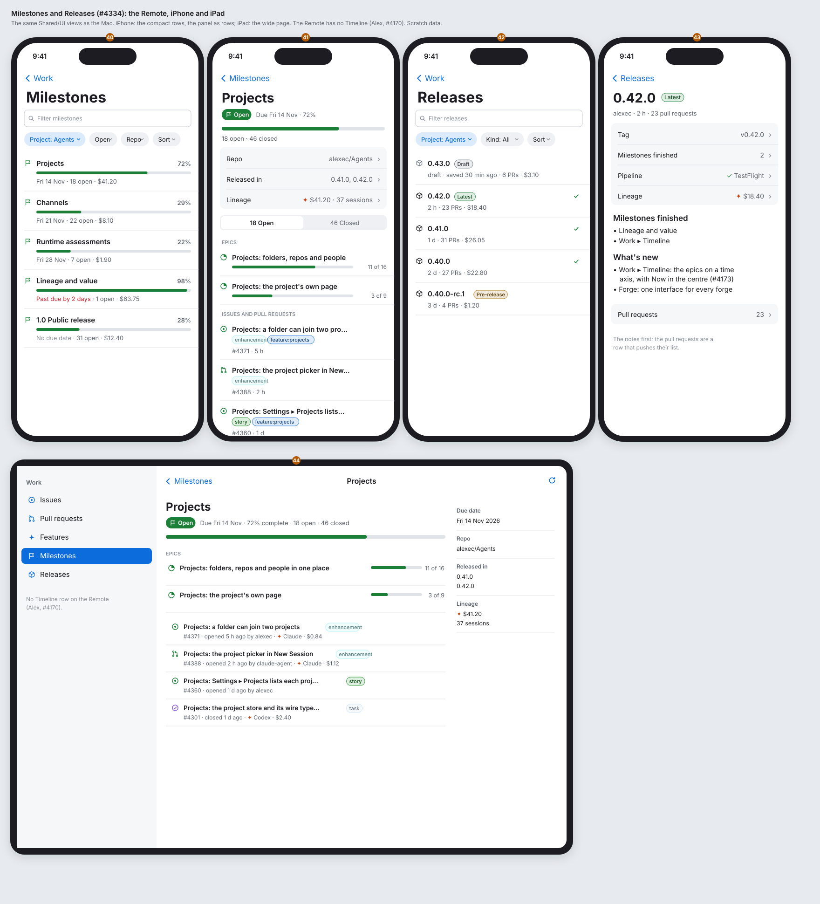
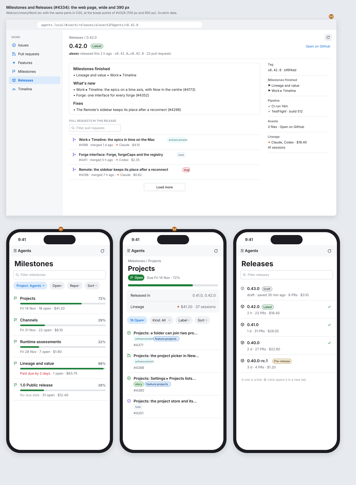
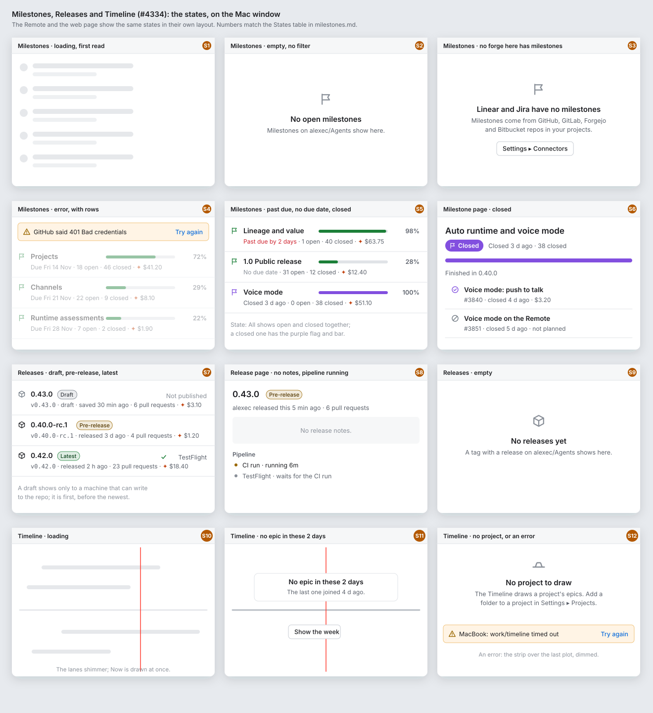

# Work look: Milestones, Releases and Timeline (#4334)

> **#3878 removed forge milestones from the app:** the Milestones list, a milestone's page, a release's *Milestones finished* and the milestone figures below are gone. The Releases and Timeline parts stand.

**Status:** draft for Alex. **Epic:** #4327, step 2. **Builds on:** [parts.md](parts.md) (#4328), [lists.md](lists.md) (#4330), [issue.md](issue.md) (#4331) and [pull-request.md](pull-request.md) (#4332). **Clients:** the Mac window, the Remote (iPhone and iPad), the web page (wide and 390 px). **Feature:** `feature:work`.

This spike makes no product code. It puts the shared parts on three Work pages, and says only what each page adds:

- **Milestones:** the list and a milestone's page.
- **Releases:** the list and a release's page.
- **Timeline:** the epics on a time axis (#4170). It works now; this page keeps the plot and changes only its bar, its hover card and its states.

Today: `Shared/UI/Work/WorkView.swift` (Milestones and Releases are `WorkListPane` rows from lineage alone, with `WorkList.lineageOnlyNote` under them), `WorkItemPage.swift` (a milestone's or a release's page is the generic node page: its links by relation), `WorkTimelineView.swift` (macOS only), `Web/src/views/Work.tsx` and `WorkTimeline.tsx`.

**Tiers.** Milestones and Releases are Core: all three clients. Timeline is Mac + web: the Remote has no Timeline row (Alex, 2026-11-08, #4170). The parity row *Work ▸ Timeline* says so already.

## The boards

Paper palette, light mode, scratch data. The orange numbers are the notes below. `milestones-boards.py` draws the boards (`python3 milestones-boards.py` in this folder).

## Today and after

| Today | After |
|---|---|
| Milestones and Releases list only what lineage knows: a milestone or a release once an agent worked on one of its items. The note *Lineage lists a milestone or a release once …* is under the list. | Both lists read the forge (new reads, below), so every milestone and release shows. Lineage adds the cost, the agents and the sessions to each row. The note goes. |
| A milestone's row is the issue row: a ref (*milestone 3*), a title, lineage's words | A row of its own: the flag, the title, the description in grey, a progress bar and the percentage; line 2 has the due date, the open and closed counts and lineage's figures. |
| A milestone's or release's page lists its links by relation | A milestone's page: the progress bar, the description, its epics, then its issues and pull requests as list rows. A release's page: the notes, then its pull requests. Both have the side panel. |
| Timeline: a row of pickers with labels and a **Refresh** link | The filter bar of parts.md §4: **Project ▾** and **Board ▾** at the leading edge, the range, **Now** and **Forecast** at the trailing edge, **Refresh** in the toolbar. |
| Timeline's hover card: words | The hover card is a mini row: state glyph, title, label chips in their colours, and line 2. |

## Milestones

### The list (notes 1 to 6)

1. **Refresh** in the toolbar, ⌘R, as on the lists (parts.md §4).
2. **The filter bar:** the search field (*Filter milestones*), **Project ▾**, **State ▾** (Open, Closed, All; its value always shows), **Repo ▾** (with 2 or more repos), and **Sort ▾** at the trailing edge: *Due date* (the default: the soonest first, then the ones with no date), *Most complete*, *Recently updated*, *Cost*. No Label or Assignee: a milestone has neither.
3. **The row,** two lines, as parts.md §2: line 1 is the `flag` glyph (green when open, purple when closed), the title (semibold), and the description's first line in grey, cut at the end. Line 2 is the due date, *18 open · 46 closed*, then lineage: the runtimes, the cost and the sessions. With no lineage, line 2 ends after the counts.
4. **Progress** at the trailing edge of line 1: a bar of 140 pt and the percentage (closed ÷ all). Green while open, purple when closed.
5. **Past due:** *Past due by 2 days* in red, in place of the due date.
6. **No due date:** *No due date* in grey; these rows go after the dated ones.

A click opens the milestone's page; ↑ ↓, Return and the selection after Back are as lists.md §2. The end of the list says the count (*5 milestones*).

### The page (notes 7 to 16)

7. **Back:** *Milestones › Projects*; ↑ *1 of 5* ↓ along the list it was opened from, as issue.md.
8. **The state line:** the pill (*Open* in green, *Closed* in purple, with the flag), then *Due Fri 14 Nov · 72% complete · 18 open · 46 closed · updated 20 min ago*. **Open on GitHub** at the title's trailing end.
9. **The progress bar,** full width of the column, 8 pt high.
10. **The description** as Markdown, in a box with a hairline border. With none, no box.
11. **The items' bar:** a search field, then **18 Open** and **46 Closed** as a two-way toggle with the counts (as GitHub's milestone page), **Kind ▾** (All, Issues, Pull requests), **Label ▾**, **Assignee ▾**, and **Sort ▾**.
12. **Epics** first, under a small grey heading, when the milestone has epics (an issue labelled `epic`). Each is a row: the `epic` glyph, the title, a bar with *11 of 16* (its sub-issues), and line 2: the number, *lead running* when a lead session is open, the cost, and *closes about Thu evening* from the Timeline's forecast (`work/timeline`, M10). A click opens the epic's page (its Plan, #3268).
13. **Issues and pull requests** after the epics: the list rows of parts.md §2 and lists.md, paged as the lists are.
14. **The side panel** (parts.md §5): **Due date**, **Progress** (the bar and *46 of 64 closed*), **Repo**.
15. **Released in:** the releases that took its closed items, with how many each took (from lineage, `Compare`). A click opens the release's page.
16. **Lineage:** the runtimes, the cost, the sessions and how many run now.

On the narrow page (iPhone, web at 390 px, a Mac window under 700 pt) the panel's rows go under the progress bar (parts.md §5): *Repo*, *Released in*, *Lineage*, each a row with ›. The toggle becomes a segmented control; the menus are the capsule row.

## Releases

### The list (notes 17 to 21)

17. **The filter bar:** the search field (*Filter releases*), **Project ▾**, **Kind ▾** (All, Releases, Pre-releases, Drafts), **Repo ▾**, and **Sort ▾** (*Newest*, the default; *Cost*). No State: a release is not open or closed.
18. **A draft** goes first, with the `box` glyph in grey, a grey *Draft* chip, and *draft · saved 30 min ago* on line 2. It shows only when a machine of the person's can write to the repo, as the forge shows drafts only to people who can.
19. **The row:** the `box` glyph, the name (semibold), its chip, and line 2: the tag in monospace, *released 2 h ago by alexec*, *23 pull requests*, the cost. The latest release has a green *Latest* chip.
20. **The pipeline** at the trailing edge: a green tick and *TestFlight* (or *App Store*) when the pipeline line (#3588) knows that the build got there; nothing when it does not know.
21. **A pre-release:** an amber *Pre-release* chip.

The end of the list says the count (*28 releases*).

### The page (notes 22 to 29)

22. **The header:** the name, the chip, **Open on GitHub**; ↑ *2 of 28* ↓ go to the newer and the older release.
23. **The state line:** *alexec released this 2 h ago · `v0.41.0…v0.42.0` · 23 pull requests · 2 milestones finished*. A click on the range opens the compare page on the forge.
24. **The notes** as Markdown, in a box with the heading *Release notes*. This folder's notes start with `## Milestones finished` (AGENTS.md), so the milestones show first.
25. **Pull requests in this release:** the list rows of the pull requests between the tag and the one before it, with the purple merged glyph; a search field, **Label ▾**, **Milestone ▾**, **Sort ▾**; paged.
26. **Tag** (and its commit) and **Compared with** (the previous tag, with the count).
27. **Milestones finished:** each a link to the milestone's page.
28. **Pipeline:** the CI run, TestFlight, the App Store, each with a tick, a dot while it runs, or a hollow dot when not sent (#3588).
29. **Lineage:** the runtimes, the cost, the sessions and the lead time (the oldest pull request's first session to the tag).

**Assets** (the files of the release) is a count and **Open on GitHub**: the app downloads no assets.

On a phone the notes come first, then a group of rows (*Tag*, *Milestones finished*, *Pipeline*, *Lineage*), then **Pull requests · 23 ›**, which pushes their list. A release page is read for its notes; the list of pull requests is long.

## Timeline (notes 30 to 36)

What works stays: the releases line in the middle, a line per epic segment in its feature's colour, filled dots for closed children, the forecast after Now (dashed, hollow dots, the band, the hollow join), *3 wait for Alex*, Now as a red line, the range, the scroll and the pinch (specs/time-stream/wireframe.md). This page changes:

30. **Refresh** goes to the toolbar (⌘R) and spins while `work/timeline` reads, as on the lists. The *Refresh* link goes.
31. **Project ▾** and **Board ▾** are the compact menus of parts.md §4 at the leading edge: a set value in the accent (*Project: Agents*), *All boards* at the top of Board's menu. They replace the pickers with their labels.
32. **The range** (*1 Day · 2 Days · Week*, a segmented control), **Now** (a bordered button) and **Forecast** (a checkbox) go to the trailing edge, where Sort is on a list. The title line says *alexec/Agents · 6 epics in these 2 days*.
33. **The hover card** is a mini row: the state glyph (an epic's, or a child's: open, done, not planned), the title, the label chips in their colours (parts.md §3), and line 2. On a closed child: *#4301 · closed 2 h ago · PR #4320 · ✦ Codex · $2.40*. On an epic's line or its join: *#4250 · 11 of 16 · closes about 5 pm · 3–9 pm, 8 in 10*. A click opens the page, as today.
34. **A release's pill** on the releases line opens the release's page (new). Its hover card is a release row: the name, the chip, *23 pull requests*.
35. **3 wait for Alex** stays an orange pill; a click opens the epic's page with its open children that wait for Alex.
36. **The web page at 390 px** (and a web window under 700 px): a plot of 24 h is not readable at that width, so the Timeline is **a list of the epics**: a row per epic segment in the window, its colour as a bar at the leading edge, the title, a progress bar with *11 of 16*, and line 2: *closes about 5 pm · 3–9 pm*, *3 wait for Alex*, or *joined 9:40 am*. The order is the order they close (forecast first, waits next, joined last). *Now · 2:40 pm* is a red line above it. A tap opens the epic's page. This is the list the screen reader reads now (`WorkTimeline.tsx`), made visible.

The line's colour stays the system colour for its `feature:` label, not the label's own colour: the forge often gives every `feature:` label one colour (this repo's are all `#1D76DB`), and the lines must differ.

## The Remote (notes 40 to 44)

The same `Shared/UI` views as the Mac.

40. **Milestones on the iPhone:** the large title, `.searchable`, the capsule row (*Project*, *Open*, *Repo*, *Sort*), and a phone row: the flag, the title, the percentage at the trailing edge, a full-width bar, and *14 Nov · 18 open · $41.20*. Pull to refresh.
41. **A milestone on the iPhone:** the pill and *Due Fri 14 Nov · 72%*, the bar, *18 open · 46 closed*, the panel as a group of rows, the **18 Open | 46 Closed** segmented control, the epics, then the items as phone rows.
42. **Releases on the iPhone:** the phone row: the glyph, the name and its chip, the pipeline tick at the trailing edge, and *2 h · 23 PRs · $18.40*.
43. **A release on the iPhone:** the name and chip, the group of rows, the notes, then **Pull requests · 23 ›**.
44. **The iPad** uses the wide page with the side panel, as issue.md. The sidebar's Work group has no Timeline row (Alex).

## The web page (notes 50 to 52)

50. **Wide:** Work's side navigation (Issues, Pull requests, Features, Milestones, Releases, Timeline), the page as on the Mac, **Refresh** at the top right, the panel at over 900 px; the address is `#/work/releases/<repo>/<tag>` and `#/work/milestones/<repo>/<number>`, so a link or a reload opens the page. The list's footer is **Load more** (lists.md §4).
51. **Milestones at 390 px:** the phone rows and the capsule row of the iPhone.
52. **A milestone at 390 px:** the panel as rows, then the capsule row with **18 Open** as its first capsule (a menu: *18 Open*, *46 Closed*), then the items.

## States

The board shows them on the Mac window. The Remote and the web page show the same states in their own layout.

| # | State | What it shows |
|---|---|---|
| S1 | Milestones or Releases, loading, first read | Placeholder rows that shimmer (parts.md §7). |
| S2 | Milestones, empty, no filter | The flag glyph, *No open milestones*, *Milestones on alexec/Agents show here.* With a filter: *No milestones match* and **Clear filters** (lists.md §5). |
| S3 | No forge in reach has milestones | *Linear and Jira have no milestones* (the forges in reach, by name), which forges have them, and **Settings ▸ Connectors**. Releases says the same with *releases*. |
| S4 | Error, with rows | The strip above the rows, one line per machine that failed, **Try again**; the rows stay, dimmed (lists.md §5). Error with no rows: the strip in the middle. |
| S5 | Past due, no due date, closed | Past due in red; *No due date* in grey, last; a closed milestone has the purple flag and bar and *Closed 3 d ago*. |
| S6 | Milestone page, closed | The purple *Closed* pill, the purple bar at 100%, *Finished in 0.40.0* (the release that took its last item); the items list opens on Closed. |
| S7 | Draft, pre-release, latest | As notes 18, 19 and 21. |
| S8 | Release page, no notes, pipeline running | *No release notes.* in a grey box; the Pipeline section with an amber dot (*CI run · running 6m*) and a grey one (*TestFlight · waits for the CI run*). |
| S9 | Releases, empty | The box glyph, *No releases yet*, *A tag with a release on alexec/Agents shows here.* |
| S10 | Timeline, loading | The releases line and Now draw at once; the lanes are grey bars that shimmer. |
| S11 | Timeline, no epic in the window | The releases line and Now, a card *No epic in these 2 days · The last one joined 4 d ago.*, and **Show the week** (it sets the range to Week). |
| S12 | Timeline, no project, or an error | *No project to draw*, and how to add a folder to a project. An error: the strip of S4 over the last plot, dimmed. |

## Decisions

- Decided: **Milestones and Releases read the forge, and lineage adds its figures**, because a list that shows only what an agent touched hides the milestones a person plans with, and the note that says so goes. Until the reads land, the lists keep lineage's rows in the new row (no bar, no due date). Alex can overrule.
- Decided: **a milestone's page shows its epics first**, then its issues and pull requests, because in this folder a milestone is a set of epics (AGENTS.md, #3465), and an epic's progress says more than 64 rows. Alex can overrule.
- Decided: **a release's page shows its notes first, then its pull requests**, and on a phone the pull requests are a row that pushes their list, because the notes say what the release is for. Alex can overrule.
- Decided: **the Timeline keeps its plot; only the bar, the hover card, the release pill and the states change**, because Alex settled its look in #4170 a few days ago. Alex can overrule.
- Decided: **the web page at 390 px shows the Timeline as a list of epics**, because a 24 h axis at 390 px puts each hour in 16 px. Alex can overrule.
- Decided: **the lines keep the system colours, not the label colours**, because one forge colour for every `feature:` label would make all lines one colour. Alex can overrule.
- Decided: **no writes in the first stories** (make or close a milestone, set a due date, publish a draft, edit the notes): **Open on GitHub** does them, because no forge write does them today. Alex can overrule.

## Fields the pages need

From parts.md and lists.md: `createdAt`, `closedAt`, the avatars, the label colours, `ForgeList.total`.

**Missing, new with this page** (for the lead to file as one task under the forge interface, #4329, with a capability per forge, #4361):

| Read | Fields | Notes |
|---|---|---|
| `forge/milestones` | `ForgeMilestone`: number, title, description, state, `dueOn`, `closedAt`, `updatedAt`, open and closed counts, url | GitHub, GitLab and Forgejo have milestones; Bitbucket, Linear and Jira say they have none (Jira's fix versions may map later). Lineage has a GitHub-only `Milestones` method now (spec 4329, "later epic"). |
| `forge/issues` with a milestone filter | the items of a milestone | The lists' read with one more filter. |
| `forge/releases` | `ForgeRelease`: tag, name, body, `draft`, `prerelease`, `latest`, `publishedAt`, author, assets count, url | GitHub, GitLab and Forgejo. |
| `forge/release` | a release, and the pull requests between its tag and the one before (number, title, labels, milestone, `mergedAt`) | From lineage's `Compare` and `CommitPR`, which exist for GitHub. |
| Lineage | a milestone's and a release's cost, runtimes, sessions; *Released in*; *Milestones finished*; the pipeline (#3588) | Lineage has the nodes; the pages need them by milestone and by release. |

The Timeline needs no new field: `work/timeline` has the epics, their children, the releases and the forecast. Its hover card needs the children's labels and their colours, which the timeline's children do not carry today; until then, the card has no chips.

## Stories to file (for the lead)

Each changes what a client shows and adds a new layout, so each waits for Alex's approval (#3474): `Approval: needed (new layout)`. Each comes after the same client's lists story (lists.md), since they share `WorkListPane` and the row (#873).

1. **Mac: Milestones and Releases in the new look.** `Shared/UI/Work/WorkView.swift`, `WorkItemPage.swift`: the milestone row and the release row; their filter bars; a milestone's page (state line, bar, description, the Open/Closed toggle, epics, items, panel with Released in and Lineage); a release's page (notes, pull requests, panel with Tag, Milestones finished, Pipeline, Lineage); the narrow page under 700 pt; states S1 to S9. With lineage's rows until task 6 lands. `remote: #<the Remote story>`, `web: #<the web story>`. Blocked by the Mac lists story.
2. **Remote: Milestones and Releases in the new look.** The same `Shared/UI` views; this story does the Remote's own parts: the phone rows, the panel as rows, the segmented control, **Pull requests ›** on a release, the iPad's wide page, pull to refresh. Blocked by story 1 (one `Shared/UI` change at a time, #873).
3. **Web: Milestones and Releases in the new look.** `Web/src/views/Work.tsx`: the same as the Mac at 700 px and 900 px, the 390 px layout, the addresses `#/work/milestones/…` and `#/work/releases/…`, Load more. `mac: #<story 1>`, `remote: #<story 2>`. Blocked by the web lists story.
4. **Mac: Timeline in the shared parts.** `Shared/UI/Work/WorkTimelineView.swift`: Project and Board as compact menus, the range, Now and Forecast at the trailing edge, Refresh in the toolbar (⌘R), the hover card as a mini row, a release pill that opens the release's page, states S10 to S12. `remote: tier mac+web (Alex, #4170)`, `web: #<story 5>`. Blocked by story 1 for the release's page (or opens the release on the forge until then).
5. **Web: Timeline in the shared parts.** `Web/src/views/WorkTimeline.tsx`: the same as story 4, and the list of epics under 700 px. `mac: #<story 4>`, `remote: tier mac+web`.

Tasks, not stories (stories 1 to 3 show what they can without them):

6. **Forge reads: milestones and releases** (`forge/milestones`, the milestone filter on `forge/issues`, `forge/releases`, `forge/release`), on the one interface, each forge saying when it has none.
7. **Lineage by milestone and by release:** the figures, *Released in* and *Milestones finished* for the pages.
8. **Timeline children's labels** in `work/timeline`, for the hover card's chips.

## Clients

- **Mac:** `Shared/UI/Work/WorkView.swift`, `WorkItemPage.swift`, `WorkTimelineView.swift`; the toolbar in `App/`.
- **Remote:** the same `Shared/UI` views; no Timeline (Alex, #4170).
- **Web:** `Web/src/views/Work.tsx`, `WorkTimeline.tsx`.
- The parity rows *Work* and *Work ▸ Timeline* in `specs/071-web-remote/walks/parity/worktrees-and-files.md` change with the stories, not with this spike.
