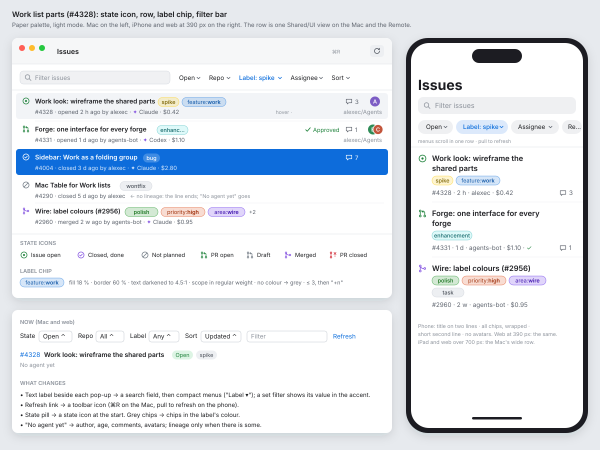
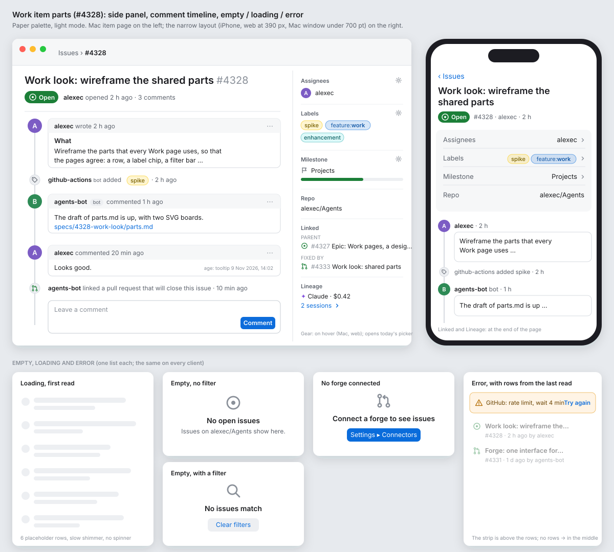

# Work look: the shared parts (#4328)

**Status:** draft for Alex. **Epic:** #4327, step 1. **Clients:** the Mac window, the Remote (iPhone and iPad), the web page (wide and 390 px). Work is Core. **Feature:** `feature:work`.

This spike makes no product code. It sets the parts that every Work page uses, so that the per-page spikes (step 2) and the stories after them agree. The reference look is GitHub's issue list and issue page, adapted to each platform (decided in #4327).

## Hi-fi mock

In the app's Paper palette, light mode. Where they differ from the ASCII sketches below, these boards are correct.





## Decision: Mac `Table` or a two-line `List`

**Decided with Alex (2026-11-09): a two-line `List`**, the same `Shared/UI` row on the Mac and the Remote. No `Table`.

- A label chip, a second line of author, age, agent and cost, and a long title do not fit a column grid: a `Table` cuts them or makes each row tall.
- The Remote and the 390 px web page cannot draw a `Table`. With a `List`, all three clients draw one row, and the parity table has one row to keep.
- What a `Table` gives (sorting by a column) the **Sort ▾** menu in the filter bar gives already.

## 1. The state icon

One glyph at the start of each row, in the state's colour. It replaces today's state pill (`WorkStatePill`) in the row; the pill stays on the item page's header.

| State | Glyph | Colour |
|---|---|---|
| Issue open | `circle.dotted` style: a ring with a dot | green `#1A7F37` |
| Issue closed (done) | ring with a tick | purple `#8250DF` |
| Issue closed (not planned) | ring with a slash | grey `#6E7781` |
| PR open | branch-and-merge glyph | green `#1A7F37` |
| PR draft | the same glyph | grey `#6E7781` |
| PR merged | merge glyph | purple `#8250DF` |
| PR closed | branch glyph with a cross | red `#CF222E` |

- A tracker's own status (Jira's In Progress, #3260) shows as a small grey word after the number on the second line, not as a new glyph.
- The glyph has an accessibility label: "Open issue", "Merged pull request", and so on. Colour is never the only sign.
- In dark mode the colours are the lighter set: green `#3FB950`, purple `#A371F7`, red `#F85149`, grey `#8B949E`.

## 2. The row

Two lines. The whole row is one button that opens the item page.

```
┌──────────────────────────────────────────────────────────────────────────────┐
│ ◉  Work look: wireframe the shared parts  [spike] [feature:work]    💬 3  (A) │
│    #4328 · opened 2 h ago by alexec · ✦ Claude · $0.42           alexec/Agents │
└──────────────────────────────────────────────────────────────────────────────┘
```

- **Line 1:** state icon, title (semibold, one line, truncated at the end), label chips, then at the trailing edge the comment count (`bubble.left` and a number, hidden at 0) and the assignees' avatars (up to 3, overlapped; "+2" after).
- **Line 2 (secondary, `.fine`):** `#<n>`, "opened <age> ago by <author>" (for an open item; "closed"/"merged" <age> ago for the others), then what lineage knows: the agent's runtime and the cost. With no lineage the line ends after the author; the text "No agent yet" goes.
- **Repo:** at the trailing edge of line 2, only when the list shows more than one repo (as `several` does now).
- **A pull request** adds its checks glyph (tick, cross, dot) and its review word (Approved, Changes requested) before the comment count.
- **Hover (Mac and web):** the row's background goes to the list's hover colour. **Selected:** the accent background, as a `List` selection.

### On a phone (Remote iPhone, web at 390 px)

```
┌──────────────────────────────────────┐
│ ◉  Work look: wireframe the shared   │
│    parts                             │
│    [spike] [feature:work]            │
│    #4328 · 2 h · alexec · $0.42  💬 3│
└──────────────────────────────────────┘
```

- The title takes up to two lines. The chips wrap under it (as `stacked` does now).
- The second line is shorter: the age without "opened … ago", no "by". The avatars go; the assignee is on the item page.
- The iPad and a web page wider than 700 px use the wide row.

## 3. The label chip

```
 ╭──────────────╮
 │ feature:work │   fill: the label's colour at 18 % · border: at 60 % · text: the colour, darkened to 4.5:1
 ╰──────────────╯
```

- A capsule, 11 pt, medium weight, 6 pt side padding, 18 pt high.
- **Colour** from `ForgeLabel.color` (`#rrggbb`, on the wire since #2956). The fill is the colour at low opacity, so a dark label does not make a dark block. The text is the colour darkened (light mode) or lightened (dark mode) until it has a contrast of 4.5:1 to the fill.
- **No colour** (a forge that gives none): the grey chip of today.
- **Scoped labels** (`feature:work`, `area:sidebar`, `priority:high`): the part before the colon is in the regular weight, the rest in medium. One chip, not two.
- **At most 3 chips** on a wide row, then "+2"; all on the item page. On a phone, all, wrapped.
- A click on a chip (Mac, web) sets the Label filter to it.

## 4. The filter bar

Today: a text label beside each pop-up ("State [Open] Repo [All] Label [Any] …"), and a blue Refresh link.

After:

```
┌──────────────────────────────────────────────────────────────────────────────┐
│ [🔍 Filter issues                         ]  Open ▾  Repo ▾  Label ▾  Assignee ▾  Sort ▾ │
└──────────────────────────────────────────────────────────────────────────────┘
```

- **A search field** first, wide, with the placeholder "Filter issues" or "Filter pull requests".
- **Compact menus** after it: each a borderless menu button with the filter's name and a chevron. When a filter is set, the button shows the value in the accent colour ("Label: bug ▾") and the menu has "Any" at the top to clear it.
- **State** shows its value at all times ("Open ▾"), because it always has one.
- **Project ▾** and **Board ▾** come first and last, only where they show now (#3283, #3282).
- **Refresh** goes to the toolbar: an `arrow.clockwise` icon with the tooltip "Refresh" (⌘R on the Mac). While a read runs it spins.
- **Mac:** the bar is above the list, in the content; the search field is not the toolbar's `.searchable`, so that the menus sit beside it.
- **Remote iPhone:** the search field is `.searchable` in the navigation bar; the menus are one horizontal scroll row of capsule buttons under it. Refresh is pull to refresh.
- **Web:** the menus are `<button>`s that open a list (not `<select>`); at 390 px they scroll in one row, as on the iPhone.

## 5. The side panel (item page)

Today an issue page has one grey line: assignee, milestone, repo.

After, on a wide page (Mac, iPad, web over 900 px), a column of 240 pt on the trailing side:

```
┌ #4328 Work look: wireframe the shared parts ───────────────┬──────────────────┐
│ ◉ Open · alexec opened 2 h ago · 3 comments                 │ Assignees        │
│                                                             │ (A) alexec       │
│ ┌ body ─────────────────────────────────────────────────┐   │──────────────────│
│ │ Wireframe the parts that every Work page uses …       │   │ Labels           │
│ └───────────────────────────────────────────────────────┘   │ [spike] [feature:│
│                                                             │ work]            │
│ │                                                           │──────────────────│
│ ●(B) agent · 1 h ago                                        │ Milestone        │
│ │  Draft of parts.md is up …                                │ ⚑ Projects       │
│ │                                                           │──────────────────│
│ ●(A) alexec · 20 min ago                                    │ Repo             │
│ │  Looks good, use the List.                                │ alexec/Agents    │
│                                                             │──────────────────│
│                                                             │ Linked           │
│                                                             │ ◉ #4327 Epic …   │
│                                                             │ ⇄ #4331 PR …     │
│                                                             │──────────────────│
│                                                             │ Lineage          │
│                                                             │ ✦ Claude · $0.42 │
│                                                             │ 2 sessions       │
└─────────────────────────────────────────────────────────────┴──────────────────┘
```

- **Sections,** each a small grey heading, then its value, with a hairline between: **Assignees** (avatar and login, one per line; "No one"), **Labels** (chips, wrapped; "None"), **Milestone** (flag and name, or progress bar when the forge gives it; "None"), **Repo**, **Linked** (the parent, the children, and the PRs that fix it, each a mini row: state icon, number, title on one line), **Lineage** (the agents that worked on it, the cost, the sessions; each opens the session).
- **Edit:** the heading of Assignees, Labels and Milestone has a gear button on hover (Mac, web) that opens the same picker as today's actions (`WorkItemActions`). The per-page spikes decide which forges can edit what; this part only says where the button goes.
- **Narrow (iPhone, web at 390 px, a Mac window under 700 pt):** the panel goes under the header, before the body, as a compact block of rows "Assignees · alexec", one row each, tappable; Linked and Lineage go to the end of the page.

## 6. A comment

```
 │
 ●(A)  alexec  commented 20 min ago                         ⋯
 │    ┌──────────────────────────────────────────────────┐
 │    │ Looks good, use the List.                         │
 │    └──────────────────────────────────────────────────┘
 │
 ○    🤖 github-actions added the label spike · 2 h ago
 │
```

- **A timeline line:** a 2 pt grey line down the leading edge, through the avatars.
- **A comment:** an avatar (28 pt, round) on the line, then the author (semibold), "commented <age> ago" (secondary, a tooltip with the exact time), and the body as Markdown in a box with a hairline border.
- **A bot** (`ForgeComment.bot`): a small "bot" capsule after the name; its avatar is the bot's.
- **An event** (a label, a state change, a linked PR; what `WorkTimelineView` has now): a small grey line, an icon on the timeline in place of the avatar, no box.
- **An avatar with no image:** a circle with the login's first letter on a colour picked from the login, so one person keeps one colour.

## 7. Empty, loading and error

| State | What it shows |
|---|---|
| **Loading, first read** | 6 placeholder rows: a grey circle and two grey bars per row, with a slow shimmer (`.redacted(reason: .placeholder)` on the Mac and Remote; a CSS skeleton on the web). No spinner in the middle. |
| **Loading, a refresh** | The rows stay; the toolbar's Refresh icon spins. |
| **Empty, no filter** | In the middle: the page's glyph (issue or PR), "No open issues", and one line under it: "Issues on alexec/Agents show here." |
| **Empty, with a filter** | "No issues match", and a **Clear filters** button. |
| **No forge connected** | "Connect a forge to see issues", and a **Settings ▸ Connectors** button (as today's empty state, in the new layout). |
| **Error** | A strip above the list (not in place of it): a warning glyph, what the forge said in one line, and **Try again**. The rows from the last read stay under it, dimmed. With no rows, the strip is in the middle. |

## Fields the parts need (for the forge interface spike, #4329)

Already on the wire (`Packages/Wire/daemon.schema.json`):

| Part | Field |
|---|---|
| State icon | `ForgeItem.state`, `draft`, `status` |
| Label chip | `ForgeLabel.name`, `color` (#2956) |
| Row | `title`, `node.ref`, `author`, `assignees`, `updatedAt`, `comments` (count), `checks`, `review`, `milestone` |
| Linked | `parent`, `progress` |
| Comment | `ForgeComment.author`, `at`, `body`, `bot` |
| Lineage | from the lineage store, as the row has now |

Missing, for #4329 to add to the one interface (each forge fills what it has, and says when it has none):

| Field | For | Notes |
|---|---|---|
| `ForgeItem.createdAt` | "opened 2 h ago" | Today the row has only `updatedAt`. |
| `ForgeItem.closedAt` (or `mergedAt`) | "merged 1 d ago" | |
| `stateReason` (`completed`, `not_planned`) | the closed-issue glyph | GitHub and GitLab give it; the others: none, so "completed". `WorkTimelineChild` has it already; `ForgeItem` does not. |
| A person: `{login, name, avatarUrl}` in place of the bare strings in `author`, `assignees`, `ForgeComment.author` | avatars on the row, the side panel, the comments | Linear and Jira give an avatar URL; GitHub and GitLab, too. The clients cache by URL. |
| `ForgeItemDetail.children` (number, title, state) | Linked | The parent is there; the children are not on an issue's read. |
| `ForgeItemDetail.linkedPulls` (number, title, state) | Linked | The PRs that close the issue. |
| `ForgeItemDetail.events` (kind, actor, at, label) | the timeline's events | Today `WorkTimelineView` builds them from lineage only. |

## Clients

- **Mac:** `Shared/UI/Work` (`WorkView`, `WorkItemPage`, `WorkTimelineView`). A `List` with the two-line row (Alex's decision above).
- **Remote:** the same `Shared/UI` views; the phone layout is the `compact` branch the row has now.
- **Web:** `Web/src/views/Work.tsx`, `WorkTimeline.tsx`; the same parts in CSS, with the 390 px layout at the same break points.
- The per-page spikes (step 2) use these parts and say only what a page adds.
