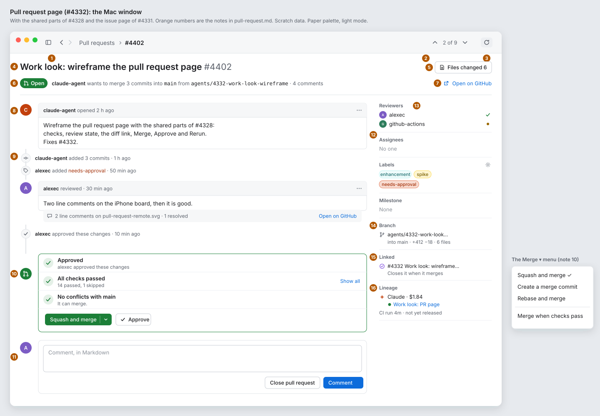
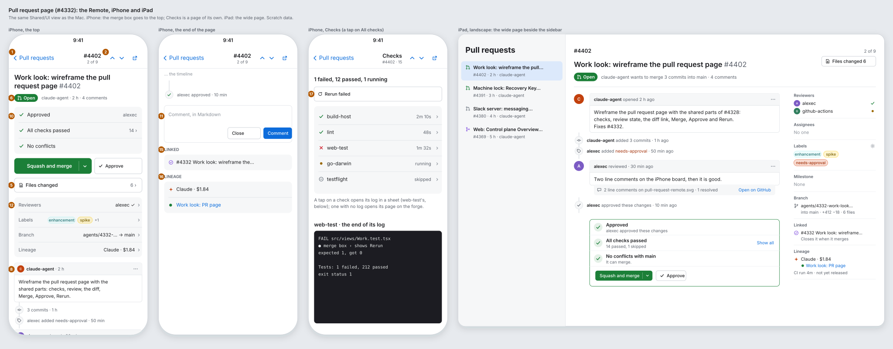
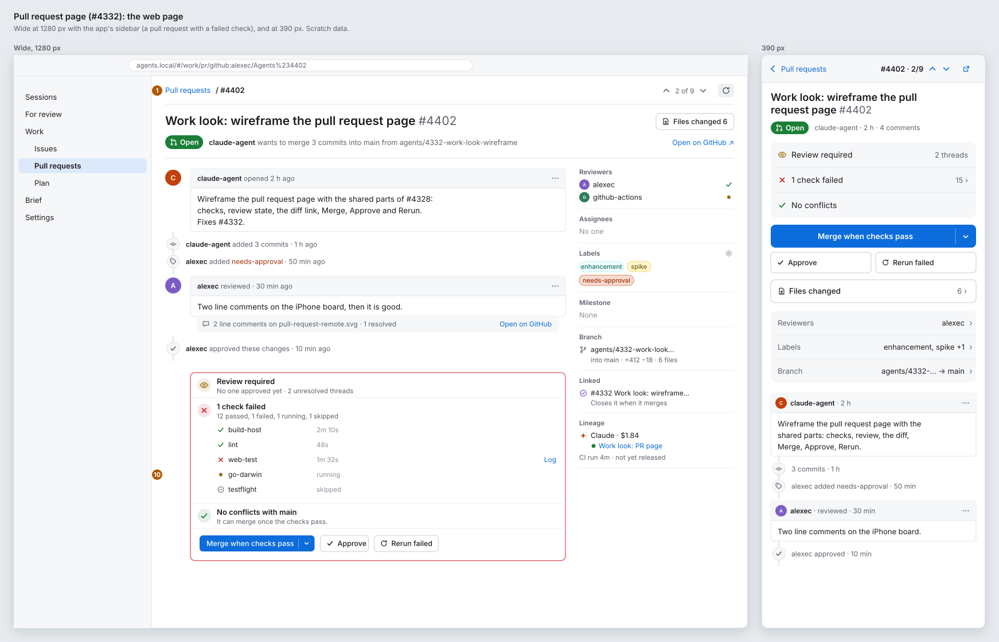
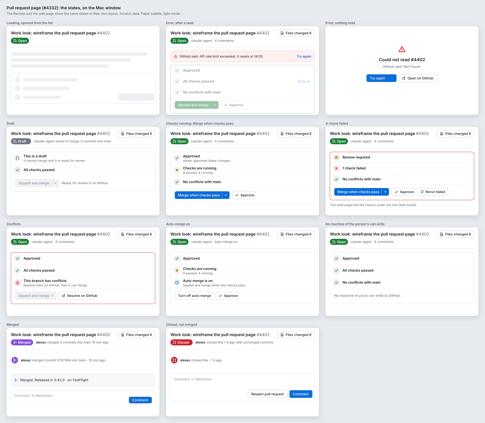

# Work look: the pull request page (#4332)

**Status:** draft for Alex. **Epic:** #4327, step 2. **Clients:** the Mac window, the Remote (iPhone and iPad), the web page (wide and 390 px). Work is Core. **Feature:** `feature:work`.

This spike makes no product code. It puts the shared parts of [parts.md](parts.md) on a pull request's page. The page has what [the issue page](issue.md) has, plus checks, the review state, the diff, **Merge**, **Approve** and **Rerun failed**. This page says only what is different from the issue page; the rest (Back, ↑ *2 of 9* ↓, Refresh, the timeline, the comment box, the side panel) is as issue.md says.

Today: `Shared/UI/Work/WorkItemPage.swift`, `WorkItemActions.swift` (`pullActions`, `failedChecks`, `showDiff`), `Web/src/views/Work.tsx`, `WorkActions.tsx`. The For review row (`Web/src/views/ReviewPull.tsx`, `Shared/UI/ReviewPullRow.swift`, #3330) opens this page.

## The boards

Paper palette, light mode, scratch data. The orange numbers are the notes below.

## Today and after

| Today | After |
|---|---|
| One grey line of words under the title: the checks (`checksWords`) and the review (`reviewWords`) | The **merge box** at the end of the timeline: one row for the review, one for the checks, one for conflicts, each with a glyph in its state's colour. |
| A row of buttons under the header: **Squash and merge ▾**, **Approve**, **Rerun failed**, **Show Diff** | **Merge ▾**, **Approve** and **Rerun failed** at the merge box's end. **Show Diff** becomes **Files changed 6** at the title's trailing end. |
| *Failed:* and a link per failed check's log | The checks list in the merge box (wide) or the Checks page (phone); a failed check has **Log**. |
| `reviewThreads` and `filesChanged` not shown | *2 unresolved threads* in the review row; the count on **Files changed**. |
| The state pill only | The state pill and *claude-agent wants to merge 3 commits into `main` from `agents/…`*. |

## The page, note by note

Notes 1 to 3, 4, 6 to 9 and 11 are as on the issue page (issue.md); the differences are here.

1. **Back:** *Pull requests › #4402* (Mac), *‹ Pull requests* (Remote), *Pull requests / #4402* (web).
2. **Previous and Next** in the list of pull requests the page was opened from.
3. **Refresh:** as issue.md. A pull request's checks change while the page is open, so a refresh also runs when a `checks.passed` or `checks.failed` event names it, if the forge sends one.
4. **The title**, as issue.md. A pull request has no **Start Agent**.
5. **Files changed 6:** a bordered button with the `files` glyph at the title's trailing end. It opens today's diff (`AppViewDiffPage`, `ViewDiff`, the `forge/diff` read) as a sheet; the number is `filesChanged`. On a phone it is a full-width row under the merge box: *Files changed · 6 ›*.
6. **The state line:** the pill (parts.md §1: *Open*, *Draft*, *Merged*, *Closed*), then *claude-agent wants to merge 3 commits into `main` from `agents/4332-work-look-wireframe` · 4 comments*. The branch names are in monospace. Merged: *alexec merged 3 commits into main 10 min ago*. On a phone: *claude-agent · 2 h · 4 comments*. Until the wire has the branches (missing fields, below), the line is *claude-agent opened 2 h ago · 4 comments*, as on an issue.
7. **Open on GitHub**, as issue.md.
8. **The body**, as issue.md. Screenshots for Alex (#2811) are images in the body and show there.
9. **Events:** an issue's events, plus *added 3 commits*, *reviewed*, *approved these changes*, *requested changes*. A review is a comment box with *reviewed* in its header; under it a grey strip says *2 line comments on pull-request-remote.svg · 1 resolved* and **Open on GitHub** goes to them. The page does not show line comments in the diff (decided, below).
10. **The merge box:** a bordered box at the end of the timeline, before the comment box, with a `pr` glyph in a green circle on the timeline. Its border is green when it can merge, red when a check failed or the branch has conflicts, grey otherwise. Its rows:
    - **Review:** *Approved* (green tick; *alexec approved these changes*), *Changes requested* (red), or *Review required* (amber eye; *No one approved yet · 2 unresolved threads*). From `review` and `reviewThreads`.
    - **Checks:** *All checks passed* (*14 passed, 1 skipped*), *Checks are running*, *1 check failed*. **Show all** opens the list in the box. When a check failed, the list is open from the start: a glyph per check (tick, cross, amber dot, skip), its name, its time, and **Log** on a failed one (today's `forge/log`). From `checks` (`ForgeCheck`).
    - **Conflicts:** *No conflicts with main*, or *This branch has conflicts* (red warning). From `mergeable`; *unknown* shows no row.
    - **The buttons:** **Merge ▾** (a split button: green when it can merge now, the accent colour when it waits), **Approve** (tick glyph), and **Rerun failed** when a check failed. The button's word is the repo's first method (*Squash and merge*); the menu has the other methods, then **Merge when checks pass** (today's `mergeButton`, `mergeWaits`). While the checks run, the main button says **Merge when checks pass** (auto-merge). **Approve** is there while the pull request is open, as today; the forge refuses it from the author and says why under the buttons.
11. **The comment box**, as issue.md, with **Close pull request** in place of **Close issue ▾** (no *not planned* for a pull request). A closed, unmerged pull request has **Reopen pull request** there. A merged one has **Comment** only.
12. **The side panel**, as issue.md, plus 13 and 14, and with **Linked** and **Lineage** changed (15, 16). The gear is on **Labels** only, as on the issue page.
13. **Reviewers:** an avatar and login per reviewer, with their state at the trailing edge: green tick (approved), red cross (changes requested), amber dot (requested, not yet). *No one* when none. Needs `reviewers` (missing fields).
14. **Branch:** the `branch` glyph, the head branch (cut in the middle on a narrow column), then *into main · +412 −18 · 6 files*. Needs `headRef`, `baseRef`, `additions`, `deletions` (missing fields); until then the section shows *6 files* alone.
15. **Linked:** the issues it closes (*Closes it when it merges*), each a mini row. Needs the closing issues (missing fields); until then the parent alone, as an issue's.
16. **Lineage:** the session that made the pull request, with a green dot while it runs, the runtime and the cost; then the pipeline line (CI run, release, TestFlight, #3588).
17. **The Checks page (iPhone, web at 390 px):** a tap on the checks row pushes a page: *1 failed, 12 passed, 1 running*, **Rerun failed** full width, then one row per check with its time and a chevron. A tap on a check opens the end of its log in a sheet; a check with no log opens its page on the forge.

### Narrow: the iPhone, the web at 390 px, a Mac window under 700 pt

- **The merge box goes to the top,** under the state line: a grouped block of three rows (review, checks, conflicts; the checks row has *15 ›*), then **Merge ▾** full width (or with **Approve** beside it, 62:38), then **Approve** and **Rerun failed** side by side when both show.
- **Files changed** is a row under it, then the side panel's rows (*Reviewers*, *Labels*, *Branch*, *Lineage*), then the timeline, then the comment box, **Linked** and **Lineage** as on the issue page.
- The iPad uses the wide page, as issue.md says.

## States

The boards show them on the Mac window. The Remote and the web page show the same states in their own layout; on a phone the merge box's rows are the block at the top.

| State | What it shows |
|---|---|
| **Loading, opened from the list** | The row gave the title, the number, the state and the checks, so the header shows at once. The timeline and the merge box are placeholders (`.redacted(reason: .placeholder)`; a CSS skeleton on the web). |
| **Loading, opened from a link, a For review row or an address** | All placeholders, the header too. |
| **Refresh** | The page stays; the Refresh icon spins. |
| **Error, after a read** | A strip under the header (the forge's words, **Try again**); the last read stays under it, dimmed, and its buttons are off. |
| **Error, nothing read** | In the middle: *Could not read #4402*, the forge's words, **Try again** and **Open on GitHub**. |
| **Draft** | The grey *Draft* pill. The merge box's first row is *This is a draft* (*It cannot merge until it is ready for review.*); **Merge** is off; *Ready for review is on GitHub.* No **Approve**. |
| **Checks running** | The amber dot, *Checks are running · 9 passed, 4 running*. The main button is **Merge when checks pass**. |
| **A check failed** | The red border, *1 check failed*, the checks listed (wide) with **Log** on the failed one, **Rerun failed**. The main button is **Merge when checks pass**: GitHub merges only once a rerun passes. |
| **Conflicts** | The red border, *This branch has conflicts*, **Merge** off, **Resolve on GitHub** (opens the conflicts page). |
| **Auto-merge on** (`autoMerge`) | The review and checks rows, then *Auto-merge is on · Squash and merge when the checks pass* with a clock glyph. **Turn off auto-merge** and **Approve**. Turning it off needs a write (tasks, below); until then the row has no button. |
| **No machine of the person's can write to the forge** | The merge box's rows, then *No machine of yours can write to GitHub.* in place of the buttons; no comment box; the gear goes. |
| **Merged** | The purple *Merged* pill; on the timeline *alexec merged commit `bf6f4dd` into main · 10 min ago*; in the merge box's place, a grey strip *Merged. Released in 0.42.0 · on TestFlight* (the pipeline line, #3588). The comment box has **Comment** only. |
| **Closed, not merged** | The red *Closed* pill, *alexec closed this 1 d ago with unmerged commits*; no merge box; **Reopen pull request** beside **Comment**. |
| **A forge with no pull requests (Linear, Jira)** | Not this page: their lists have no Pull requests section (#4361's capabilities). |

## Decisions

- Decided: **a merge box at the end of the timeline, as on GitHub**, with the review, the checks and conflicts as rows and the buttons under them, because the person reads why it can or cannot merge right above the button that merges. Alex can overrule.
- Decided: **on a phone, the merge box goes to the top**, because a pull request's page is long and Merge is the one action a person opens it for. Alex can overrule.
- Decided: **Files changed is a button that opens today's diff sheet, not a tab**, because the app has a diff view already (#1341), and tabs (Conversation, Commits, Checks, Files) would be a second navigation on top of Back. Alex can overrule.
- Decided: **no line comments in the diff in the first stories**; the review's strip says how many and opens them on the forge, because the wire has only their count (`reviewThreads`). Alex can overrule.
- Decided: **the checks list opens by itself when a check failed**, and stays closed (*Show all*) when they all passed, because a failure is what the person must read. Alex can overrule.
- Decided: **no Request changes button in the first stories**, because no forge write sends one today; Approve stays as it is. Alex can overrule.

## Fields the page needs

From #4328's list (each has its issue):

| Part | Field | Issue |
|---|---|---|
| *opened 2 h ago*, *merged 10 min ago* | `ForgeItem.createdAt`, `closedAt` | #4373 |
| Avatars | `authorAvatar`, `ForgeComment.avatar` | #4363 |
| Label colours | `ForgeLabel.color` | #4362 |
| *4 comments* | the comment count | #4364 |
| Events (commits, reviews) | `ForgeItemDetail.events` | #4373 |
| Which buttons show (Merge, Approve, Rerun, Close, Reopen) | `ForgeItemDetail.actions` | #4361 |

On the wire already: `checks` (`ForgeCheck`: name, state, url), `review`, `reviewThreads`, `filesChanged`, `mergeable`, `autoMerge`, `draft`, `head`, `mergeMethods`.

**Missing, new with this page** (for the lead to file as one task under the forge interface):

| Field | For | Notes |
|---|---|---|
| `ForgeItem.headRef`, `baseRef` | the state line, Branch | GitHub, GitLab, Bitbucket, Forgejo and Azure Repos all have them. |
| `ForgeItemDetail.additions`, `deletions`, `commits` | Branch, *3 commits* | GitHub gives them on the read; others: count from `forge/diff`, or none. |
| `ForgeItemDetail.reviewers` (person, state: `approved`, `changes_requested`, `pending`) | Reviewers | `review` is the sum of these. |
| `ForgeItemDetail.closes` (number, title, state) | Linked | GitHub's closing issues; GitLab's *Closes*; the others: none. |
| A check's time (`ForgeCheck.startedAt`, `finishedAt`) | *2m 10s* in the checks list | Without it, the list shows no time. |
| `ForgeItem.mergedBy`, `mergeCommit` | the Merged state | |

## Stories to file (for the lead)

Each changes what a client shows and adds a new layout, so each waits for Alex's approval (#3474). Each comes after the same client's issue page story, since both change `WorkItemPage` and its web twin (#873).

1. **Mac: the pull request page in the new layout.** `Shared/UI/Work/WorkItemPage.swift`, `WorkItemActions.swift`: **Files changed** in the header; the state line; the merge box (review, checks with **Show all** and **Log**, conflicts, **Merge ▾**, **Approve**, **Rerun failed**); **Close** and **Reopen pull request** in the comment box; the panel's Reviewers and Branch; the narrow page under 700 pt with the merge box at the top; the states. `remote: #<the Remote story>`, `web: #<the web story>`. Blocked by the Mac issue page story and #4361.
2. **Remote: the pull request page in the new layout.** The same `Shared/UI` views; this story does the Remote's own parts: the merge box at the top on the iPhone, the Checks page and its log sheet, the panel's rows, the iPad's wide page. Blocked by the Mac story (one `Shared/UI` change at a time, #873).
3. **Web: the pull request page in the new layout.** `Web/src/views/Work.tsx`, `WorkActions.tsx`, `WorkTimeline.tsx`, CSS: the same as the Mac at the same break points (700 px and 900 px), the Checks page at 390 px. `mac: #<the Mac story>`, `remote: #<the Remote story>`. Blocked by the web issue page story.

Tasks, not stories, and not needed by the three above (each shows what the wire has until they land):

4. **Forge field: a pull request's branches, size, reviewers, closing issues, check times and merge commit** (the table above), in the one interface, with each forge saying when it has none.
5. **Forge writes: turn off auto-merge, and mark ready for review** (a capability per forge, #4361), so the Auto-merge row and the Draft state get their buttons.

## Clients

- **Mac:** `Shared/UI/Work/WorkItemPage.swift`, `WorkItemActions.swift`; the toolbar in `App/`.
- **Remote:** the same `Shared/UI` views; the navigation bar and the Checks page in `Remote/` or `Shared/UI`.
- **Web:** `Web/src/views/Work.tsx`, `WorkActions.tsx`, `WorkTimeline.tsx`.
- The parity rows *Work* and *Work page actions* in `specs/071-web-remote/walks/parity/worktrees-and-files.md` change with the stories, not with this spike.
