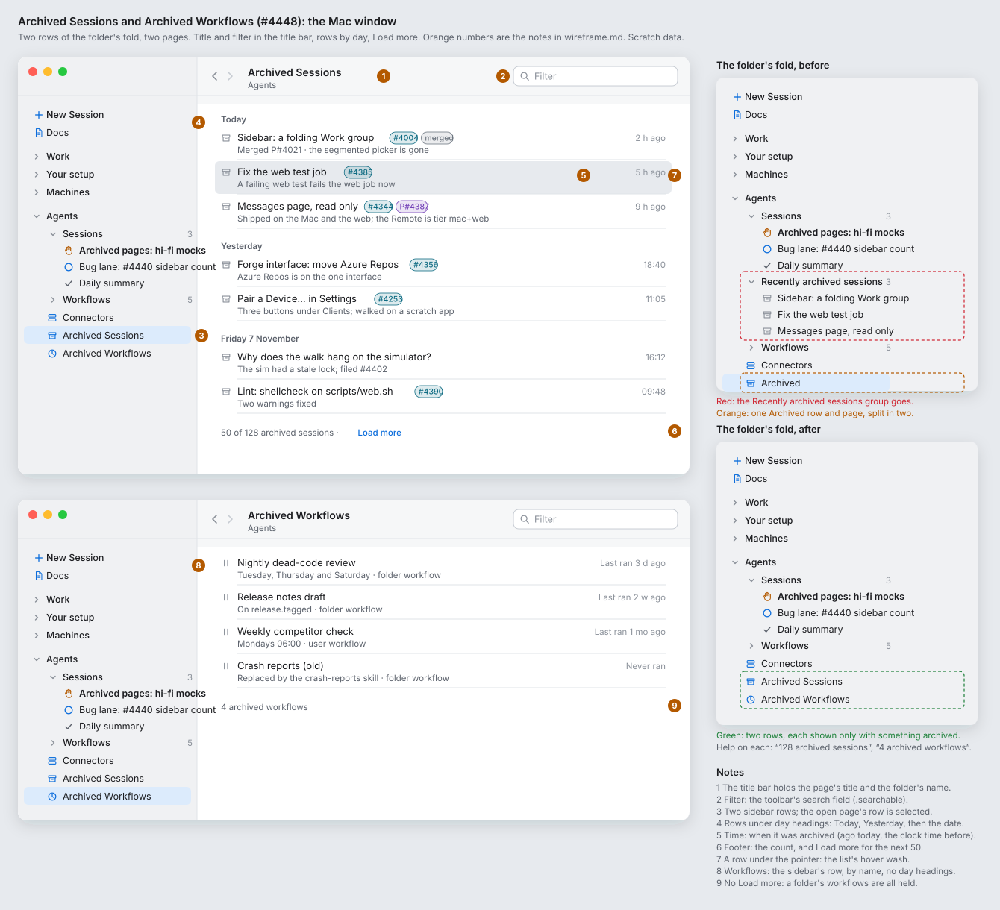
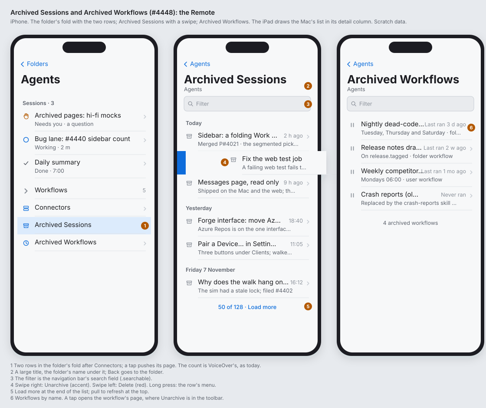
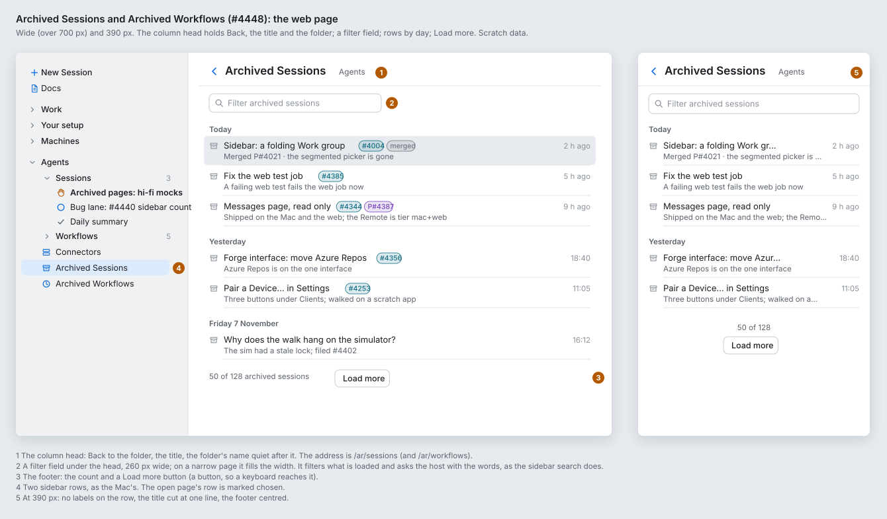
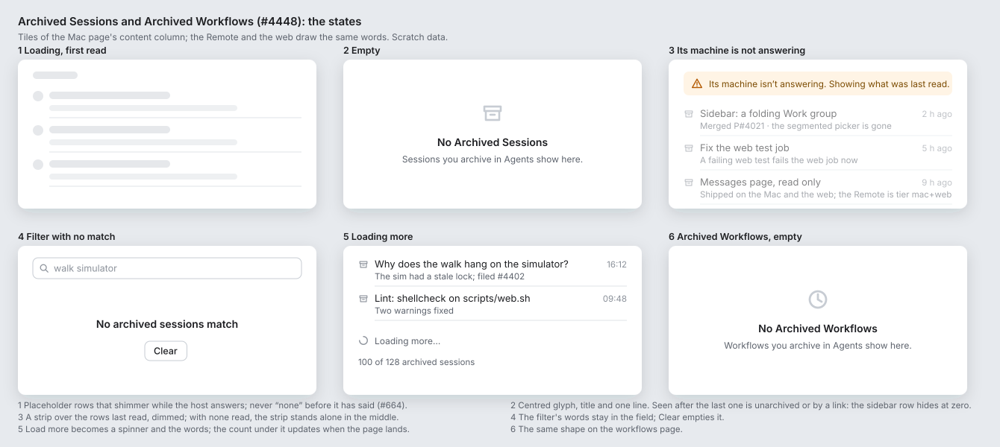

# Wireframe: Archived Sessions and Archived Workflows (#4448)

**Status:** draft for Alex. **Epic:** #4448. **Clients:** the Mac window, the Remote (iPhone and iPad), the web page. The sidebar and the Archived page are Core (#2796). **Feature:** `feature:sidebar`. **Areas:** `folders`, `sidebar`.

Three changes, in this order:

1. Remove the **Recently archived sessions** group from each folder's fold (#2587, #2868, #2731).
2. Split the **Archived** page into **Archived Sessions** and **Archived Workflows**: two rows, two pages.
3. Give both pages the look of the app's other pages (Work, Messages, a workflow): the title in the title bar, a filter, rows by day, a Load more footer, and standard states.

## Hi-fi mocks

Paper palette, light mode, scratch data. `python3 boards.py` in this folder draws them. Where they differ from the sketches below, the boards are correct. An orange number on a board is a note on the board.









## 1. Remove the Recently archived group

Today an open folder shows a **Recently archived sessions** fold under **Sessions**: the three newest archived sessions of the last 24 hours. The folder asks its host for them each time it opens.

After: the fold is gone. The person opens **Archived Sessions** instead. Nothing replaces the fold.

What goes, on every client:

| Where | What |
|---|---|
| `K/Sidebar/SidebarFolderFold.swift` | `recentArchived`, `recentArchived(now:)`, `recentArchivedShown`, `recentArchivedWithin` |
| `K/Sidebar/SidebarFolds.swift` | `Fold.recentArchivedSessions` |
| `A/Folders/FolderListView.swift`, `R/Sidebar/RemoteSidebar.swift` | the fold's rows, and the `.task` that asks the host for three archived sessions when the folder opens |
| `W/model/groups.ts`, `W/model/store.ts`, `W/model/folds.ts`, `W/views/Sidebar.tsx`, `W/sidebar.css` | `recentlyArchived`, `recentArchivedWithin`, `recentArchivedShown`, the fold's state, the `<details class="recent-archived-sessions">` and its rules |
| `AgentsKitTests/Unit/SidebarModelTests.swift` | `recentlyArchivedHoldsOnlyTheLastDaysArchived` |
| `specs/071-web-remote/walks/parity/sidebar-and-project-list.md` | the words about the three archived sessions in rows 7 and 59 |

A search still lists the archived matches after the workflows (#2758). The Archived pages still hold their page while open and let it go when they close (#165). An open folder makes no `agents/list` call for its archive any more (#2731).

## 2. Two rows, two pages

### The folder's fold

```
Before                               After
▾ Agents                             ▾ Agents
  ▾ Sessions                    3      ▾ Sessions                    3
      ✋ Archived pages: hi-fi mocks       ✋ Archived pages: hi-fi mocks
      ◯ Bug lane: #4440 sidebar count      ◯ Bug lane: #4440 sidebar count
      ✓ Daily summary                      ✓ Daily summary
  ▾ Recently archived sessions  3      › Workflows                   5
      ▣ Sidebar: a folding Work group    ▤ Connectors
      ▣ Fix the web test job             ▣ Archived Sessions
      ▣ Messages page, read only         ◷ Archived Workflows
  › Workflows                   5
  ▤ Connectors
  ▣ Archived
```

- **Archived Sessions** (`archivebox`) and **Archived Workflows** (`clock.arrow.circlepath`), after Connectors, in that order. Each shows only when it has something archived: `counts[.archived] > 0` for sessions, an archived workflow held for workflows. Nothing at a row's end (#587): the count is the help on the Mac ("128 archived sessions") and VoiceOver's on the Remote.
- The open page's row is selected (Mac, iPad), or chosen (web).
- A folder's own window (#1089) has the same two rows at its foot.
- The sidebar search is unchanged: archived matches are listed in the fold, after the workflows, with **Show all**.

### Routes

| Client | Today | After |
|---|---|---|
| Mac | `AppModel.FolderPage.archive` | `.archivedSessions`, `.archivedWorkflows` |
| Remote | `RemoteRoute.archive`, `openArchive` | `.archivedSessions`, `.archivedWorkflows`; `openArchive` becomes which of the two, or none |
| Web | `#/…/ar/1` | `#/…/ar/sessions`, `#/…/ar/workflows`; an old `ar/1` link opens sessions |

## 3. The pages

### Archived Sessions

```
┌ ‹ ›  Archived Sessions                                   [🔍 Filter       ] ┐
│      Agents                                                                  │
├──────────────────────────────────────────────────────────────────────────────┤
│ Today                                                                        │
│ ▣ Sidebar: a folding Work group  [#4004] [merged]                   2 h ago  │
│   Merged P#4021 · the segmented picker is gone                               │
│ ▣ Fix the web test job  [#4385]                                     5 h ago  │
│   A failing web test fails the web job now                                   │
│ Yesterday                                                                    │
│ ▣ Forge interface: move Azure Repos  [#4356]                          18:40  │
│   Azure Repos is on the one interface                                        │
│ Friday 7 November                                                            │
│ ▣ Why does the walk hang on the simulator?                            16:12  │
│   The sim had a stale lock; filed #4402                                      │
│                                                                              │
│ 50 of 128 archived sessions · Load more                                      │
└──────────────────────────────────────────────────────────────────────────────┘
```

1. **The title bar** holds the title (`navigationTitle("Archived Sessions")`) and the folder's name as the subtitle (`navigationSubtitle`), as a workflow's page and Messages do. No title drawn in the content (today's `Text("Archived").appText(.title)` goes).
2. **Filter:** the toolbar's search field (`.searchable`, prompt "Filter"). It keeps the rows whose title, labels or last line hold the words, and asks the host with the words (`agents/list` with `query`, archived only), as the sidebar search does, so an older session than the loaded page is found too.
3. **Rows:** the sidebar's session row (`SessionSidebarRow`, `SidebarSessionRow`, `SidebarSession`): the grey archive mark, the title, the label chips, one grey line. Its context menu, swipe (Remote and Mac) and keyboard are the row's own: Unarchive, Delete…, Show in Finder. A click opens the chat, as today.
4. **Day groups:** a `Section` per day by `archivedOrder` (`archivedAt`, or the last activity for a record from before it): **Today**, **Yesterday**, then the day ("Friday 7 November"; with the year when it is not this year). The groups follow the host's order, newest archived first (#2153), so no re-sort.
5. **Time:** when it was archived. Under Today: "2 h ago"; under any other day: the clock time, "18:40". A row's tooltip has the full date and time.
6. **Footer:** "50 of 128 archived sessions · **Load more**". Load more asks the host for the next 50 (`loadArchived(limit: held + 50)`) and shows a spinner with "Loading more…" while it does. With every one held: "128 archived sessions". The hint "Search to find an older one" goes.
7. **Hover (Mac, web):** the list's wash. **Selected:** the window's selection, as today.

### Archived Workflows

```
┌ ‹ ›  Archived Workflows                                  [🔍 Filter       ] ┐
│      Agents                                                                  │
├──────────────────────────────────────────────────────────────────────────────┤
│ ⏸ Nightly dead-code review                                  Last ran 3 d ago │
│   Tuesday, Thursday and Saturday · folder workflow                           │
│ ⏸ Release notes draft                                       Last ran 2 w ago │
│   On release.tagged · folder workflow                                        │
│                                                                              │
│ 4 archived workflows                                                         │
└──────────────────────────────────────────────────────────────────────────────┘
```

8. The same frame. Rows are the sidebar's workflow row (`WorkflowListRow`, `SidebarWorkflowRow`, `WorkflowRow`): the status icon, the name, when it last ran, a grey line with its schedule or trigger and its scope. By name, no day groups: a workflow has no archive date. A click opens the workflow's page, where Unarchive is.
9. No Load more: a folder's workflows are all held. The footer says the count.

### States

| # | State | What it shows |
|---|---|---|
| 1 | Loading, first read | Placeholder rows that shimmer (`.redacted(reason: .placeholder)`; a CSS skeleton on the web). Never "none" before the host has said (#664). |
| 2 | Empty | In the middle: the glyph, **No Archived Sessions**, "Sessions you archive in Agents show here." (`ContentUnavailableView`). Seen after the last one is unarchived, or by a link: the sidebar row hides at zero. |
| 3 | Its machine is not answering | A strip over the rows last read, dimmed: "Its machine isn't answering. Showing what was last read." With no rows read, the strip stands alone in the middle. |
| 4 | Filter with no match | The words stay in the field. **No archived sessions match**, and **Clear**. |
| 5 | Loading more | The footer becomes a spinner and "Loading more…"; the count updates when the page lands. |
| 6 | Archived Workflows, empty | The same shape: **No Archived Workflows**, "Workflows you archive in Agents show here." |

`ArchivedSessionsNote` (Loading…, Its machine isn't answering, No archived sessions, The newest 50 of N) becomes a state model that the Mac and the Remote share from AgentsKit, with the day groups and the footer words, and that the web mirrors in `W/model/archivedPage.ts`. Its tests move with it.

## 4. The Remote

See `remote.svg`. The same `Shared/UI` row views as the Mac.

- **The fold:** two `FolderPageRow`s after Connectors, no count shown (the count is VoiceOver's, as today's Archived row).
- **The page:** a large title "Archived Sessions", the folder's name as the subtitle, Back to the folder. The filter is the navigation bar's search field. Sections by day with the system's section headers. Swipe right: Unarchive (accent); swipe left: Delete (red); long press: the row's menu. A row pushes the chat. **Load more** is the last row of the list; pull to refresh asks the first page again. Empty: `ContentUnavailableView`.
- **iPad:** the detail column draws the Mac's list and footer; the filter is the navigation bar's search field.
- **Archived Workflows:** the same, rows by name, no sections; a tap pushes the workflow's page.

## 5. The web page

See `web.svg`.

- **The column head:** Back, the title, the folder's name quiet after it (as `WorkflowPage.tsx`'s `PageTitle`). Addresses `#/…/ar/sessions` and `#/…/ar/workflows`.
- **A filter field** under the head, 260 px wide, the full width at 390 px. It filters what is loaded and asks the host with the words.
- **Day headings** as `<h2 class="subhead">`; rows as the sidebar's `SidebarSession` and `WorkflowRow`.
- **The footer:** the count and a **Load more** `<button>`, so a keyboard reaches it.
- **At 390 px:** no label chips on the row, the title cut at one line, the footer centred.

## Decisions

- **Decided: two sidebar rows,** not one row with a segmented control, because #4004 just replaced a segmented control with sidebar rows and the sidebar stays two levels deep (#495). Alex can overrule.
- **Decided: Title Case** ("Archived Sessions", "Archived Workflows"), as Alex wrote them and as macOS names sidebar items. Alex can overrule.
- **Decided: day groups** on Archived Sessions, the time being when it was archived, because that is how Safari's History, Mail and Finder's Recents list a put-away list. None on Archived Workflows: no archive date. Alex can overrule.
- **Decided: Load more** (50 at a time) in place of the hint to search, because every other list of the app pages by a footer. Alex can overrule.
- **Decided: the rows stay the sidebar's rows,** not a new row, so a session looks the same wherever it is listed and the parity table keeps one row for it. Alex can overrule.

## Not in this epic

- **Archived folders** stay a fold at the foot of the sidebar (#343, #677). An "Archived Folders" page is a later issue, if Alex wants one.
- **Several rows at once** on the Mac page (⌘-click, then Unarchive or Delete).
- **A date on a workflow's archive.** When the host records `archivedAt` on a workflow, Archived Workflows can take the day groups too.

## Stories (the epic's sub-issues)

1. Remove the Recently archived group: one PR, all three clients.
2. The Mac: the two rows and the two pages. Sets the look; waits for Alex (#3474). Commits this folder.
3. The web, from the Mac's screenshots.
4. The Remote.
5. Docs (`docs/reference/sidebar.md`, `docs/how-to/archive-and-stop.md`) and the parity rows (`sidebar-and-project-list.md` rows 57, 60 and 63).

Stories 2 to 4 are all in the `folders` area, so they go one after another.
