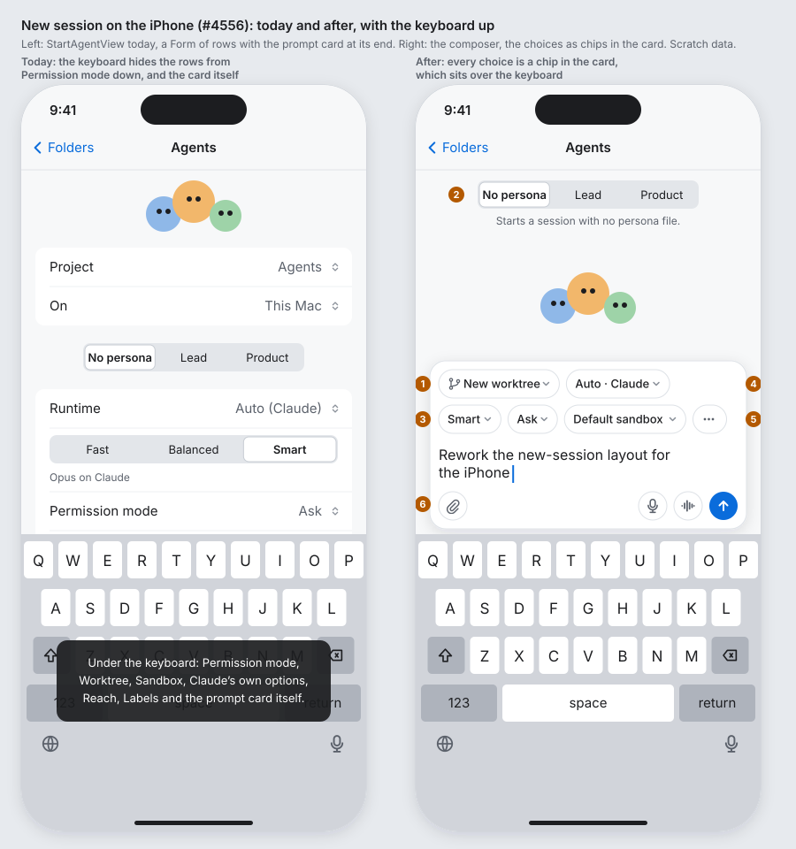
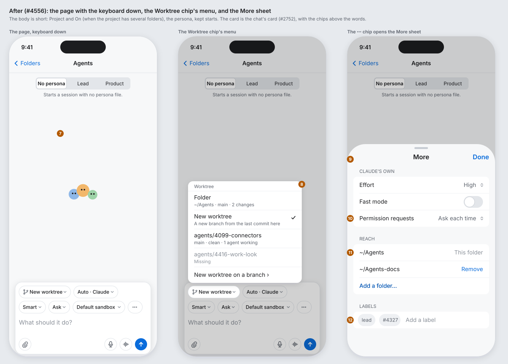
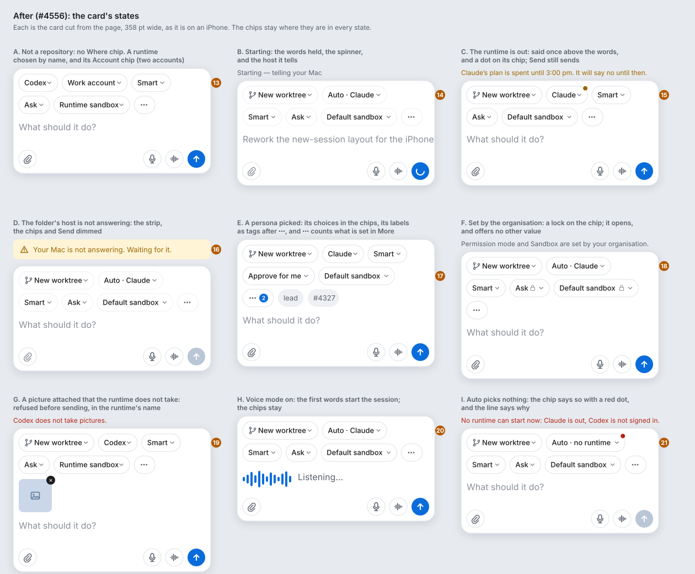
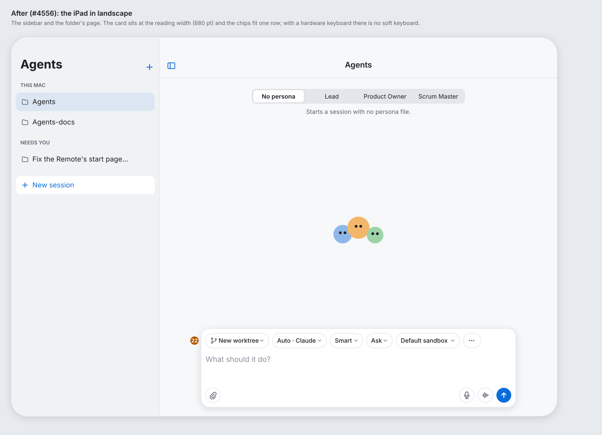

# New session on the iPhone and iPad: the composer (#4556)

**Status:** draft for Alex, 2026-11-10. **Issue:** #4556. **Client:** the Remote (iPhone and iPad). The Mac window and the web page keep their bars: `mac: by design`, `web: by design`. New session is Core. **Feature:** `feature:remote`. **Area:** `chat` (`Remote/Sources/StartAgent/`).

The Remote's New session page is a Form: the choices are rows, one under the other, and the prompt card is at the end. With the keyboard up, the keyboard hides every row from Permission mode down, and the card itself (`today-after.svg`, left). A person who wants a worktree or the sandbox has to put the keyboard away and scroll. This spec makes the page a **composer**: the chat's prompt card (#2752) with every choice as a **chip** in the card, above the words, so that the choices are on screen whenever the words are. Nothing is trimmed: every control the Mac's bar has is here, the rarer ones behind one **⋯** chip.

Today: `Remote/Sources/StartAgent/StartAgentView.swift` (the Form, the prompt bar), `ChoiceRows.swift` (the rows), `ProjectRows.swift`, `PhoneAttachments.swift`, `StartDraftKeeper.swift`. The chat's card and its pills: `Remote/Sources/Chat/PromptBar.swift`, `Shared/UI/Chat/LevelPill.swift`, `SandboxCapsule.swift`, `ClientPermissionCapsule.swift`, `SelectCapsule.swift`.

## The boards

Paper palette, light mode, scratch data. The orange numbers are the notes below. `boards.py` draws them; run it again after a change.

## Today and after

| Today | After |
|---|---|
| A Form: the Blobs, Project and On, the persona, kept starts, guarded changes, a section of seven choice rows, the runtime's own section, Reach, Labels; the prompt card at the end, over the keyboard. | A short body (Project and On, the persona, kept starts, guarded changes, the Blobs) and the card at the bottom, over the keyboard, with the choices in it (notes 1 to 7). |
| Runtime, Model (segmented), Permission mode, Permission requests, Account, Worktree, Sandbox: rows of 44 pt, each with a menu. | Chips in the card, in the Mac's order: **Where**, **Runtime**, **Account**, **Model**, **Permission mode**, **Sandbox**, **⋯** (note 1). Each chip reads its value and opens the same menu the row opened (note 8). |
| The runtime's own options (Effort, Fast mode…), Reach and Labels: three more sections, under the fold. | Behind the **⋯** chip, in the **More** sheet (notes 9 to 12). The chip shows how many are set. A label is also a tag after the chip (note 17). |
| The keyboard hides the choices. | The chips wrap into rows inside the card, never scroll sideways, and are on screen with the keyboard up (note 3). |
| A phone's page and the Mac's bar look like two different forms. | The page looks like a chat with nothing in it yet: the card is the chat's card, and the chips are the chat's pills. Starting an agent and talking to one look like the same act (#2752). |

## The page, note by note

1. **The chips.** In the card, above the words: a wrapping row of raised paper capsules, 32 pt tall, 13 pt text, a chevron at the end (`SelectCapsule`'s look). In order: **Where** (only on a repository: *Folder*, *New worktree*, a worktree's name, or a branch; the `branch` glyph), **Runtime** (*Auto · Claude* on Auto, as the chat's header says it; else the name), **Account** (only when the runtime has more than one), **Model** (*Fast*, *Balanced*, *Smart*, *Custom*), **Permission mode** (*Plan*, *Ask*, *Approve for me*, *Bypass Permissions*), **Sandbox** (*Default sandbox*, *Runtime sandbox*, *No sandbox*), and **⋯**. The words are `LevelWords` and `SandboxWords`, as the rows use now. Each chip has an accessibility label of its field and value (*Worktree, New worktree*).
2. **The persona** stays where it is: the segmented control centred under the title, with the picked one's description under it, and the menu when the segments do not fit (#2795); its labels and settings go into the chips and the tags when it is picked (#2649). **Project** and **On** stay as the first rows of the body when the project has several folders (#3279). Both are above the card, which is a short scroll with the keyboard up and on screen without it.
3. **The chips wrap, never scroll.** A flow layout puts as many chips on a row as fit the card's width, then starts a new row; two rows on an iPhone, one on an iPad. A sideways scroll would hide the ones past the edge, which is the problem this page has today. Chip titles are short by design (a word or two); a worktree's name is cut at the end at 140 pt, and the menu shows the whole of it (#2659).
4. **The words and the buttons** are the chat's bar: the field (*What should it do?*, 2 to 8 lines), attach on the left, dictate, voice mode and Send on the right, 44 pt tap targets (#2897). Paste of a picture, the attachment strip, the refusal in the runtime's name (#3162), dictation at the cursor (#427), voice mode's first words (#2375): all as today.
5. **The ⋯ chip** opens the More sheet (note 9). With something set in it, a badge in the accent colour counts what is set: the runtime's own options changed from their default, Reach folders added, labels, and Permission requests set for this session. With nothing set, the plain glyph.
6. **The card** is pinned to the bottom, over the keyboard, as today (`safeAreaInset`). Its state lines (starting, refused, the runtime out, the host not answering) go above the card, as the Mac's bar puts them (states board).
7. **The body** above the card is only what is not a choice: Project and On, the persona, kept starts (#691), a guarded change's question (#531), and the Blobs (#987) in the space left, looking at the prompt as they do in the chat. With the keyboard up on an iPhone, the Blobs are what gives way.
8. **A chip's menu** is the row's menu as today: the same items, the same detail lines, the same ticks, the same org-policy marks (#998) and the same confirmations (Bypass Permissions #2892, Yes to all #2746). It opens as a menu, not a sheet: choosing a value is a glance (033). The Worktree menu keeps *Folder* with its path and git status, *New worktree* with why not when it cannot, the worktrees with their branch, status and agents (missing ones off), and *New worktree on a branch ›*.
9. **The More sheet** is a half-height sheet (medium detent, with the large one for a long list) with a grabber, the title *More* and **Done**. Its sections, in this order, each only when it has something: the runtime's own options under *Claude's own* (`LevelWords.own`, the rows `ChoiceRows.row(for:)` draws now, with *Asking Claude what it offers…*, the failure and *Try again* as now); **Permission requests** (Cursor, Grok and OpenCode only; not on Auto); **Reach**; **Labels**. On Auto the first section is absent (#2658). A change in the sheet shows in the ⋯ badge at once.
10. **Permission requests** is the row it is today (`permissionRow`), with its confirmation for *Yes to all*.
11. **Reach:** the folder itself first, marked *This folder*, then each added folder with **Remove**, then **Add a folder…**, which opens a path field in place (autocapitalisation and autocorrection off, as now). The sheet is where the list has room; the chips have none for a path.
12. **Labels:** the shared `LabelTagField`, tags and suggestions as now. A tag added here appears after the ⋯ chip on the card too (note 17).

## The states, note by note

13. **Not a repository:** no Where chip. **Two accounts:** the Account chip after the runtime, in `AccountWords`, with the org marks (#999, #2265).
14. **Starting (#87):** the words held and dimmed, the spinner in Send, and *Starting — telling your Mac* above the card (`Telling`). The chips are off until it starts or refuses.
15. **The runtime is out (052, 065):** an attention dot on the Runtime chip and the allowance's sentence above the card (`runtimeAllowances.startingOnOut`), as the Mac's bar says it. Send still sends: there is no other runtime to offer.
16. **The host is not answering (#239):** `HostOfflineStrip` stays at the top of the page; the chips and Send dim; the words stay editable. A stopped workspace that starts when used keeps Send on (#691 US3).
17. **A persona picked:** its settings go into the chips (*Approve for me*), its labels appear as tags after ⋯ (a grey capsule with no chevron; a tap opens More at Labels), and ⋯ counts the labels among what is set. Switching takes the last persona's labels away (#2649).
18. **Set by the organisation (#998):** a lock glyph on the chip; the menu opens, shows every value, and the ones the policy refuses are dimmed with *Set by your organisation*, as today. One line above the card names the fields that are set.
19. **An attachment the runtime does not take (#3162):** the strip under the chips, and the refusal in the runtime's name above the card, in the failure colour; Send is off until the picture is removed or the runtime changes.
20. **Voice mode (#2375):** `VoiceSpeechPrompt` in the field's place; the chips stay, and the first words start the session with them (Alex, 2026-10-29).
21. **Auto picks nothing (#2658):** the chip says *Auto · no runtime* with a red dot, the line says why for each runtime (`autoNoRuntime`), and Send is off.
22. **The iPad:** the same page at the reading width (680 pt, `ReadableWidth`), the chips on one row. With a hardware keyboard there is no soft keyboard and the body stays in view. The Blobs look at the pointer (#987). On an iPad with a soft keyboard the card rises as on the iPhone.

## What does not change

- The model's state and methods (`startRuntimeID`, `chooseRuntime`, `chooseWorktree`, `startLevels`, `startSandbox`, `startFolders`, `startAgent`, `StartDraftKeeper`): the view changes, not the wire or the draft.
- The default runtime, Available and Out groups, the Auto preview, prewarm on typing, the kept form, the offered start (#834), the page's hold on the model (#1044, #2089).
- The words: every title, detail line and confirmation is the one the rows use now.

## Parity

`specs/071-web-remote/walks/parity/start-sheet-and-new-project.md`, the *Its shape* row: the Remote's cell becomes "The chat's card with the choices as chips, pinned over the keyboard; the rarer ones in a More sheet: `R/StartAgent/StartAgentView.swift`", verdict still **by design** (a bar on the Mac and the web, a card on a phone). The rows *Model, effort, permission*, *Sandbox choice*, *Where it runs*, *Reach: extra folders*, *Labels* and *Account* change their Remote cells to name the chips or the More sheet; the verdicts stay **same**.

## Decisions

- **Decided:** the chips wrap into rows inside the card rather than scroll sideways as the chat's pills do, because a sideways scroll hides the chips past the edge, which is the complaint this spec answers. The chat's bar is not changed by this spec. Alex can overrule.
- **Decided:** the runtime's own options, Permission requests, Reach and Labels go behind one ⋯ chip, with a count, because they are set rarely and a path or a tag field has no place in a chip; the six first-order choices stay in view. Alex can overrule.
- **Decided:** the persona and Project/On stay above the card as today, because a persona is picked before the words are typed and both are on screen without the keyboard; a Persona chip would also diverge from the segmented control the three clients share (#2924). Alex can overrule.
- **Decided:** the Mac window and the web page do not change, because their bars already keep every control in view. Alex can overrule.

## Open questions

- Should the Model chip keep the three-way segmented control the row has today (one tap to change) rather than a menu? The chip is a menu in the boards, for one look across the chips; a segmented control would take a row of its own.
- On an iPhone SE-sized screen (667 pt tall) with the keyboard up, two chip rows and a two-line field leave about 60 pt for the body. The persona would then be behind a short scroll. The lane checks it on the small simulator and says what it found in the PR.

## Approval

A new layout and a new control (the chips, the More sheet): the PR waits for Alex with screenshots of the iPhone and the iPad, one per state of the states board (#2811, #3474). `Approval: needed (new layout: the composer; new control: the chips and the More sheet)`.
