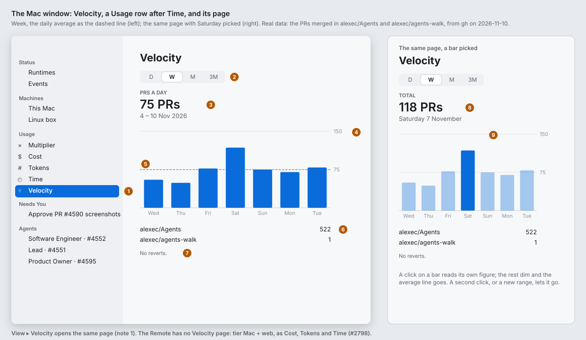
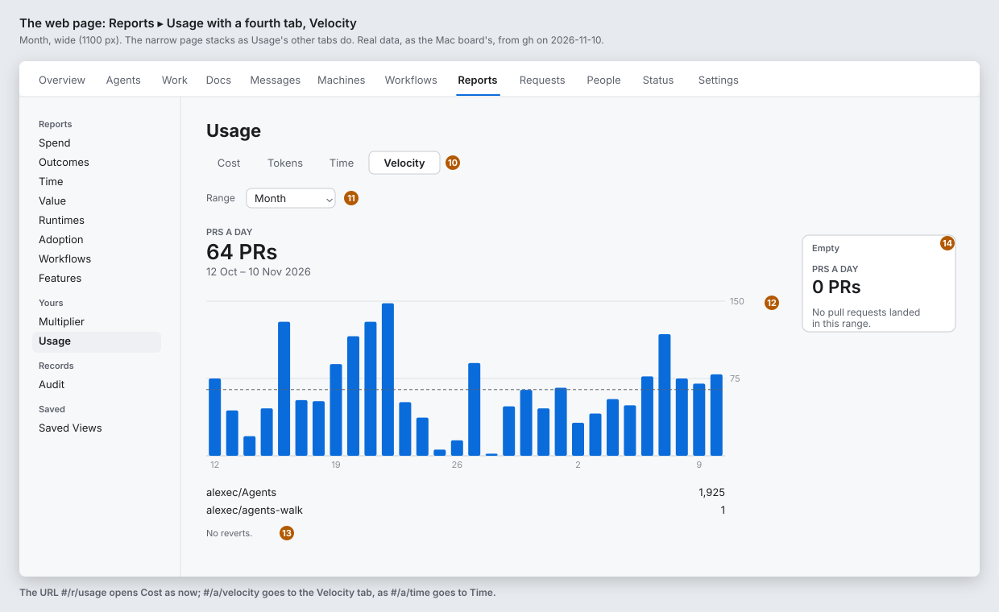

# Velocity: the pull requests that landed, over time (#4595)

**Status:** draft for Alex. **Epic:** #4595; its children are #4596 (the daemon method), #4597 (the Mac window) and #4598 (the web page). **Clients:** the Mac window and the web page. **Tier:** Mac + web, as Cost, Tokens and Time; the Remote has no Velocity page (#2798). **Feature:** `feature:multiplier`.

Alex asked for it (2026-11-10): a new report, Velocity, like the Cost, Tokens and Time report. Just PRs landing.

## Why

The Multiplier (#3901) says one figure: the PRs the person's agents merged in the last 7 days, against 1.4. Cost, Tokens and Time draw what the work used over time. Nothing draws **what the work produced** over time: the PRs that landed, by hour, day and week.

What exists today:

| Where | What it says | Why it is not Velocity |
|---|---|---|
| Usage ▸ Multiplier | one figure for the last 7 days, and the best week | no bars, no range |
| Usage ▸ Time, the recap (#985) | *PRs merged* on one day, from `gh pr list` once an hour | one number in a recap; counts only the app's branches in this machine's folders; no hours, no reverts |
| Reports ▸ Outcomes (web, admins) | every person's PRs opened, merged and reverted, and their cost | the admin's report about other people; Velocity is the person's own, as Cost is to Reports ▸ Spend (#3224) |
| Reports ▸ Planning, the DORA keys (#4551) | deployment frequency, lead time, change failure rate | releases and quality, for a project or a group; not the person's PRs a day |

## The boards

Paper palette, light mode. **The bars are real data** (Alex, 2026-11-10): the PRs merged in alexec/Agents and alexec/agents-walk by day, in America/Los_Angeles, which `real-data.py` fetches with `gh pr list` into `data.json`; `boards.py` draws the boards from it (`python3 real-data.py && python3 boards.py` in this folder). The sidebar's other rows are scratch. The orange numbers are the notes below.

What the real data says, fetched 2026-11-10: a median day of the last 30 is about 55 PRs, the busiest (Saturday 7 November) 118, and no merged PR in the 30 days has a title that starts with "Revert". A `gh pr list` proxy counts every merged PR; `velocity/history` will count only the PRs a session worked on, which in this repository is nearly all of them (876 of the 1,000 newest are from `agents/…` branches; the rest are nightly and Dependabot).





## Note by note

1. **The row.** A **Velocity** row in the sidebar's Usage group, after Time, with the icon `arrow.triangle.merge` (a merge), in the Usage rows' size and ink. Its tooltip says the last 7 days' PRs (*312 PRs in the last 7 days*), as Tokens' says today's tokens (#587). **View ▸ Velocity** opens the same page, after View ▸ Time, with no shortcut.
2. **Range.** D / W / M / 3M as a segmented control on the Mac and a Range select on the web (Day, Week, Month, 3 months), the usage charts' control, Week to start.
3. **The headline.** Health's block (#823): **PRS A DAY**, the figure (*46 PRs*), and the range in words (*3 – 9 Nov 2026*; *Today* in D). In 3M the bars are weeks, and the average line is drawn as a week's worth, as the usage charts do; the headline stays the daily average.
4. **The bars.** One bar per hour (D), day (W, M) or week (3M): the PRs that landed in it. The accent colour, the right-hand axis in PRs (*35*, *70*), the day or hour labels under the bars as the usage charts place them. One series: a merged revert is a PR that landed (note 7).
5. **The average line.** Dashed, at the daily average, as Cost's. Not in D, and not while a bar is picked.
6. **The shares.** Where the PRs landed, by repository, largest first: *alexec/Agents · 312*, *alexec/agents-site · 11*. The repository is the PR node's `repo`, shown without the forge prefix (`github:`). Cost's shares are by runtime; a PR has no one runtime, and the question here is which repository moved.
7. **The line under the bars.** *Including 4 reverts.* when the range has any, or *No reverts.* when it has none, in the fine secondary style of *Plus 1.2M read from cache, not drawn.* The line is always there: none reverted is worth saying, and the real data has had none for 30 days.
8. **A picked bar.** A click on a bar reads its own figure: **TOTAL**, *52 PRs*, *Monday 9 November* (an hour in D: *14:00–15:00*; a week in 3M: *Week of 3 November*). The other bars dim and the average line goes. A second click, or a new range, lets it go. The Mac uses `chartXSelection`; the web a hit rect per bar, as `UsageCharts.tsx`.
9. **Live.** The page reads `velocity/history` on open, and again when `multiplier/changed` arrives (a merge or a merged revert), so the bar moves when the PR lands. The web also reads every 60 s while visible, as Time does.
10. **The tab.** Reports ▸ Usage gets a fourth tab, **Cost | Tokens | Time | Velocity**. `#/a/velocity` goes to it, as `#/a/time` goes to Time (`movedPage`).
11. **Range** on the web is the usage charts' select, labelled *Range*.
12. **The chart** on the web is the same bars, drawn by `VelocityCharts.tsx` from `model/velocity.ts`, the shape of `UsageCharts.tsx` and `model/usage.ts`. Narrow (390 px), it stacks as Usage's other tabs do; nothing new.
13. **The line** under the bars is the Mac's (note 7).
14. **Empty.** *PRS A DAY*, *0 PRs*, and *No pull requests landed in this range.* in the chart's place, as *Nothing was spent in this range.* Loading says *Loading…* on the web and a progress wheel on the Mac, as the usage charts do.

## The data

A daemon method **`velocity/history`** (#4596), shaped as `usage/history` and `time/history`, so the clients draw it with the same chart code (`UsageChart` and `model/usage.ts` have the bucketing and the ranges; `HistoryMerge` the time zones).

```
VelocityHistory {
  hours: Record<hourStamp, Record<repo, VelocityBucket>>;   // 168 hours
  days:  Record<dayStamp,  Record<repo, VelocityBucket>>;   // 90 days
  now: WireDate;
  timeZone?: string;                                         // the host's, as usage/history (#1267)
}
VelocityBucket { merged: number; reverted: number }
```

- **What counts:** a PR node in this machine's lineage store with `outcome` merged or reverted that a session worked on: the nodes the Multiplier counts (`multiplierMergesLocked`, `Go/internal/agentsd/multiplier.go`; `lineage.Merges`, `Go/internal/lineage/multiplier.go`). A PR the person merged by hand, or another person's PR in the same repository, counts 0. A PR still open counts 0.
- **Where it goes:** the bucket of the PR's `endedAt`, in the host's time zone. `merged` is every PR that landed, reverts included; `reverted` is the merged reverts among them, so a client can say *Including 4 reverts.* and a later client can subtract them if it wants the Multiplier's net figure.
- **How long:** the lineage store keeps 90 days of ended work, so the method counts from it on each ask (a few thousand nodes) and keeps no ledger of its own. 168 hours and 90 days, as `usageHoursKept` and `usageDaysKept`.
- **The key:** the PR node's `repo`, such as `github:alexec/agents`. One key per repository.

### Not the Time recap's count

The Time page's recap (#985) asks `gh pr list --state merged` once an hour, in each folder that is a git repository, and counts the PRs from the app's branches (`agents/…`). It has no hour, no repository and no reverts, and it misses a PR an agent worked on from a branch of another name. Lineage has all four, and it is the Multiplier's own count, so the two pages agree. The recap stays as it is.

## Today and after

| Today | After |
|---|---|
| Usage: Multiplier, Cost, Tokens, Time. | Usage: Multiplier, Cost, Tokens, Time, **Velocity**. |
| The merged PRs are one figure (the Multiplier) and one recap line (Time). | Bars by hour, day and week, 90 days back, with the daily average and a picked bar's figure. |
| Reverts are subtracted in the Multiplier and said nowhere. | *Including 4 reverts.* under the bars. |
| Nothing says which repository the PRs landed in. | The shares by repository. |

## What it is not

- **Not the Multiplier:** no baseline, no engineer-hours, no crowd. The Multiplier page stays the first row and the page the window opens to (#3986).
- **Not Reports ▸ Outcomes:** no other person's PRs, no cost per PR, no opened or closed-without-merge counts.
- **Not a count of every machine's PRs added up.** v1 is this machine's lineage; the web page reads this Mac's history, as the Multiplier page does (`pageHost`), because two machines that worked on one PR would count it twice when their histories are added. A control-plane sum for the person (as `multiplier/count`) is a follow-up when it is wanted.
- **Not a change to the Time page.** Its recap's *PRs merged* line and its *Most PRs in a day* record stay.

## Parity

A **Velocity** row in `specs/071-web-remote/walks/parity/pool-runtimes-and-spending.md`, after Time's: tier Mac + web; the Mac cell from #4597, the web cell from #4598, the Remote cell *None: by design (tier mac+web, #2796, #2798)*. Each story updates its cell in its branch.

## Approval

Both stories add a new screen or control (a sidebar row and a menu item; a tab), so their PRs wait for Alex with screenshots of W and 3M, a picked bar, and on the web the narrow page too (`Approval: needed`, #3474).

## Decisions

- **Decided:** lineage, not the Time recap's `gh pr list`, counts the bars, because it has the hour, the repository and the reverts, keeps 90 days, and agrees with the Multiplier. Alex can overrule.
- **Decided:** one series, reverts included, with *Including N reverts.* or *No reverts.* always under the bars, because one series is simpler to read and the Multiplier already subtracts them where that matters. Alex can overrule.
- **Decided:** shares by repository, because a PR has no one runtime and the question is which repository moved. Alex can overrule.
- **Decided:** v1 is this machine's lineage and the web reads this Mac's, as the Multiplier page does, because adding every host's history counts a shared PR twice. Alex can overrule.
- **Decided:** the headline is the daily average in every range, as the usage charts' is, because the four Usage pages then read alike. Alex can overrule.
- **Decided:** the icon is `arrow.triangle.merge` and the row's place is after Time, because the Usage rows run from the figure (Multiplier) through what the work used (Cost, Tokens, Time) to what it made. Alex can overrule.

## Sizes

| Issue | Points | Size |
|---|---|---|
| #4596 the daemon method | 0 clients + 1 wire | S |
| #4597 the Mac window | 1 client + 2 new screen | M |
| #4598 the web page | 1 client + 2 new control | M |

mac: docs only, remote: docs only, web: docs only.
