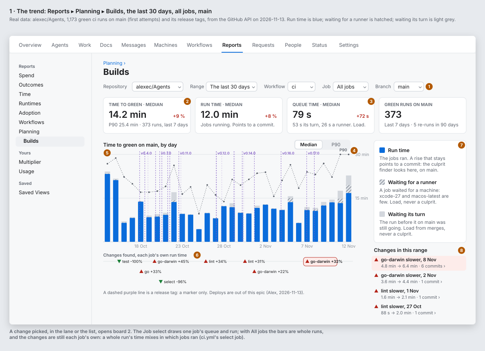
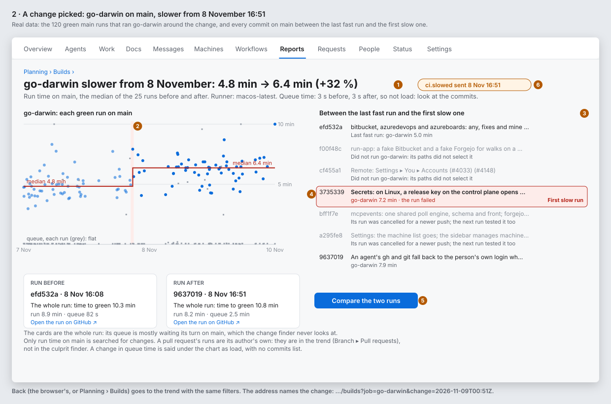
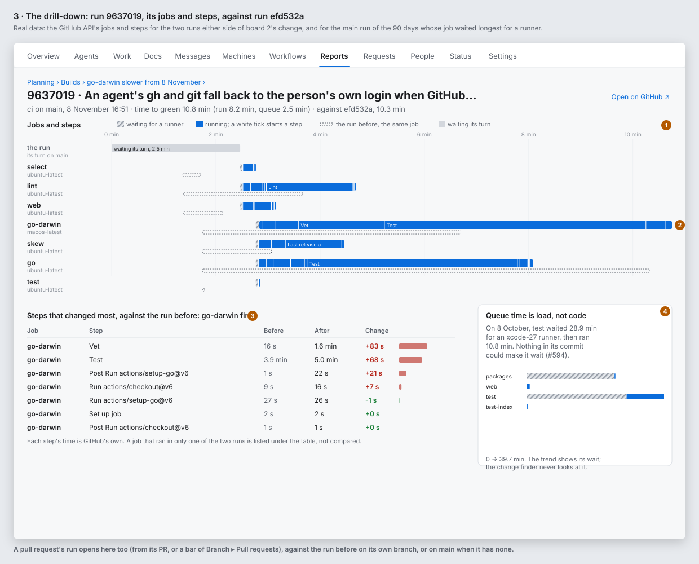
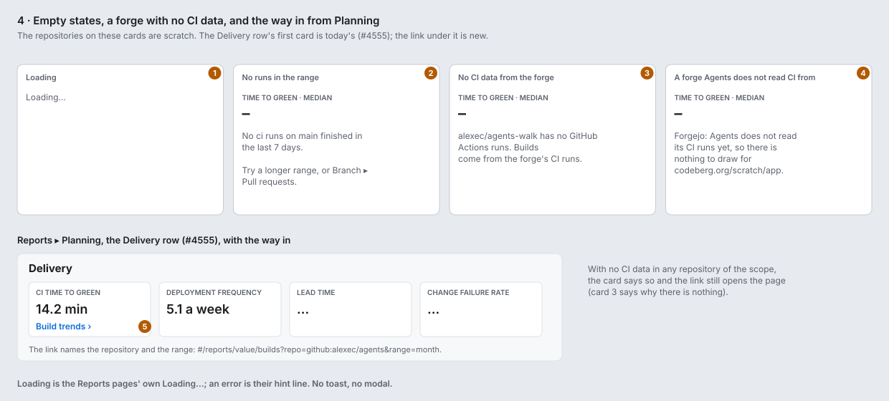
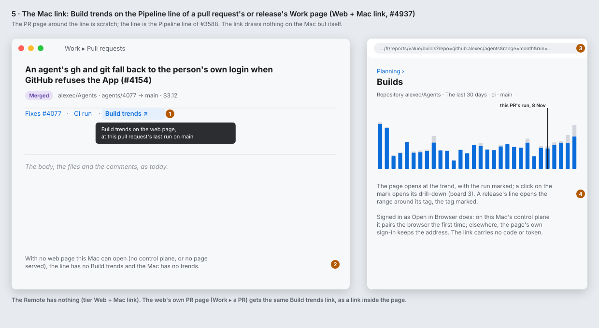

# Build trends: how long CI takes, and what made it slower (#5166)

**Status:** Alex approved the UX on 2026-11-13 (#5167). Revised the same day on Alex's direction: deploys are out of this epic, the timings have a store of their own, and a slowdown on `main` makes an event. **Epic:** #5166. **Feature:** `feature:planning`. **Tier:** Web + Mac link (#4937; Alex: "Web only, linked from Mac"). The web page has the report. The Mac window shows one link to it. The Remote has nothing.

Alex asked (2026-11-12) for a report on Reports ▸ Planning that shows:

1. how long CI builds take, as a trend;
2. whether they get slower or faster;
3. the build that caused a change;
4. a drill-down into the slow part.

Alex asked for deploys too. **Deploys are out of this epic** (Alex, 2026-11-13): a deploy needs a model of its own (see "Later: releases and deploys"). Release tags stay, as markers on the CI trend only.

## Why

| Where | What it says | Why it is not this report |
|---|---|---|
| Reports ▸ Planning ▸ Delivery, *CI time to green* (#4554, #4555) | One figure for each repository: the median and P90 of a merged PR's last push to green, over 4 weeks, with a sparkline | No queue/run split, no job, no step, no cause |
| The ci-speed skill (#596) | The median time to green of recent PRs, against 15 minutes, once a day | An agent's check, not a page; it changes `ci.yml` and shows nothing |
| Work ▸ a PR or a release, the Pipeline line (#3588) | A link to each CI run on GitHub | One run, no trend |
| Work ▸ Timeline (#4171, #4425) | Epics in time | Not about CI |

Nothing shows if a build gets slower, when it started, or which commit did it.

## What the real data says

`fetch.py` and `derive.py` read this repository's `ci` and `release` runs of the last 90 days from the GitHub API, with their jobs and steps, into `data.json`. `boards.py` draws the boards from it (`python3 fetch.py && python3 derive.py && python3 boards.py` in this folder). The raw answers stay in `/tmp/bdt-cache`. This folder keeps only the figures and a few runs. Data from alexec/Agents only. The sidebar rows, the Mac PR page around its Pipeline line and the empty-state repositories are scratch.

Fetched 2026-11-13: 5,829 `ci` runs, 1,173 green first-attempt runs on `main`, 2,357 green first-attempt PR runs, and 28 `release` runs. The fetch made about 3,400 API calls: 3-day windows for the run lists, and jobs for each `main` run, each release run and each 4th PR run. The `ci` runs start on 25 September. Most days before 4 October have 0 to 3 runs on `main`.

What the data taught the design. Each item changes a board:

1. **A run's total time does not find a culprit.** `ci.yml`'s `select` job starts only the jobs that a change's paths need. A docs change runs `lint`, `web` and `select` in 3 minutes, and an app change also runs `apps` and `swift` in 13. The first version of `derive.py` found change points on the run total. The two that it found were changes in which jobs ran, not slower builds. **So change points are found for each job, on that job's own run time** (board 1, the "Changes found" lane).
2. **Queue time has two causes, and neither is a commit.** On `main`, most queue time is *waiting its turn*: `ci.yml`'s concurrency group keeps one run going and one pending on `main`, so on a busy day a run waits for the run before it. The rest is *waiting for a runner*. In the last 7 days, the median queue on `main` was 79 s: 53 s its turn and 26 s a runner. On 12 November, waiting for a runner also grew. **So the trend draws three layers: run, waiting for a runner, and waiting its turn** (board 1, note 7).
3. **A re-run is not queue time.** The jobs API gives a run's latest attempt. A run of 17 October had a `swift` job re-run two hours later, and its "queue" looked like 1 h 43 min. **So re-runs are not in the time figures.** Delivery's *Failed rounds* already counts them: 5 on `main` and 284 on PRs in the 90 days.
4. **Real runner waits are short jobs on scarce runners.** On 8 October, `packages` waited 25.4 min for an xcode-27 runner and then ran for 12 s. This is the problem that #594 fixed (`ci.yml`'s note on `select`). Board 3's queue panel shows it.
5. **A change and its culprit, from the data.** On `main`, `go-darwin` went from 4.8 min to 6.4 min (+32 %) at 16:51 on 8 November (Los Angeles). Six commits are between the last fast run and the first slow one. Two of them did not run `go-darwin`, because their paths did not select it. Two had their runs cancelled for a newer push. The first slow run is `3735339`, *Secrets: on Linux, a release key on the control plane opens a secret…* (#4145), which changed 19 Go files. Its step diff: `Vet` went from 16 s to 1.6 min, and `Test` from 3.9 to 5.0 min. Queue time was 3 s before and 3 s after. Boards 2 and 3 draw this case.
6. **Deploys (out of this epic).** The `release` workflow's runs took a median of 22.1 min in 30 days. v0.18.0 took 57.5 min, of which 57.4 were TestFlight. These figures stay in `data.json` for the later epic. The boards do not draw them.
7. **The detector must be strict.** With no floor, binary segmentation found 28 changes in 90 days, many of them a few seconds on a short job. The boards keep a change only when the median moves by at least 30 s *and* 20 %, with a score of 8 or more. That leaves 8 changes in the 90 days. The timing task tunes these figures (open question 4).

## The boards

Paper palette, light mode, real figures. The orange numbers are the notes below.

## Note by note

### Board 1: the trend

0. **How fresh the data is** (#5139): the page reads the runs from an earlier read, so it says *Last update <time ago>* under the title, in the words of `docs/reference/design-system.md`, "How fresh the data is". The boards do not draw it yet; the report story does.
1. **The filters.** Repository, Range (the Reports ranges: the last 24 hours, 7, 30 or 90 days), Workflow (`ci` to start with; the workflows that ran in the range), Job (All jobs, or one), Branch (`main` to start with, Pull requests, or one branch). The address keeps each filter, so a link and a saved view (#2019) open the same page. There is no person scope: a build belongs to a repository. The Scope picker narrows the Repository list to the scope's repositories.
2. **The headline tiles**, the last 7 days against the 7 days before: *Time to green* (median, with P90 and the count), *Run time*, *Queue time* and *Green runs on main* (with the re-runs of the 90 days). A rise in run time is red, a fall is green.
3. **Queue time says seconds, not a percentage.** 7 s to 79 s is +1,000 %, which is true and alarming but says nothing. The tile line splits it: *53 s its turn, 26 s a runner. Load.*
4. **The chart.** A bar for each day: the median run (blue), with the median wait for a runner (hatched) and the median wait for its turn (light grey) on top. The P90 of time to green is a dotted line. **Median | P90** draws the bars at P90 instead. With one job picked, the bars are that job's run and queue. With All jobs, the bars are whole runs, which mix in which jobs ran: the note under the chart says so.
5. **Releases** are dashed purple lines through the chart, labelled for a minor tag. A patch tag is a fainter line with no label. They are markers only, the way Grafana's annotations and Datadog's deployment markers are: the page draws no deploy duration.
6. **Changes found**, a lane under the chart: a marker for each change, at its time, named by its job, red ▲ when slower, green ▼ when faster. The change finder looks only at run time on the default branch (Design point, below). A click opens board 2.
7. **What the colours mean**, in words, beside the chart. This is the design point on the page: **run time** points to a commit, **waiting for a runner** points to scarce runners (xcode-27, macos-latest), and **waiting its turn** points to many merges. The last two are load, never a culprit.
8. **Changes in this range**, newest first: the job, slower or faster, the date, the medians before and after, and how many commits are between. A click opens board 2.

### Board 2: a change picked

1. **The heading** says the change in one line: the job, slower or faster, from when, the medians and the share. Under it: the runner, and the queue before and after, *so not load: look at the commits*. When the queue changed and the run did not, the board says *load* and shows no commit list.
2. **Each run** of that job on `main` around the change, as a dot, with the two medians as a step. Queue time for each run is a grey mark on the floor. It is flat here, and that is why this is a commit's change, not load.
3. **Between the last fast run and the first slow one:** every commit on `main` in between, in order. A commit whose run did not start this job is grey, with *Did not run go-darwin: its paths did not select it*. A commit whose run was cancelled says so, and says that the next run tested it too. Each commit links to its PR's Work page.
4. **The first slow run** is outlined in red, with *First slow run*: the first commit whose run of this job is slow. This is the culprit to look at first. The finder does not blame. It shows the line and the evidence.
5. **Compare the two runs** opens board 3 for the run before and the run after. The two cards are the whole runs: their queue is mostly waiting their turn on `main`, which the finder never looks at.
6. **`ci.slowed` sent**, a small label beside the heading: the daemon sent the event for this change (see "A slowdown makes an event"), at the time the change was found. A workflow can start on it.

### Board 3: the drill-down

1. **The Gantt chart** of one run (as Kesin11/actions-timeline draws one): a row for each job, hatched from when it was made to when a runner took it, then blue to its end, with a white tick at the start of each step and the long steps named. A first row, *the run*, is light grey for the wait for its turn. The same job of the run before is a dashed outline under each row (as Gradle Develocity compares two builds).
2. **The job of the change** (go-darwin) is the long row: Vet and Test are longer than the outline.
3. **Steps that changed most**, the picked job's steps first, then the rest, by size: job, step, before, after, change, a bar. Each step's time is GitHub's own. A job in only one of the two runs is listed under the table, not compared.
4. **Queue time is load, not code:** the run on `main` whose job waited longest for a runner in the range. In the 90 days, that was `packages` on 8 October (25 min, then 12 s). This panel is in the range's drill-down, not in the run's, when the run's own queue is short.

A PR's run opens this page too: from its PR, or from a bar of Branch ▸ Pull requests, against the run before on its own branch, or on `main` when it has none.

### Board 4: empty, and no CI data

1. **Loading** is the Reports pages' own *Loading…*. An error is their hint line. There is no toast and no modal.
2. **No runs in the range:** the tiles say –, and *No ci runs on main finished in the last 7 days. Try a longer range, or Branch ▸ Pull requests.*
3. **No CI data from the forge:** *alexec/agents-walk has no GitHub Actions runs. Builds come from the forge's CI runs.*
4. **A forge Agents does not read CI timings from:** CI outside the forge (CircleCI, Buildkite, Jenkins), or a forge whose timing reader is not built yet (the spike found a `run.completed` reader on all five forges and a timing reader on none; #5177 builds GitHub's). The board's example: *Forgejo: Agents does not read its CI runs yet, so there is nothing to draw for codeberg.org/scratch/app.*
5. **The way in from Planning:** the Delivery row's *CI time to green* card (#4555) gets a link, *Build trends ›*, to this page, with the repository and the range of the card. Reports' left list also gets *Builds* under Planning (board 1). With no CI data in any repository of the scope, the card says so and the link still opens the page, where card 3 says why.

### Board 5: the Mac link

1. **Build trends ↗** at the end of the Pipeline line (#3588) of a PR's or a release's Work page, after *CI run*, as a link. Its tooltip: *Build trends on the web page, at this pull request's last run on main.* Alex chose this place (2026-11-13).
2. **No web page, no link.** With no control plane, or no page served, the line has no *Build trends*, and the Mac has no trends: the rule of **Edit in Console** and **Open Reports** (#4938).
3. **It opens the right place:** `#/reports/value/builds?repo=github:alexec/agents&range=month&run=<id>`, the trend with this run marked. A click on the mark opens its drill-down. A release's line opens the range around its tag, with the tag marked.
4. **Signed in as Open in Browser:** with the control plane on this Mac, it pairs the default browser the first time. With the control plane somewhere else, the page's own sign-in keeps the address. The link carries no code or token.

The web's own Work ▸ PR page gets the same *Build trends* link, inside the page.

## The design point: run time finds the culprit, queue time is context

| | Run time | Waiting for a runner | Waiting its turn |
|---|---|---|---|
| What it is | A job's steps running | A job made, no runner free | The run before on `main` still going |
| What moves it | A commit: more tests, a slower tool, a cache missed | Load on scarce runners (xcode-27, macos-latest), another repository's jobs | Many merges close together |
| What the page does | Finds change points, for each job, on the default branch, and lists the commits | Draws it hatched; says *load* when it changes; no commits | Draws it light grey; says *load*; no commits |
| What a person does | Opens the first slow run and its step diff | Looks at runner capacity (#2966) or at `select` (#594) | Nothing, or fewer lanes (the lane-count rule) |

The culprit finder works only on the default branch. A PR's runs are its author's own, and a PR built on an old base tells nothing about `main`. PR runs are in the trend (Branch ▸ Pull requests), and the PR page links to its own run.

## Prior art

From their public docs and pages as I know them (mid-2026). I did not read them again for this draft.

| Tool | What it does | What this report takes |
|---|---|---|
| CircleCI Insights | Workflow and job duration trends (P50/P95), success rate, by branch | Per-job trends with a branch filter; P90 beside the median |
| Buildkite Pipeline Insights | Build duration with *wait time* apart from run time; agent queue metrics | Queue apart from run, everywhere |
| GitLab CI/CD analytics | Pipeline success and duration charts, per pipeline | A per-commit view of the default branch |
| TeamCity statistics | Build duration and *time spent in queue* charts, a point per build | A point per run (board 2); queue as its own series |
| Gradle Develocity | Trends dashboards; *Build Comparison* of two builds, task by task | *Compare the two runs*, step by step (board 3) |
| Kesin11/actions-timeline | A GitHub Action that draws a run's jobs and steps as a Gantt chart, with the wait | The Gantt chart with the wait hatched (board 3) |
| Apache Otava (was Hunter) | E-divisive change-point detection on performance series | Change points, not thresholds, one series at a time |
| Grafana annotations, Datadog deployment markers | Deploys as lines across every chart | Release tags as lines through the chart |
| GitHub Deployments | A deployment's status timeline for each environment | Not in this epic: input for the later Release × Environment model |

In the app: Reports ▸ Planning and its Delivery row (#4551, #4555) give the page and its way in; Velocity (#4595) gives the chart conventions (range, headline, picked bar); Work ▸ Timeline (#4171, #4425) gives the time axis.

## What exists for the data (not planned here)

- Lineage `ci-run` nodes (#3581, `Go/internal/lineage/lineage.go`, `Go/internal/agentsd/lineageci.go`): a run's id, branch, head and completion, from the forge's `run.completed` and `checks.passed` events, for the PRs that agents work on. There are no jobs or steps.
- `release` nodes (#3023): tags, used here as markers. `deploy` and `target` nodes (#3584, #3657) are not used by this epic (see "Later: releases and deploys").
- CI time to green and failed rounds per merged PR (#4554, `Go/internal/lineage/delivery.go`).
- Deploy events in the forge MCP servers' `deploys.go` (#3820; GitHub's waiting deployments in `Go/internal/githubmcp/deploys.go`): for the later epic, not this one.

## Where the timings live

Lineage is a secondary copy of the forge and the other systems, which links them for a fast lookup by ref and for graph walks. Its Store (`Go/internal/lineage/lineage.go`) keeps links and node states, not series. So:

- **The timings have a store of their own:** for each run, its jobs and their steps (made, started, ended, attempt, runner label, conclusion), as plain files, bounded, one per repository, keyed by the `ci-run` ref.
- **Lineage keeps only the `ci-run` node and its links** (its PR, its commit, the release that holds it), so the report walks from a run to its PRs and from a change to its commits.
- The spike (#5176) says whether the forge's run, job and step data is enough, and sets the store's bounds (how many days, how many runs, its size).

## The data spike (#5176)

Measured on 2026-11-13 from alexec/Agents (the cache of `fetch.py`, 5,831 `ci` runs and 3,364 runs' jobs) and from the forge servers in `Go/internal/*mcp`.

### Is the forge's data enough? Yes, on GitHub

GitHub Actions gives all the fields this report uses:

| Level | Endpoint | Fields used |
|---|---|---|
| Run | `actions/runs` (the list `run.completed` reads already) | `id`, `run_attempt`, `created_at` (made; a re-run keeps it), `run_started_at` (the attempt's start), `updated_at`, `conclusion`, `head_branch`, `head_sha`, `event`, `path` (the workflow) |
| Job | `actions/runs/{id}/jobs?filter=all` | `run_attempt`, `created_at`, `started_at`, `completed_at`, `conclusion`, `labels` (the runner label), `runner_name` |
| Step | inside each job of the same answer | `name`, `number`, `started_at`, `completed_at`, `conclusion` |

- **Waiting its turn** = run made → its first job made (attempt 1). **Waiting for a runner** = job made → job started. **Run** = job started → job ended. A step has no "made" time, and it does not need one.
- **Re-runs (the spec's finding 3) are told apart by `filter=all`.** The jobs API with `filter=latest` (what `RunDetails` reads today) gives only the latest attempt. `filter=all` gives every attempt's jobs, each with its own `run_attempt`. Probe: run 36315623551 has its `test` job twice, attempt 1 at 11:24 and attempt 2 at 13:01. So one call per run gives attempt 1's timings for the time figures, and the later attempts to count apart. `actions/runs/{id}/attempts/{n}` gives each attempt's own `run_started_at`.
- One run's jobs and steps are one call (≤ 100 jobs a run; `ci.yml` has about 7).

The other forges (from their APIs and our servers; none of them walked for this):

| Forge | `run.completed` today | Jobs | Steps | Runner wait | Its turn | Attempts |
|---|---|---|---|---|---|---|
| GitHub Actions | yes | yes | yes | yes | yes | yes (`filter=all`) |
| GitLab pipelines | yes (`gitlabmcp/deploys.go`) | yes (`pipelines/{id}/jobs`) | **no** (only log sections) | yes (`queued_duration`) | in part (a `resource_group` wait only) | yes (`include_retried=true`, `retried`) |
| Azure Pipelines | yes (`azuredevopsmcp/azuredevops.go`) | yes (timeline `Job` records) | yes (timeline `Task` records) | yes (build `queueTime`, job `startTime`) | in part | yes (record `attempt`, `previousAttempts`) |
| Bitbucket Pipelines | yes (`bitbucketmcp/deploys.go`) | yes (pipeline steps) | **no** (commands only in the log) | in part (pipeline made → first step) | no | not checked |
| Forgejo / Gitea Actions | yes (`forgejomcp/runs.go`) | Forgejo 16, Gitea 1.25 (`actions/runs/{id}/jobs`) | Forgejo 17 | not checked | no | not checked |

So **all five forge servers have a CI reader** (`run.completed`), and **none reads timings yet**. Board 4's "Agents does not read its CI runs" is for CI outside the forge (CircleCI, Buildkite, Jenkins) and for a forge whose timing reader is not built yet. A forge with no steps draws board 3 with jobs only.

### The store and its bounds

- **One store per repository, plain files** (as lineage): `<data>/ci-timings/<forge>/<owner>/<repo>/<YYYY-MM-DD>.jsonl`, one file per UTC day the run was made, one line per run attempt. Times are seconds from the run's made time; the run line has its `ci-run` ref.
- **Size** (measured): 2.8 KB a run with its jobs and steps, 0.55 KB without the steps; 6.9 jobs and 57 steps a run. alexec/Agents makes about 160 `ci` runs a day (30 days to 12 November; 399 on 12 November), about 70 of them on `main`.
- **Bounds:**
  - **90 days**, as lineage's `KeepEnded`: a day file past it is deleted whole.
  - **Steps for 90 days on the default branch and on tags; 14 days on other branches.** A PR's drill-down compares with the run before it, which is days old, not months. At 14 days, a day file is written once again without the steps of its PR runs.
  - **At most 20,000 runs a repository** (as lineage's `MostLinks`). Past it, the oldest PR runs go first, then the oldest default-branch runs.
  - For alexec/Agents: 6,300 `main` runs × 2.8 KB + 8,100 PR runs × 0.55 KB + 14 days of PR steps ≈ **25 MB**, which is high: this repository makes more runs than most.
- **What is dropped first:** a PR run's steps (at 14 days), then a PR run (at the run bound), then any run past 90 days.

### How it fills, and its API cost

- **Live:** on each `run.completed` (its event id has the attempt already), the daemon reads `jobs?filter=all`: **one call a run**, the run itself being in the event. alexec/Agents: about 160 calls a day, against GitHub's 5,000 an hour for a token.
- **Backfill,** when a repository is first watched: the run list in 3-day windows (the list gives at most 1,000 runs for one query), newest first, then one jobs call a run. **Default-branch and tag runs for 90 days, PR runs for 14 days.** For alexec/Agents: about 100 list calls + 6,300 + 1,300 jobs calls ≈ 7,700 calls. **Paced at 10 % of the token's hourly limit** (500 an hour on GitHub), so that the forge's other events never wait: about 15 hours, the page filling from today backwards. The spec's own fetch (3,400 calls) took jobs for only each 4th PR run.
- A run that the backfill and the live read both see is the same line (same `ci-run` ref and attempt).

### GitLab (#5221)

The daemon reads GitLab pipelines as it reads GitHub's (`Go/internal/citimings/gitlab.go`): the project's finished pipelines (`scope=finished`, windows by `created_after` and `created_before`), and each one's jobs with `include_retried=true`. A pipeline is a run, and a job's nth try is attempt n. A job is made at its `started_at` less its `queued_duration`, so "waiting its turn" is the stages before it and "waiting for a runner" is `queued_duration`. There are no steps. Decided: a pipeline the store has is not read again, so a retry after the first read is not seen, because GitLab's list does not say the attempt. Alex can overrule.

### Where

**Alex chose (2026-11-13, #5176): the machine reads and keeps the store, and sends a copy to the control plane, as lineage's merged copy does.**

- **The machine's daemon** reads the runs, jobs and steps, because only the machine has the forge's token (principle 6). Its store is the system of record.
- **The control plane keeps a copy**, sent a few seconds after a change, as `lineage/sync` sends links (#4275): refs, times, attempts, conclusions, runner labels, and the names of workflows, jobs and steps. It keeps no commit or PR titles and no logs (principle 7). The copy has the store's bounds, and the hourly sweep applies them to a machine that stopped sending.
- **The web page reads the copy,** so every board works while the Mac sleeps (principle 1). Two machines that watch one repository send the same runs; a read takes one line for each `ci-run` ref and attempt.
- Board 2's commit list shows each commit's short hash and PR number from lineage's links. A title comes only from a client that can read the forge.

### Decisions

- **Decided:** the forge's data is enough on GitHub; the jobs read uses `filter=all`, and attempt 1 gives the time figures, because `filter=latest` hides the re-run that made finding 3's false queue. Alex can overrule.
- **Decided:** 90 days, at most 20,000 runs a repository, steps for 14 days on branches other than the default branch, one JSONL file per repository and day, because it bounds this busy repository at about 25 MB and keeps every board's data (board 3 for `main` over the whole range). Alex can overrule.
- **Decided:** fill from `run.completed` (one call a run) and a backfill paced at 10 % of the token's hourly limit, default branch first, because the live cost is small and the backfill must not delay the forge's events. Alex can overrule.
- **Alex chose:** the machine's daemon reads and keeps the store; the control plane keeps a bounded copy with names but no titles, and the web page reads it (2026-11-13).
- **Decided:** #5177 builds the GitHub reader; GitLab, Azure DevOps, Bitbucket and Forgejo each get a task of their own, the lead's to file, because the fields differ by forge (no steps on GitLab and Bitbucket) and GitHub is where the data was measured. Alex can overrule.

## A slowdown makes an event

When the change finder finds a step up in a job's run time on the default branch, the daemon sends an event, **`ci.slowed`** (in the style of `checks.passed`), with:

- `repo`, `workflow`, `job`, `branch`;
- `first_slow_run` (its `ci-run` ref) and `first_slow_run_url`, and `last_fast_run` and `last_fast_run_url`;
- `median_before` and `median_after` in seconds, and the `score` (names settled in #5200: open question 5).

A workflow can start on it (Alex makes the workflows), and the report marks it (board 2, note 6). A faster step makes no event. A change in queue time makes no event, because it is load, not a commit.

## Later: releases and deploys (a later epic, not filed)

Alex's model (2026-11-13): a **Release** has a **Changeset**, which references many **Changes** (PRs). A **Deploy** is one Release into one **Environment** (Release × Environment). Deploy duration and the deploy board come back in that epic. Today's lineage `deploy` and `target` nodes (#3584, #3657) fit it only in part: a `deploy` is a TestFlight build or an App Review version and a `target` is where it went, but nothing models the Changeset, and an Environment is only implied by the target.

## Clients and parity

- **Web:** the page (boards 1 to 4) and its way in from Planning.
- **Mac:** one link (board 5). `mac: tier web+link`.
- **Remote:** nothing. `remote: tier web+link`.
- A **Builds** row in the parity table's Reports screen, tier Web + Mac link. Each story updates its cell.

## Approval

The stories add a new page, controls and a link, so each PR waits for Alex with screenshots (`Approval: needed`, #3474). This spec's own approval is the UX story's deliverable.

## Decisions

- **Decided:** a page under Planning (`#/reports/value/builds`, *Builds* in Reports' left list under Planning), with a link from the Delivery row's CI card, not a block inside the Planning page, because the trend, the change and the Gantt chart need the width and the address of a page, and Planning is already long. Alex can overrule.
- **Decided:** change points for each job on run time on the default branch, never on queue time and never on a whole run's time, because `select` makes a run's total a mix of jobs (finding 1), and queue time is load (finding 2). Alex can overrule.
- **Decided:** queue time split into *waiting for a runner* and *waiting its turn*, because they have different causes and different fixes. Alex can overrule.
- **Decided:** re-runs out of the time figures, because the gap before a re-run is a choice, not a queue (finding 3). Delivery's *Failed rounds* counts them. Alex can overrule.
- **Decided:** the culprit is shown as *First slow run* with its evidence, not as a verdict, because two commits can land in one run and a cancelled run hides its commit. Alex can overrule.
- **Decided:** a Repository filter, no person scope, because a build belongs to a repository; the report scope only narrows the list. Alex can overrule.
- **Decided:** the per-run, per-job and per-step timings go in a store of their own (plain files, bounded, kept per repository), keyed by the `ci-run` ref; lineage keeps only the `ci-run` node and its links (PR, commit, release), because lineage is a linked copy for lookups and walks, not a store of series (Alex, 2026-11-13). Alex can overrule.
- **Decided:** a slowdown on the default branch sends `ci.slowed` (repo, workflow, job, branch, first slow run, last fast run, medians, score); a speed-up and a queue change send nothing, because only a slowdown in run time asks someone to act (Alex, 2026-11-13). Alex can overrule.
- **Decided:** deploys are out of this epic, and release tags stay as markers only, because a deploy needs the Release × Environment model first (Alex, 2026-11-13). Alex can overrule.
- **Decided:** queue changes are shown in seconds, not percentages, because a small base gives a large, empty percentage (board 1, note 3). Alex can overrule.

## Open questions

1. ~~Where is the Mac link?~~ **Answered (Alex, 2026-11-13):** the Pipeline line of a PR's or release's Work page, after *CI run* (board 5). The other choices were the Work ▸ Releases toolbar and the Cost page.
2. ~~Forge API or extend the `ci-run` nodes?~~ **Decided (Alex, 2026-11-13):** a timing store of its own, keyed by the `ci-run` ref (see "Where the timings live"). The spike (#5176) answered the data, the bounds and the fill (see "The data spike"); Alex chose where it lives: the machine, with a copy on the control plane.
3. ~~What is a deploy?~~ **Out of this epic** (Alex, 2026-11-13): the later Release × Environment epic.
4. ~~The detector's floor and its library?~~ **Answered (#5177):** no Go library fits AGENTS.md's rule (pgregory.net/changepoint was last updated in 2023, github.com/lytics/impact in 2015; Otava is Python), so `Go/internal/citimings/changes.go` has its own binary segmentation, as `derive.py`. The floor stays 30 s and 20 % with a score of 8: on the spike's cache it finds the same 8 changes in 90 days, `go-darwin` on 8 November among them, with its 6 runs between.
5. ~~Should a change found on `main` tell someone?~~ **Yes (Alex, 2026-11-13):** the daemon sends `ci.slowed` (see "A slowdown makes an event"). **Settled (#5200):** the name stays `ci.slowed`, an app event in `Packages/Wire/event-catalogue.json` (not a forge server's: the machine finds it in its own store). Its details are in the catalogue's own style, snake_case and all text: `repo` (owner/name), `workflow`, `job`, `branch`, `first_slow_run` and `last_fast_run` (`ci-run` refs) with their `_url`, `median_before`, `median_after` and `score`; `repo`, `workflow` and `job` narrow a wait. Two machines send it once on the bus: its envelope id is `<first_slow_run>@ci.slowed/<workflow>/<job>` on both. A change whose first slow run is more than 7 days old is not sent, so the first backfill sends no old change. `builds/history` says `slowedSent` on each change sent, for board 2's label (#5178).

## Sizes

The children and their sizes are in #5166. The `ci.slowed` event is #5200.

mac: docs only, remote: docs only, web: docs only.
