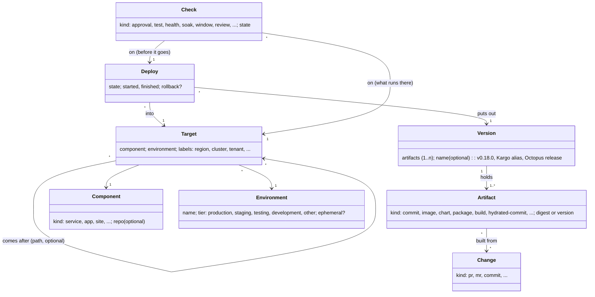
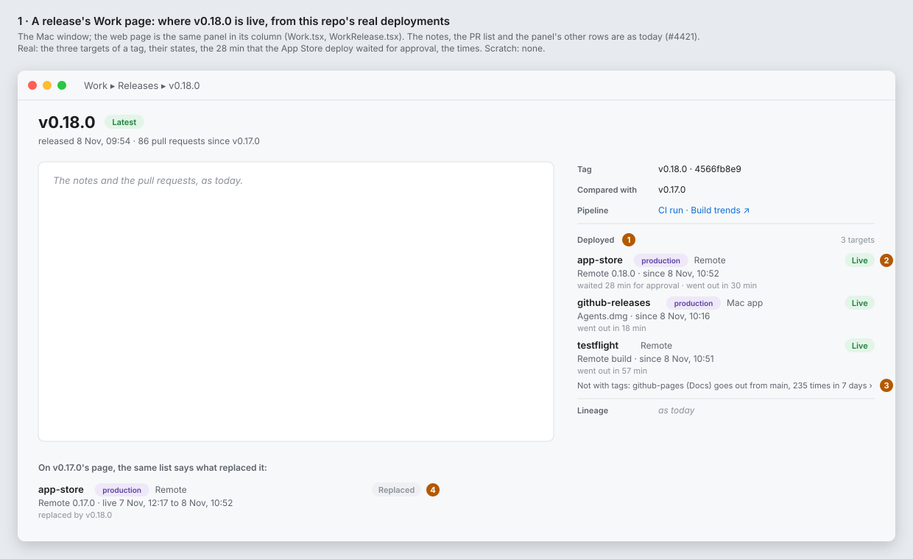
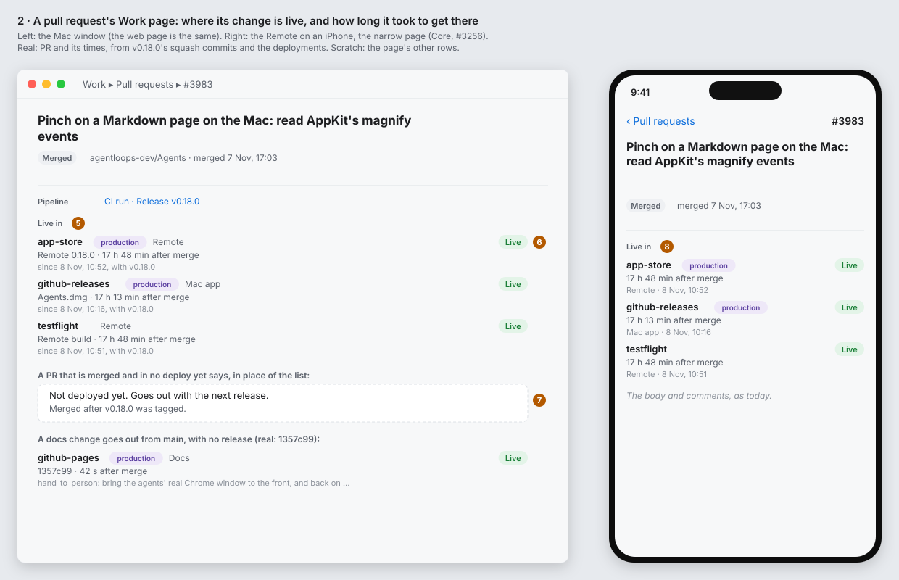
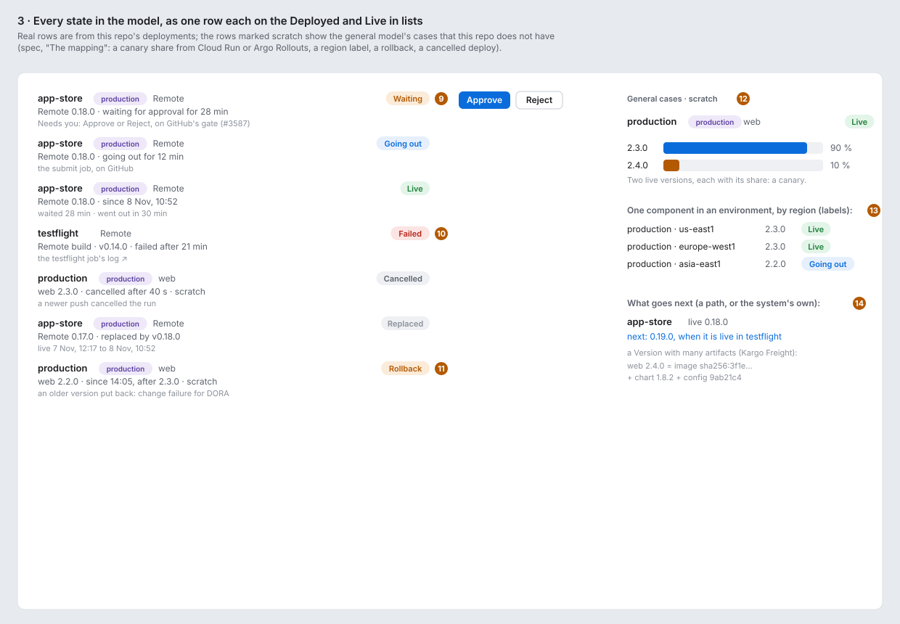
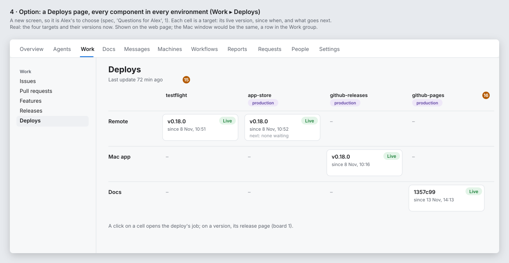
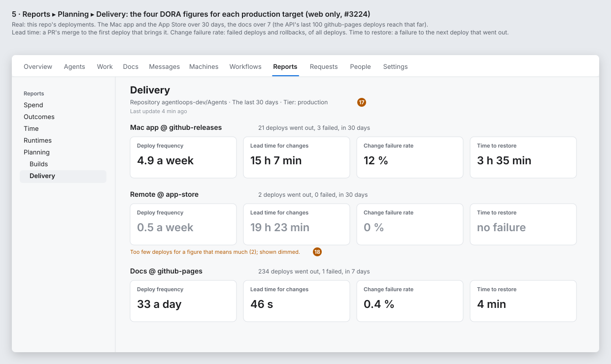
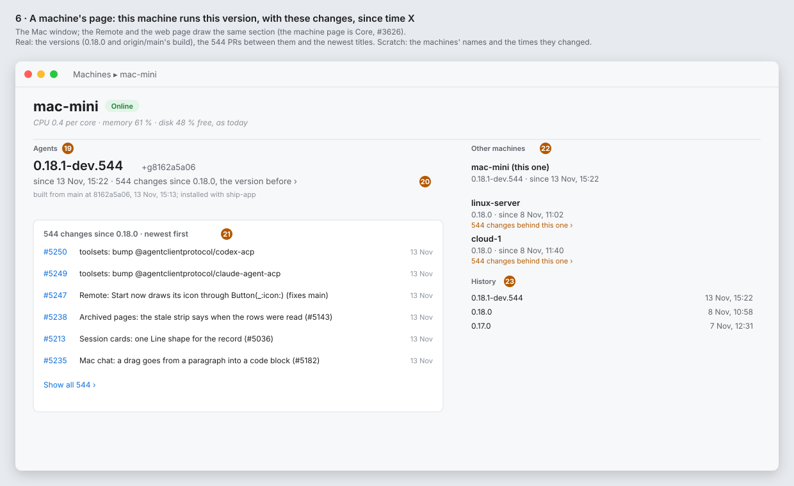

# Deploys: a general type model for changes, versions, environments and deploys

**Status:** revised on Alex's direction (2026-11-13): "I don't want to be opinionated about the data model. I want one that is general enough to work for all systems." **Epic:** #5239. **Feature:** `feature:delivery`. **Comes from:** #5166, "Later: releases and deploys".

## Alex's direction (2026-11-13)

1. The first model: a **Release** has a **Changeset**, which refers to many **Changes** (PRs). A **Deploy** puts a Release into one **Environment**.
2. Then: the model takes no side. It must work for every deploy system, not only for the way this repo deploys.

This spec gives a general model, then shows that each system maps to it with no loss of meaning (the mapping table), and that the simple case (one repo, one commit, GitHub environments) stays simple (the defaults).

## How the model stays general

These rules decide every choice below:

1. **The model takes the widest form that a real system has.** When one system has a set and another has one item, the model has a set. A set of one is the simple case.
2. **A system's own words and states are kept** beside the model's: `kind` is an open string, and each item keeps its system, its id there and its raw state.
3. **Who does the work is not part of the model.** A system that runs the promotion (Argo CD, Kargo, GitOps Promoter, Octopus) and a system that only records it (GitHub Deployments) give the same types. Agents observes in both cases.
4. **Defaults fill what a system does not say.** A system that says only "sha X went to production" fills the model, because each missing type has a default.
5. **Only what all systems share is a required field.** The rest is optional or a label.

## What we have now

| Type | In lineage now | Ref now | Source now |
|---|---|---|---|
| Change | `pr` | `github:pr:alexec/agents#4702` | the forge |
| Release | `release` | `github:release:alexec/agents#v0.18.0` | `git ls-remote --tags`, once an hour (#3023) |
| Changeset | the `part-of` links from PRs to a release | none: no node | the forge's compare API, from the previous `v*` tag |
| Deploy | `deploy` | `testflight:<bundle id>/<build>`, `appstore:<bundle id>/<version>`, `cloudrun:<project>/<region>/<service>/<revision>` | a job's `::notice title=deploy::…`, read from `run.completed` on a `v*` tag (#3584, #3654, #3657) |
| Environment | `target` | `target:testflight:<bundle id>` | the prefix of the deploy notice |
| (gate) | none: an approval | `owner/name/<run id>` | GitHub's pending deployments (#3587), the `deploy.waiting` event |

What is not right now:

1. **A `deploy` node is an artifact, not a deploy.** `testflight:…/812` is the build that was uploaded.
2. **A `target` is not an environment.** It is a kind of place and an app, from a string in CI.
3. **A deploy has no state and no time.**
4. **A deploy needs a release.** Only a run on a `v*` tag is read, so a deploy from `main` is lost.

## What the real data says

Read from alexec/Agents's GitHub Deployments API on 2026-11-13:

1. **GitHub already records a Deployment for each job with `environment:`**, with statuses `waiting` → `queued` → `in_progress` → `success` or `failure` → `inactive`. No change to CI is needed to get this. GitLab, Azure DevOps and Bitbucket have the same records.
2. **A forge environment is not always a place.** `release` is a scope for the release secrets: two jobs of each tag use it, and GitHub sets the first one `inactive` when the second ends.
3. **Most deploys have no release.** `github-pages` got 100 Deployments in 3.5 days, one for each push to `main`.
4. **One job can deploy to two places** (`app-store.yml`: TestFlight and the App Store).

## The model

### The types

| Type | What it is | Required | Default when a system does not say |
|---|---|---|---|
| **Change** | one unit of work that changes what is built: a PR, an MR, a commit | its ref | the commits' PRs, from the forge |
| **Artifact** | one immutable thing that a build made or that a deploy uses: a commit, an image digest, a Helm chart version, a package version, a mobile build, a hydrated commit | `kind` and an id (a digest, or a version) | the commit itself |
| **Version** | the set of artifacts that go out together. One artifact is the simple case. A **Release** is a Version with a name | one artifact or more | one artifact: the commit |
| **Component** | what runs and has versions: a service, an app, a site | an id | the repo |
| **Environment** | a place where components run. It can be shared by many components and many repos. It has a **tier** (`production`, `staging`, `testing`, `development`, `other`, as GitLab's) and can be ephemeral (a preview for each PR) | a name | the forge environment, or the deploy notice's name |
| **Target** | one component in one environment, and any more labels that a system uses to tell instances apart (region, cluster, namespace, tenant). It is where a version runs | component and environment | component × environment, with no labels |
| **Deploy** | one try to put a Version into a Target | target, version, state | |
| **Check** | a condition with a state: an approval, a test, a health status, a soak time, a window, an App Review. **Before** a deploy it can hold it; **after** a deploy it says how what runs there is | `kind`, state | none |
| **Path** | an optional order between targets: "after staging, production". A DAG, not a list | | none |

### What is computed, not stored

- **A Target's live versions:** the versions that run there now, each with its **share** of the traffic. Usually one at 100 %. Two during a canary or a blue-green switch (Argo Rollouts, Flagger, Cloud Run traffic splits, Spinnaker).
- **A Target's next versions:** what will go there next. A deploy that is waiting or running there; when there is a path, the live version of the target before it; or a system's own "proposed" (GitOps Promoter, Kargo).
- **A Changeset:** the Changes between two Versions, through each artifact's "built from". There are two uses: a release's changeset (from the Release before it) and what a deploy brings (from the target's live version before the deploy). When a Version holds artifacts from many repos, the changeset spans those repos.
- **A rollback:** a deploy whose version is older than the live version it replaced. A system that says it (GitOps Promoter's `RestoreActiveCommit`, `helm rollback`, CDEvents `service.rolledback`) sets it directly.
- **Replaced:** a deploy is replaced when a newer deploy to the same target has succeeded. It is not taken from a system's own word for it (finding 2).

### What a target reports: observed versions

A deploy says what a system **did**. A target can also say what it **runs**: Argo CD's live state, the images in a Kubernetes pod, a machine's own version when it connects. The two can differ: a deploy that said `success` and a pod that did not start, a machine that someone updated by hand, an iPhone that TestFlight updated by itself.

- **An Observation** is a target's report of the version it runs, with the time of the report. It is not stored for each report: only a change is kept.
- **When a target reports, its report wins** for its live version. When it does not, the live version comes from its deploys.
- **A change in the reported version is a deploy** with `source: observed`: from the last report of the old version to the first report of the new one. So "since when" is known to within the time between two reports, and the deploy, its changeset and its DORA figures work as for any other.
- **A deploy that a system says succeeded and a report that does not agree** is drift: the target's row says both.

Every system in the mapping table that has a live state (Argo CD, Kargo, Flux, Kubernetes rollouts, Cloud Run) gives observations as well as deploys.

### Alex's question: "this machine has this version, with these changes, since time X"

Alex (2026-11-13): *Will we be able to clearly say "this machine has this version with these changes since time X"?* Yes, with the observation above. What there is today and what is missing:

| Part | There today | Missing |
|---|---|---|
| **This machine** | each machine's id and name (`ControlMachine`) | nothing |
| **Has this version** | each host sends `version` in `machine/hello` on each connect, and the control plane keeps it on `ControlMachine.version` | nothing |
| **With these changes** | the version names its commit: a tagged build is `0.18.0` (the tag `v0.18.0`), an untagged one `0.18.1-dev.544+g8162a5a06` (`scripts/version.sh`: the commit after `+g`). So the changes are the PRs between two versions' commits, through the forge's compare API, as a release's changeset is | the version before: nothing keeps it |
| **Since time X** | none: the control plane keeps only the version now | a record of each change of a machine's version, with the time of the first `machine/hello` at the new version (#5272) |

In the model: the component is **Agents** (the host: agentsd and, on a Mac, the app that carries it), the environment is the project's machines, and each machine is a target with the label `machine`. A host's restart after an update sends `machine/hello` at once, so "since" is the restart's time, to within seconds.

So a machine's page can say: *Agents 0.18.1-dev.544 · since 13 Nov, 15:22 · 544 changes since 0.18.0, the version before* (board 6). And two machines can be compared: *the Linux server is 544 changes behind this Mac*.

The same holds for the Remote on an iPhone or iPad when the Remote sends its version when it pairs (not filed yet), and for any target that reports.

### Deploy states

Five states. Every system's states map to them, and the raw state is kept:

| State | GitHub | GitLab | Argo CD | Kargo | Octopus | Kubernetes rollout |
|---|---|---|---|---|---|---|
| `waiting` | `waiting` | `blocked` | (sync window) | `Pending` | Queued (manual step) | paused |
| `running` | `queued`, `in_progress` | `created`, `running` | `Running` | `Running` | Executing | progressing |
| `succeeded` | `success` | `success` | `Succeeded` | `Succeeded` | Success | complete |
| `failed` | `failure`, `error` | `failed` | `Failed`, `Error` | `Failed`, `Errored` | Failed, TimedOut | degraded |
| `cancelled` | (run cancelled) | `canceled` | `Terminating` | `Aborted` | Canceled | aborted |

### Refs

Each item keeps the system that said it: `<system>:<type>:<topic>#<id>`, as the refs of #4724 do.

| Type | Ref | Example |
|---|---|---|
| Artifact | `<system>:artifact:<topic>#<id>` | `oci:artifact:ghcr.io/alexec/agents-control#sha256:…`, `testflight:artifact:com.alexecollins.agents.remote#812`, `github:artifact:alexec/agents#645acc7` |
| Version | a Release's ref when it has a name, else its one artifact's ref, else `<system>:version:<topic>#<id>` | `github:release:alexec/agents#v0.18.0`, `kargo:version:my-project#<freight id>` |
| Component | `<system>:component:<topic>#<id>` | `github:component:alexec/agents#alexec/agents` (the default: the repo) |
| Environment | `<system>:environment:<topic>#<name>` | `github:environment:alexec/agents#app-store`, `argocd:environment:prod-cluster#prod` |
| Target | `<system>:target:<topic>#<component>@<environment>` (labels after `/`) | `github:target:alexec/agents#alexec/agents@app-store` |
| Deploy | `<system>:deploy:<topic>#<id>` | `github:deploy:alexec/agents#7639583967`, `argocd:deploy:prod-cluster#guestbook/42` |

## The mapping: each system in the model

| System | Change | Artifact | Version | Component | Environment | Target | Deploy | Check | Path |
|---|---|---|---|---|---|---|---|---|---|
| **GitHub Deployments** | PR | the sha | the sha (one artifact) | the repo | environment | repo × environment | Deployment | protection rules (approval, wait timer, branch policy) | none |
| **GitLab** | MR | the sha | the sha | the project | environment (with tier) | project × environment | deployment | protected environment approvals | none |
| **Azure DevOps** | PR | the sha, pipeline artifacts | a pipeline run | the repo or pipeline | environment | pipeline × environment, with resources | deployment job | approvals and checks | stages |
| **Argo CD** | | revision, images | the revisions of a sync (more than one for a multi-source app) | the app | the destination (cluster, namespace) | Application | sync operation | health, sync windows | none (ApplicationSet progressive sync has steps) |
| **GitOps Promoter** | PR | dry commit, hydrated commit | the dry sha | the repo | environment branch | the branch pair (`ChangeTransferPolicy`) | merged promotion PR; `RestoreActiveCommit` is a rollback | `CommitStatus`: proposed (before) and active (after) | `PromotionStrategy` (a list or a DAG) |
| **Kargo** | | commits, images, charts, other artifacts | Freight | the Warehouse's subject | Stage's place | Stage | Promotion | verification, promotion windows | Stage's upstream Stages (a DAG) |
| **Octopus Deploy** | | packages | Release (a set of packages) | Project | Environment | Project × Environment (× Tenant) | Deployment | manual intervention, steps | Lifecycle phases |
| **Spinnaker** | | images, manifests | a pipeline's artifacts | Application | account, region | server group (cluster) | deploy stage | manual judgement, canary analysis | the pipeline's stages |
| **Flux** | | revision | the source revision | Kustomization or HelmRelease | cluster, namespace | the Kustomization or HelmRelease | a reconcile with a new revision | health checks | none (`dependsOn` is between components) |
| **CDEvents 0.5** | `change` | `artifact` | `artifact` | `service` | `environment` | service × environment | `service.deployed`, `upgraded`, `rolledback` | `testcaserun` | none |
| **TestFlight / App Store** | | the build | the version (marketing version) with its build | the app (bundle id) | TestFlight, App Store (tier production) | app × place | upload, submission | App Review, beta review | TestFlight → App Store |
| **Cloud Run** | | the image digest | the revision | the service | project, region | service in a region | a new revision | traffic share (several live versions) | none |
| **Vercel, Netlify** | PR | the build | the commit | the project | production, preview (ephemeral, one for each PR) | project × environment | deployment | checks | preview → production (promote) |

Every row fits with no new type. The lines that test the model:

- **Kargo, Octopus, Argo CD multi-source** need a Version with many artifacts.
- **Octopus tenants, Cloud Run regions, Argo CD clusters** need a Target with labels, not only component × environment.
- **Argo CD and Kargo environments** are shared by many components, so an Environment does not belong to one repo.
- **Cloud Run, Argo Rollouts, Flagger** need more than one live version, each with a share.
- **Vercel previews, GitLab review apps** need ephemeral environments.
- **GitOps Promoter and Kargo** need a "next version" that the system itself says, and a Path that is a DAG.
- **GitHub, with this repo's `release` environment**, needs "replaced" to be computed, not taken from the system.

## The simple case stays simple

For a GitHub repo that deploys with `environment:` jobs, the defaults fill everything:

| Type | Filled from |
|---|---|
| Artifact and Version | the Deployment's sha (with its `v*` tag as the Release's name) |
| Component | the repo |
| Environment | the Deployment's environment, or the deploy notice's name (`::notice title=deploy::<environment>=<artifact ref>`) |
| Target | repo × environment |
| Deploy | the Deployment and its statuses |
| Check | the environment's required reviewers, as a waiting deploy (#3587) |
| Path | none |

A notice that names an artifact (`testflight:…/812`, an image digest) adds it to the Version. So one TestFlight build that goes to TestFlight and then to the App Store is one Version deployed to two Targets.

## Events

In the style of the events we have (`noun.verbed`, CloudEvents 1.0 envelope), from each system's MCP server:

| Event | When | Details |
|---|---|---|
| `deploy.waiting` | there now (#3587) | stays, with the fields below |
| `deploy.started` | a deploy goes `running` | target, component, environment, tier, version (name, artifacts), deploy ref, url |
| `deploy.succeeded` | a deploy goes `succeeded` | the same, `rollback: true` when it is one, and the share when it is less than 100 % |
| `deploy.failed` | a deploy goes `failed` or `cancelled` | the same, `outcome: failed \| cancelled` |
| `check.changed` | a check on a deploy or a target changes state | the check's kind, state, and what it is on |

Filter by `environment`, `tier` and `component`, so a workflow can start on "a deploy to any production environment failed" (`tier: production`) with no list of names.

## Lineage

| Node kind | Type | Replaces |
|---|---|---|
| `pr`, `commit` | Change | as now |
| `artifact` | Artifact | the `deploy` nodes of today (they are artifacts) |
| `release` | a named Version | as now |
| `component` | Component | new |
| `environment` | Environment | `target` |
| `target` | Target | the old `target` kind takes its right meaning |
| `deploy` | Deploy | new meaning: one try |

| Link | From → to |
|---|---|
| `part-of` | PR → release (a release's changeset, as now) |
| `built-from` | artifact → commit |
| `part-of` | artifact → release, when the Version has a name |
| `deploys` | deploy → release, or deploy → artifact when the Version has no name |
| `part-of` | deploy → target; target → component; target → environment |
| `builds` | ci-run → artifact, as for a release now |
| `seen-in` | health → deploy, as now |

A Version with no name and many artifacts (Kargo Freight with no alias) gets a `version` node, so the deploy has one node to link to.

Checks are not nodes. They are events and details of a deploy or a target. Deploy timings are not in lineage (#5166's decision): a later epic stores them.

## What it gives us

- On a PR's and a release's Work page: the targets where it is live, the share, since when, and what waits to go next.
- On Reports ▸ Planning ▸ Delivery: the four DORA figures for each component, counted on the `production` tier. A repo with no tier says which environment is production in the forge (GitLab) or by its name, `production` or `prod`.
- In workflows: `on: deploy.failed` with `tier: production`.

## The boards

Alex (2026-11-13): wireframes and mocks of the UX early, before the code. Paper palette, light mode, as spec 5166's boards. `fetch.py` reads this repo's real GitHub Deployments (the last 30 days of `release` and `app-store`, 7 days of `github-pages`), its version tags and the PRs in each into `data.json`; `boards.py` draws the boards from it (`python3 fetch.py && python3 boards.py` in this folder). The raw answers stay in `/tmp/deploy-model-cache`. What is scratch is said on each board. The orange numbers are the notes below.

This repo's deployments as targets (the names come from the deploy notice of #5242):

| GitHub environment / job | Component | Environment | Tier |
|---|---|---|---|
| `release` / `mac` | Mac app | `github-releases` | production |
| `release` / `testflight` | Remote | `testflight` | testing |
| `app-store` / `submit` | Remote | `app-store` | production |
| `github-pages` | Docs | `github-pages` | production |

What the data showed: in 30 days, 21 Mac app deploys went out and 3 failed; the Remote's TestFlight deploys, 18 and 6; the App Store, 2 and 0 (it began with v0.17.0); the docs, 235 and 1 in 7 days. v0.18.0's App Store deploy waited 28 min for Alex's approval and then took 30 min.

### Note by note

1. **Deployed**, a new section in a release's panel (Mac, Remote and web: the Work pages are Core). One row for each target that the release went to: the environment, its tier when it is `production`, the component, what went out, the state, since when.
2. **The gate's wait is said:** *waited 28 min for approval · went out in 30 min*, from the deploy's `waiting` and `running` times. It is the figure that tells a person where a release's time went.
3. **A target that does not take tags** is one line, not a row: the docs go out from `main`, 236 times in 7 days. The line opens board 4 (or, with no board 4, the docs' own deploys).
4. **On an older release's page**, the same row says *Replaced* and by what, with the time it was live.
5. **Live in**, a new section on a PR's page: the targets that its change reached, through the deploys that bring it (the spec's second changeset).
6. **Lead time, on the PR itself:** *17 h 48 min after merge*. It is the DORA lead time for one change.
7. **A merged PR in no deploy yet** says so in place of the list: *Not deployed yet. Goes out with the next release.*
8. **The Remote on an iPhone**: the same rows, with the component under the line in place of beside the environment.
9. **Waiting** has Approve and Reject when the person is one of the gate's reviewers: today's Needs You approval (#3587), now on the row too.
10. **Failed** opens the job's log. The row says how long it ran before it failed.
11. **Rollback** is its own state on the row (amber), because it counts as a change failure.
12. **Two live versions with shares** (a canary): a bar for each. Shown only when a target has more than one live version.
13. **Labels** (region, cluster, tenant): one row for each target of a component in an environment.
14. **Next**, from a path or from the system's own "proposed": *next: 0.19.0, when it is live in testflight*. A Version with many artifacts lists them in the row's details.
15. **Last update** (#5139): the page reads the deploys from an earlier read.
16. **Board 4's columns** are the environments, in tier order (testing, then production). The rows are components. A cell is a target.
17. **DORA by tier**: the figures are for the `production` tier, a block for each production target. The filter is the Reports filter, with Tier added.
18. **Too few deploys:** under 5 in the range, the figures are drawn dimmed, with the count, rather than hidden.
19. **Agents**, a new section on a machine's page (#5273; Core): the version this machine runs, from its own report (an observation), not from a deploy.
20. **Since when, and the changes:** *since 13 Nov, 15:22* is the first `machine/hello` at this version (#5272). *544 changes since 0.18.0, the version before* are the PRs between the two versions' commits; the line opens them.
21. **The changes, newest first**, with *Show all*. Real titles from `v0.18.0..origin/main`.
22. **Other machines:** each one's version and how many changes it is behind (or ahead of) this one, so a person sees which machine runs old code.
23. **History:** the last versions this machine ran and when each came (at most 20, #5272).

### Alex's answers (2026-11-13)

1. **A Deploys page (board 4): yes, Mac + web.** A new screen in Work, beside Releases, on the Mac window and the web page; the Remote has none (tier mac+web). Story #5270.
2. **Where the list sits (boards 1 and 2): a section of its own** in the panel: *Deployed* on a release, *Live in* on a PR, as drawn.
3. **Approve on the row (board 3, note 9): yes, on the row too**, for the gate's reviewers only: the same approval as Needs You (#3587).
4. **The boards: approved** ("LGTM", after asking first for changes and then naming none), as the direction for #5243, #5245 and #5270 (#5268).
5. **Board 6 (what a machine runs): approved** ("LGTM", 2026-11-13), as the direction for #5272 and #5273.

## Prior art

The mapping table above is the prior art. Two notes:

- **GitOps Promoter** (`argoproj-labs/gitops-promoter`, v0.49.0): its active and proposed states for each environment are the model's live and next versions. Its proposed and active commit statuses are the model's checks before and after a deploy. Its move from a list of environments to a DAG (0.38 → 0.39) is why the Path is a DAG from the start.
- **Kargo** (`akuity/kargo`, v1.12.5): its Freight ("a collection of versioned artifacts": commits, images, charts, others) is why a Version is a set.

## Decisions

Alex (2026-11-13): the model is general, not opinionated. This replaces three of the first answers of the same day:

| First answer | Now | Why |
|---|---|---|
| A deploy puts out a Version, a commit | A Version is a set of artifacts; a commit is the default artifact | Kargo, Octopus and Argo CD multi-source put out more than one artifact |
| The artifact is a detail of the deploy | The artifact is a type | Versions are made of artifacts, and one artifact goes to many targets |
| A Release and an Environment belong to one repo | An Environment is shared; a Target is component × environment with labels; a Version can span repos | Argo CD, Kargo and Octopus share environments; tenants and regions need labels |

It keeps: where an Environment's name comes from in the GitHub case (the notice, else the job's forge environment), now as one system's mapping, not a rule of the model.

Decided by the Product Owner (in #5239; Alex can overrule): five deploy states with the raw state kept; "replaced" and "rollback" computed; live versions with shares; a Path as a DAG; checks as events, not nodes; tier as GitLab's five values; no CDEvents type names.

## Later

- **Deploy sources beyond the forges:** Argo CD, Kargo, GitOps Promoter, Flux, Octopus, each as an MCP server's events in this model. The mapping table is their spec.
- **Path:** read from the systems that have one (GitOps Promoter, Kargo, Octopus Lifecycles, Azure DevOps stages); a person can say one for the rest.
- **Deploy trends:** how long deploys take, on the same page and store as the CI build trends (#5166).
- **CDEvents at the edge:** the model's events sent out as CDEvents, only when someone asks for it.
