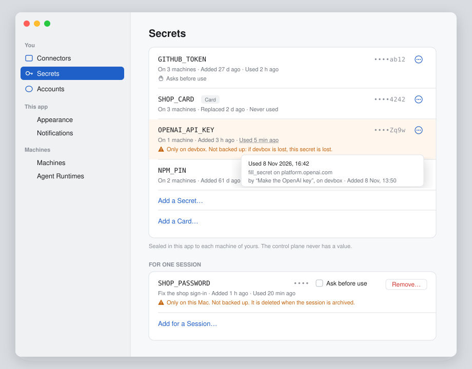
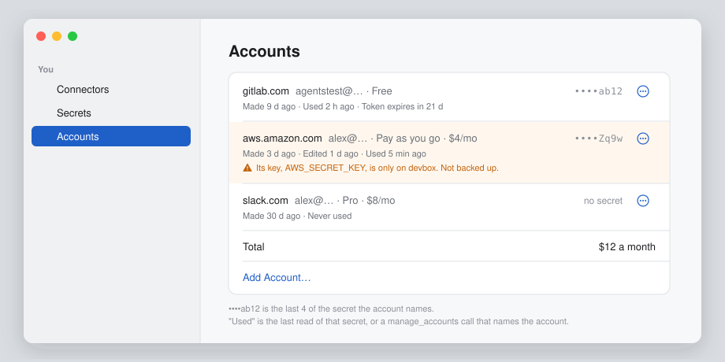
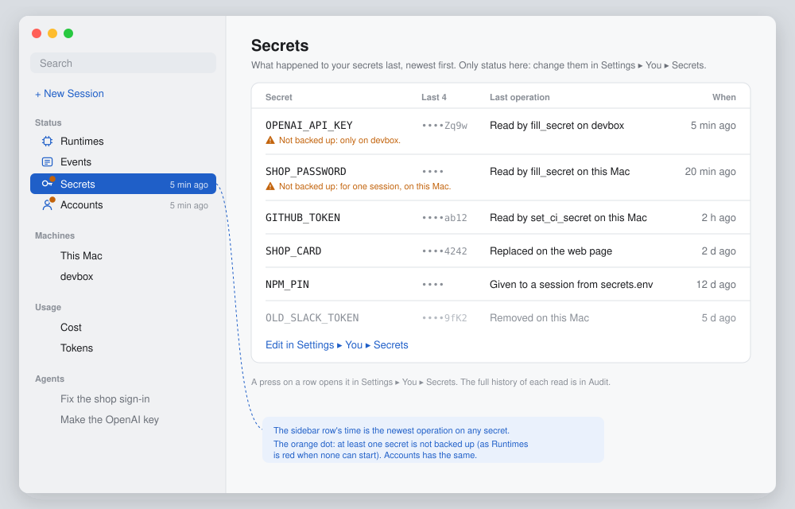
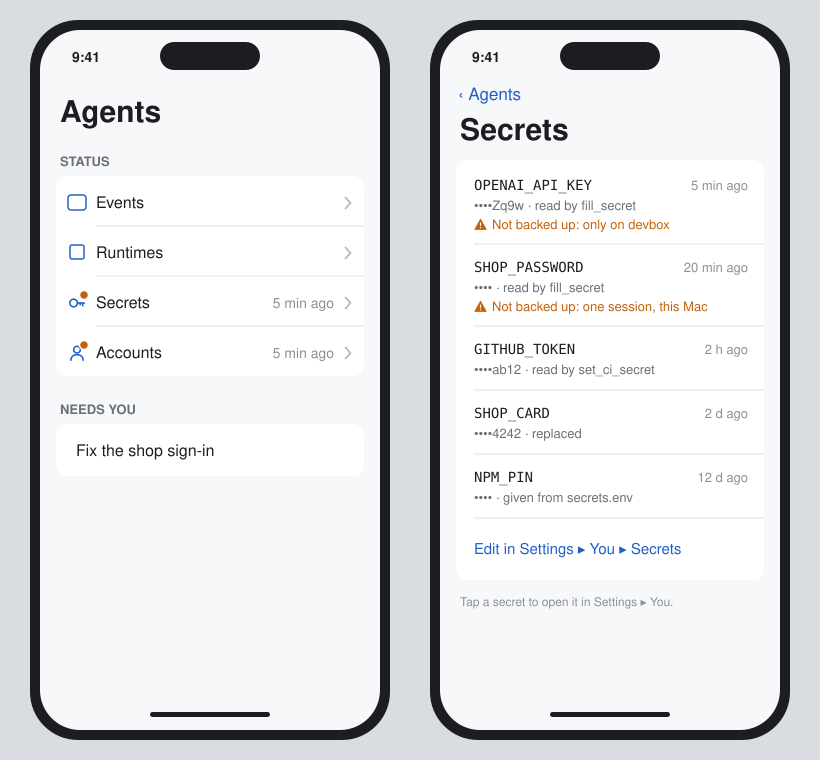

# Wireframe: what a secret's row tells you

Alex, 2026-11-08: show info for each secret. To know if a secret is the one you expect, show its last 4
characters. Show when it was added and when it was last used, as an age ("3 d ago"). When a secret is read,
record an audit entry and an event (`secret.read`). A secret that is only on one machine is not backed up:
show a warning on it. Epic #4155 (children #4156–#4161). The names and values below are made-up examples.

Alex, later the same day: the same applies to accounts. Status must show both secrets and accounts, each with
a "time ago" for the last operation on it (sections 8 and 9).

Clients: **all three.** Secrets and Accounts moved from Mac + web to Core on 2026-11-07 (#4030), so the Remote
gets its Secrets and Accounts pages from that epic, and this work adds the same lines to them. Status is Core
already.

## Hi-fi

Drawn in the app's own colours (`Shared/UI/Paper.swift`): ground, raised, rule, the cobalt accent, and the
attention orange for the warning. Made-up data.

**Mac, Settings ▸ You ▸ Secrets:** the last 4, the age line, the warning, the hover on "Used", and For One
Session.



**Mac, Settings ▸ You ▸ Accounts:** the last 4 of the account's secret, Made / Edited / Used, and the warning
from its key.



**Mac, Status ▸ Secrets:** the two new sidebar rows with their age and the orange dot, and the read-only
list. Status ▸ Accounts is the same, a row per account.



**iPhone (the Remote), Status and Status ▸ Secrets.** The web page draws the Mac's list under the bar's
Status section (`#/status/secrets`).



## 1. Settings ▸ You ▸ Secrets, today and after

Today a row has the name, "On 3 machines", and lines for Asks before use, waiting copies and a removed
machine. After, each row has one more line, and the end of its name line has the last 4:

```
┌ Secrets ─────────────────────────────────────────────────────────────────────┐
│                                                                              │
│  GITHUB_TOKEN                                         ••••ab12     (⋯)       │
│  On 3 machines · Added 27 d ago · Used 2 h ago                               │
│  ✋ Asks before use                                                          │
│ ──────────────────────────────────────────────────────────────────────────── │
│  SHOP_CARD   Card                                     ••••4242     (⋯)       │
│  On 3 machines · Added 4 d ago · Never used                                  │
│ ──────────────────────────────────────────────────────────────────────────── │
│  OPENAI_API_KEY                                       ••••Zq9w     (⋯)       │
│  On 1 machine · Added 3 h ago · Used 5 min ago                               │
│  ⚠ Only on devbox. Not backed up: if devbox is lost, this secret is lost.    │
│ ──────────────────────────────────────────────────────────────────────────── │
│  NPM_PIN                                              ••••         (⋯)       │
│  On 2 machines · Added 61 d ago · Used 12 d ago                              │
│ ──────────────────────────────────────────────────────────────────────────── │
│  Add a Secret…                                                               │
│  Add a Card…                                                                 │
└──────────────────────────────────────────────────────────────────────────────┘
```

| Part | What it shows | Rule |
|---|---|---|
| **••••ab12** | The last 4 characters, in the code font, grey. | Only for a value of 16 characters or more. A shorter value shows `••••` only (`NPM_PIN`), because 4 of 6 characters is most of the secret. A card shows the last 4 of its number, as a bank does. |
| **Added 27 d ago** | When the name was first set. Replace… does not change it. | Hover (the web: `title`) gives the date and time: "Added 12 Oct 2026, 09:14". |
| **Replaced 2 d ago** | Takes the place of "Added" after a Replace…, so you see the value is new. | Hover gives both dates. |
| **Used 2 h ago** | The last read by any machine of yours. "Never used" when none. | Hover gives the time, the machine, the session and the use: "fill_secret on github.com, by *Fix the sign-in*, on devbox". |
| **⚠ Only on …** | The attention tint, as the waiting line is today. | Section 4. |

The `(⋯)` menu does not change. The page has no new control, so it is "Approval: not needed" (#3474),
except for the one option in section 5.

## 2. Settings ▸ You ▸ Secrets ▸ For One Session

The same line. A secret for one session is only on the Mac (or machine) that holds the session, so it always
has the warning:

```
│  For One Session                                                             │
│  SHOP_PASSWORD                         ••••         [ ] Ask before use  Remove…  │
│  Fix the shop sign-in · Added 1 h ago · Used 20 min ago                      │
│  ⚠ Only on this Mac. Not backed up. It is deleted when the session is archived. │
```

## 3. Where each value comes from

The control plane never has a value (#3397), and keeps nothing it could misuse (direction.md, principles 6
and 7). So:

| Value | Who knows it | How a client gets it |
|---|---|---|
| Last 4 | Only a machine that holds a copy. | Each machine keeps a **hint** beside its copy: the last 4 when the rule allows, else none. It sends the hint with its state, as it sends that it has a copy. The control plane passes it to the person's clients and does not write it to its store (Decided below). |
| Added | The control plane (its first `version` for the name). | A new `created` field on `UserSecretRow`. |
| Used | The machine that read it. | The machine writes the time in its own record and sends `secret.read` (section 6). The control plane keeps the last one per name in memory and in the row, as `lastUsed` (the time only: no session, no place). |
| Only on one machine | The row's `machines`. | Section 4. |

## 4. The warning: not backed up

The control plane keeps each person's secret sealed to each machine's key. Only a machine can open its own
copy. So a secret with one copy that opens is lost with that machine:

- **A person's secret on one machine** (`machines` has one, `waiting` is empty): "⚠ Only on devbox. Not backed
  up: if devbox is lost, this secret is lost." When `waiting` is not empty, the waiting line is shown, and not
  this one: a copy is coming.
- **A secret for one session:** always (section 2).
- **A person with one machine only** sees the warning on every row. Then one line at the top of the page says it
  once ("Your secrets are only on this Mac. Add a second machine to keep a copy.") and the rows have no
  warning. Open question 3.

## 5. One new control (not now)

Decided in #4155: not now. Status ▸ Secrets shows the last operation, and Audit has the full history.


`(⋯) ▸ Show Uses…` opens the person's Audit (Control plane ▸ Audit, #996), filtered to this secret's name.
The audit list is the full history; the row has only the last use. Without it, a person reads the audit by
hand. It is in the menu only, so the row stays the same size. It can go to a later story.

## 6. The record of a read

Every read through agentsd counts as a use:

| Use | Today | Records |
|---|---|---|
| `fill_secret` | agentsd types it into a page. | `secret.read`, use `fill`, place the field's domain. |
| `set_ci_secret` | agentsd sends it to GitHub. | use `ci`, place `owner/repo`. |
| An HTTP MCP server's header | agentsd puts it in (#4120). | use `mcp`, place the server's name. |
| `secrets.env` | agentsd writes the file; a runtime or an MCP server reads it at its start. | use `env`, place the session or the server, once at each start. A process that reads the file again later is not seen (open question 1). |
| An answer to Ask before use | already a request. | The use that follows records as above. A deny records `secret.denied`. |

- **The event** `secret.read` is on the machine's event stream, so `wait_for_event` and a workflow can use it:
  `{name, machine, agent, use, place, at}`. Never the value, never the hint.
- **The audit entry** goes to the control plane's audit, as each call does (`auditing.go`): action "Read a
  secret", target `GITHUB_TOKEN · fill · github.com`, who is the session's person and the machine. The audit's
  days (90 by default) and its sinks apply.
- **Many reads:** an MCP header is read on each call. One entry per secret, per session, per place, per
  minute, with a count, keeps the audit small (memory: bound data).

## 7. The web page and the Remote

The same rows, in `Web/src/views/UserScope.tsx` and `Web/src/views/settings/SessionSecrets.tsx`. The age uses the
page's own age words (the same as the session list's), and the date is in `title`. The Remote draws
`Shared/UI/UserScope/SecretsPane.swift` once #4030 puts it there, so it gets the lines from the same change; on
iOS a long press on the line gives what the hover gives.

## 8. Settings ▸ You ▸ Accounts: the same

An account holds no secret: its `secret` and `card` are names in Secrets. So its info comes from them, and from
its own record:

```
┌ Accounts ────────────────────────────────────────────────────────────────────┐
│  gitlab.com   agentstest@…   Free                     ••••ab12     (⋯)       │
│  Made 9 d ago · Used 2 h ago · Token expires in 21 d                         │
│ ──────────────────────────────────────────────────────────────────────────── │
│  aws.amazon.com   alex@…   Pay as you go   $4/mo      ••••Zq9w     (⋯)       │
│  Made 3 d ago · Edited 1 d ago · Used 5 min ago                              │
│  ⚠ Its key OPENAI… is only on devbox. Not backed up.                         │
│ ──────────────────────────────────────────────────────────────────────────── │
│  slack.com   alex@…   Pro                             no secret    (⋯)       │
│  Made 30 d ago · Never used                                                  │
└──────────────────────────────────────────────────────────────────────────────┘
```

| Part | Rule |
|---|---|
| **••••ab12** | The hint of the secret the account names, by the rule of section 1. "no secret" when it names none; "not in Secrets" when the name is not there (a secret kept somewhere else). |
| **Made 9 d ago** | The account's `made`. An account with no `made` (added by hand) gets the time it was first added. |
| **Edited 1 d ago** | After an add with the same service and address, or an Edit…. |
| **Used 2 h ago** | The last of: a `secret.read` of its secret or its card, and a `manage_accounts` call that names it (`list` with its service, `add`). |
| **⚠** | When its secret or its card is only on one machine (section 4). The accounts themselves are in the person's settings on the control plane and on every machine, so they are backed up. |

The record: `manage_accounts` writes an audit entry ("Listed accounts", "Added an account", target the service
and address) and an event `account.read` or `account.changed` `{service, address, machine, agent, at}`. A read
of the account's secret is a `secret.read` (section 6), and the account's "Used" follows it.

## 9. Status ▸ Secrets and Status ▸ Accounts

Two new rows in the Status group, after Events, on all three clients. Status is "status only, no settings", so
each opens a read-only list, newest operation first, with a "time ago" for the last operation of any kind (added,
replaced, edited, read, denied, removed):

```
Sidebar                         Status ▸ Secrets
─────────                       ┌───────────────────────────────────────────────────────────┐
Status                          │  OPENAI_API_KEY   ••••Zq9w   read by fill_secret    5 min ago │
  ⚙ Runtimes                    │                  ⚠ Not backed up                           │
  ≡ Events                      │  GITHUB_TOKEN     ••••ab12   read by set_ci_secret   2 h ago │
  🔑 Secrets          5 min ago │  SHOP_CARD        ••••4242   replaced                2 d ago │
  👤 Accounts         5 min ago │  NPM_PIN          ••••       read from secrets.env  12 d ago │
                                │                                                           │
                                │  Edit in Settings ▸ You ▸ Secrets                         │
                                └───────────────────────────────────────────────────────────┘
```

- **The sidebar row's time** is the newest operation on any of them. Its mark has the warning tint when any
  item is not backed up, as Runtimes' is when none can start (#587).
- **A list row** is the name, the hint, the last operation in words, and its age. A press opens that item in
  Settings ▸ You (the web: `#/settings/secrets`). No buttons on the Status page.
- **Status ▸ Accounts** is the same: `gitlab.com · agentstest@… · ••••ab12 · listed by manage_accounts · 2 h ago`.
- **The web:** two more pages under the bar's Status section, `#/status/secrets` and `#/status/accounts`, beside
  Runtimes and Events (`Web/src/model/nav.ts`).
- **The Remote:** two more rows in its Status group (`Remote/Sources/Sidebar/RemoteSidebar.swift`).

These are two new screens, so this part waits for Alex's approval (#3474). Sections 1 to 8 change only the look
of existing rows.

## 10. Where "last operation" comes from

Each machine keeps, for each secret and each account, its last operation and its time, and sends them with its
state. The control plane keeps the newest per name, in memory and on the row, as `lastOp` `{what, at, agent}`:
the session that did it, but no place and no value. The full history is the audit (section 5).

The sidebar's Status ▸ Secrets and Status ▸ Accounts rows show, in grey under the title, the item read last and
the session that read it (its title, from the sessions the client knows), only when the newest operation is a read
less than 4 hours old (Alex, 2026-11-11). The row's icon has no warning tint; "Not backed up" is on the page.

## Decided

- Decided: the last 4 only for a value of 16 characters or more, and the last 4 of a card's number, because 4
  characters of a short PIN or password are most of it. Alex can overrule.
- Decided: the hint comes from a machine and the control plane does not keep it, because the store must never
  hold part of a value in clear text (direction.md, Credentials; principle 7). Alex can overrule.
- Decided: one audit entry per secret, session, place and minute, with a count, because an MCP header is read on
  every call. Alex can overrule.

## Open questions

Answered in #4155 (Decided), except the first: whether `secrets.env` must move behind agentsd so each read is
seen. The first version records "given from secrets.env" once at each start.
