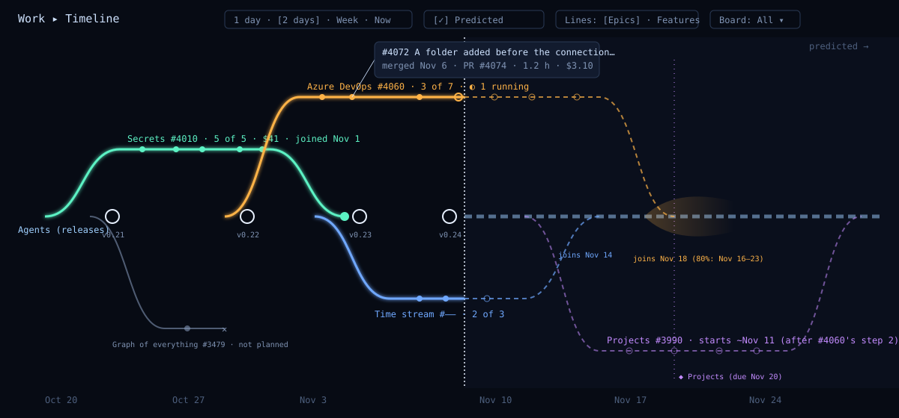
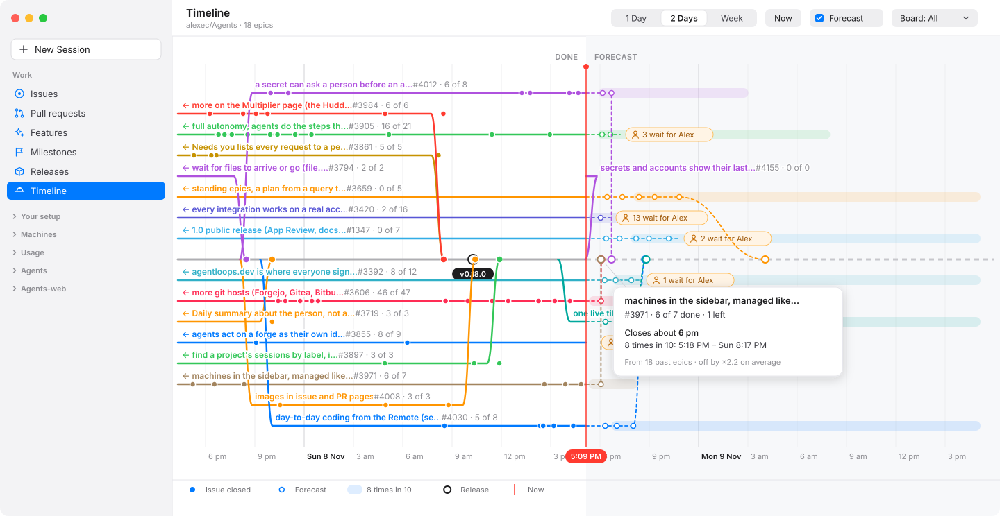
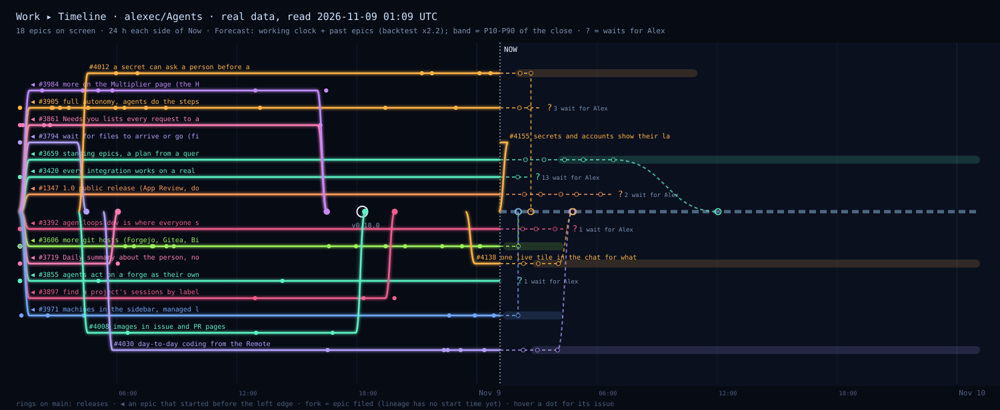

# Wireframe: Work ▸ Timeline (the "time stream")

Alex, 2026-11-08: a sci-fi "time stream" graph of the work. Each epic is a line that forks from a central
timeline, gets a dot for each issue that lands, and joins the timeline again when it is complete. Lines in the
future are predicted. The figures below are made-up examples. No issue yet.



## Hi-fi: the Mac window, day mode

Real data, drawn on 2026-11-09 by `hifi.py` (it uses `real.py`'s data and forecast). The times are Pacific.
Hover a dot for its issue. The card shows what a hover on a forecast join says.



- **Where:** a **Timeline** row in the sidebar's Work group, after Releases (#4004). The toolbar has the
  range (1 Day · 2 Days · Week), **Now**, **Forecast** and the Board menu.
- **Day mode:** a white plot, the forecast half on a light grey, the system colours for the features, the
  releases line in grey with black tag pills, and Now as a red line with its time in a red pill, as in
  Calendar. No glow: the sci-fi look is for night mode.
- **Labels:** the epic's name in its colour, then `#n · 6 of 8` in grey. A ← says that it started before
  the left edge.
- **Waits for Alex:** an orange pill with a person, "3 wait for Alex", where the forecast stops.
- **The band** (8 times in 10) is a soft bar on the epic's own line; the join is a hollow ring on the
  releases line. The card says "Closes about 6 pm", the range, and how far off past forecasts were.

## 0. The same, from real data

Drawn on 2026-11-09 from this repo's epics, their sub-issues and the releases (`real.py` draws it; it reads
only GitHub). It shows the default view: 24 h on each side of Now. Hover a dot or a line for its issue.



What the real data shows:

- **The scale is hours, not weeks.** The median epic lives 21 hours, from filed to closed, and in an epic a
  child closes every 0.7 h (median; 80% within 3.3 h). A linear time axis puts all the predicted work in a
  thin strip after Now, so the default range is short: 24 h on each side of Now.
- **Up to 15 epics are open at once** (11 now). The labels need their own space: a lane stays free until the
  name of the line before has ended, which gives 13 lanes on each side.
- **What holds an epic open is Alex, not the agents.** Of the 11 open epics, 6 end in "? waits for Alex"
  (`alex-todo` or `needs-account` children; #3420 has 13). The prediction cannot say when those land, so the
  line stops at "?" and does not join. This may be the most useful thing the view shows.
- **The fork in these pictures is the date the epic was filed,** because lineage has no start time per issue
  yet (section 8). The product forks when the first child starts (section 7).
- **The forecast** is the backtested method in section 4 (M10). The first prototype put one child every
  0.7 h; that was off by ×3.7.

## 1. What each part means

| Part | Meaning | From |
|---|---|---|
| **The trunk** | The releases line, named for the project. Solid up to Now, dashed (Forecast) after it. | — |
| **A ring on the trunk** | A release tag. | the forge's tags |
| **A line (a branch)** | An epic. Its colour is its `feature:` label. | `forge/plan` |
| **Where it forks** | The first child started (Alex). Not the date the epic was filed. | the earliest child start (section 8) |
| **A filled dot** | A child that closed, at its close time. Size = its cost. | the forge's `closedAt`, `lineage/cost` |
| **A ring on a line, at Now** | A child that is working now (◐). | the lead's lanes |
| **Where it joins** | The last child closed (Alex), not the epic's own close. A big dot on the trunk. | the latest child `closedAt` |
| **A dashed line, hollow dots** | Predicted: each open child at its estimated close. | `lineage/estimate` (#3557) |
| **The glow cone at the join** | The 80% range of the predicted join. | the estimate's p80 |
| **A line that ends in ✕** | Closed as not planned. It never joins. | `stateReason: not_planned` |
| **◆ dotted vertical** | A milestone's due date. | milestones |

### On the trunk (the releases line)

Only the release tags, as rings, and the epics that join it (Alex, 2026-11-08: "KISS. Just releases for the
moment."). No bugs, loose issues, PRs or broken-main marks for now.

## 2. Above and below the trunk

- The lines go above and below the trunk in turn, so the trunk is in the middle. A new epic takes the free
  lane nearest the trunk, so lines that run at the same time stay near each other.
- A line has its own lane only while it is open. When it has joined, its lane is free for the next one.

## 3. Controls

```
Work ▸ Timeline   [1 day · 2 days · Week]   [Now]   [✓ Predicted]   [Lines: Epics · Features]   [Board: All ▾]
```

- **Now is in the centre** when the page opens (Alex, 2026-11-08: most people will not go far back in
  history). The range is the same before and after Now.
- Decided: the default range is **2 days** (24 h each side), because the median epic lives 21 h, so an
  epic open now has most often started in the last day. Alex can overrule.
- **Range:** scroll or pinch to zoom time, drag to pan. **Now** goes back to the centre.
- **Only the epics that overlap the window are drawn** (Alex, 2026-11-08). An epic that joined before the
  left edge, or that starts (or is predicted to start) after the right edge, is not drawn.
- An epic that started before the left edge comes in from that edge with ◀. One that joins (or is predicted
  to join) after the right edge goes out of the right edge with ▶. An open epic that waits for Alex has no
  end, so it is drawn while it is open.
- **Predicted:** off draws the past only.
- **Lines: Features** puts each `feature:` on one line, its epics as segments one after the other on it. This
  gives a calmer view when there are many epics.
- **Hover a dot:** a card with the issue, its PR, the hours and the cost. **Click:** the issue's page.
  **Click a line:** the epic's page (its Plan, #3268).

## 4. How the forecast works

It uses only past data: the epics that closed before Now. `backtest.py` tests each method on the 18 closed
epics with 4 or more children. It stops the clock just after 25%, 50% and 75% of an epic's children closed
(43 to 53 test points), forecasts the close from what was known at that moment, and compares the result
with the real close. The error is `max(forecast/actual, actual/forecast)`.

| Method | Median error | Within ×2 | P10–P90 holds |
|---|---|---|---|
| M0 the first prototype: 0.74 h for each open child | ×3.67 | 18 of 53 | — |
| M1 the median gap of past epics × open children | ×2.31 | 19 of 43 | — |
| M2 this epic's own rate so far | ×3.29 | 18 of 53 | — |
| M3 a simulation of past epics' gaps | ×2.76 | 17 of 43 | 37 of 43 |
| M5 a simulation + scope growth | ×2.33 | 21 of 43 | 29 of 43 |
| M6, M7 past epics at the same fraction done | ×4.20, ×3.27 | 8, 15 of 43 | — |
| M8 a working clock + a simulation of past gaps | ×2.24 | 19 of 43 | 28 of 43 |
| M9 a working clock + a simulation + scope growth | ×1.93 | 22 of 43 | 28 of 43 |
| **M10 as M9, the growth still to come shrinks as the epic is done** | **×2.15** | **20 of 43** | **27 of 43** |

**Also tested at 90% done** (57 test points), because the Timeline shows epics at every stage: M8 ×2.27,
M9 ×2.52, **M10 ×2.22**. M9 adds 20% more children even to an epic that is 46 of 47 done ("more git hosts"
was forecast for the next afternoon). The simulation is random, so a figure moves by about ±0.05 from run to
run.

**Measured again on the span (#4172, 2026-11-08):** from the first child's start (here the opening of the
first PR that closes it, else its close) to the last child's close, as section 7 says, not filed to closed.
On 21 closed epics, cut at 25/50/75/90% (69 test points): M8 ×1.94, **M10 ×1.99**, M9 ×2.22. M10's P10–P90
held 46 of 69 (67%), so the host widens the band by the width factor its backtest finds. The host's
`work/timeline` runs this backtest in Go (`Go/internal/lineage/forecast.go`) at most once a day; on
`backtest.py`'s own filed-to-closed data it gives ×2.16 where `backtest.py` gives ×2.19.

**Why calendar time is hard:** 83% of an epic's life is in a few gaps longer than 3 h. They start mostly
at 20:00–21:00 and 06:00–07:00 Pacific, and children close mostly from 14:00 to 21:00 Pacific. The work
follows the day (Alex's hours and approvals), not a steady rate. #3557's estimates are good for the agents'
working hours (×1.45) but not for calendar time (×2.4), for the same reason.

Decided: **M10**, because it had the smallest error when tested at every stage, up to 90% done, and it
does not push out an epic that is nearly done. Alex can overrule.

1. **A working clock.** It runs at the rate that this repo closes issues at each hour of the day: fast at
   18:00 Pacific, almost stopped at 02:00. All the gaps are measured on this clock.
2. **Scope growth.** Past epics ended with ×1.2 the children they had when their first child closed: the
   lead files new children as it goes. An open epic gets `known × 0.2 × (1 − done/known)` more children:
   all of the growth at the start, none at the end.
3. **A simulation.** It draws one past gap (on the working clock) for each child left, adds them up,
   1,000 times, and turns the sums back into time of day: the median is the join, and P10–P90 is the band.
4. **"Waits for Alex"** children (`alex-todo`, `needs-account`) are not forecast. The line ends at "?".

**What this means for the UX:**

- Even the best method is off by ×2.2, and its P10–P90 holds the close only 2 times in 3. So the **band is
  the forecast**, not the dot. In `real.svg` most bands go past the right edge: "likely tonight, could be
  tomorrow". The join dot says "about".
- The P10–P90 must hold 8 times in 10. M9's holds 28 of 43 (65%), so the product shows a wider range
  (P5–P95), or calibrates it on the backtest.
- 18 epics is a small sample. The product runs the backtest again as epics close, and shows its error in
  the Timeline's help ("Forecasts were off by ×1.9").
- Not tried yet: "blocked by" order, the working hours from #3557 for each child, the lanes free, the
  queue. Try them in the spike, with the same backtest.

## 5. Sci-fi, but readable

- Dark background, lines with a soft glow, the trunk the brightest. In the light appearance, no glow: thin
  colour lines on paper.
- A dot that lands while the page is open moves along its line to its place and pulses once. With Reduce
  Motion: no movement and no pulse.
- At least 3:1 contrast for each line. The meaning never comes only from the colour: a line has its name
  written on it, and a predicted part is dashed.
- A screen reader gets a list in time order: "Azure DevOps, 3 of 7 done, joins about November 18".

## 6. Clients and name

**The Mac window first, the web page later, never the Remote** (Alex, 2026-11-08: "Only MacOS to start
with. Get the UX right." and "MacOS to start with, web later. Not remote."). The Mac's commit says
`web: #NNN` (the follow-up, after the Mac's UX is settled) and `remote: by design`.

Decided: the name is **Timeline**, a sixth row in the sidebar's Work group, after Releases (Issues, Pull
requests, Features, Milestones, Releases, Timeline; #4004). Because it says what the view is (the epics on a time axis) and promises
nothing more. Alex can overrule. The names it is not:

- **Roadmap** says that the dates are a plan someone committed to. Here they are a forecast for the next day.
- **Forecast** is only the half after Now.
- **Time stream** is the idea's name, not what a person looks for.
- **Epics** leaves out the time.

To keep the view honest:

- The part after Now is labelled **Forecast**, and every predicted date says "about" ("joins about 14:00").
- The centre line is the **releases** line, not `main`. An epic closing is not a merge: its PRs merged into
  `main` all along. The line's name is the project's name.
- A join is "closed", not "merged" or "shipped". It shipped with the next ring.

## 7. Settled (Alex, 2026-11-09)

1. **Horizontal.** Time goes from left to right.
2. **A line leaves the releases line when its first child starts.** An epic with no child started is not
   drawn in the past half. In the forecast half, it forks at its first child's forecast start.
3. **A line joins when its last child closes,** not when the epic issue is closed. When the lead files a new
   child after that, the line leaves again at that child's start: one epic can have more than one segment.
4. **A line is an epic** (decided, #4170), coloured by its `feature:`.

Consequences:

- An epic with no children is not drawn.
- The forecast measures from the first start to the last close. The backtest must be run again on that
  span (#4172): today's figures use "filed" to "closed", and the gap from filing to the first start is
  waiting, not work.
- "Waits for Alex" children are not forecast, so the line ends at the pill and does not join while one is
  open.

## 8. What it needs that is not there

- **A start time for each child.** The forge has no "started". Decided: a child starts at the **earliest** of
  (a) the first session linked to it in lineage (a link's `at`), (b) the first PR that closes it, opened,
  and (c) its close, when nothing else is known; because lineage already links sessions and PRs to issues,
  and this needs no new field on the forge. Alex can overrule. #3479 found that lineage keeps no `startedAt`
  per node; `work/timeline` works it out from the links.
- `forge/plan` reads one epic. The Timeline needs all the epics of a window in one read, with their
  children's close times.

## 9. The algorithm

Three parts. The first two are on the host, so the web page gets the same answer later. The third is on the
client, because it depends on the window's width and the font.

1. **The data: a new host method, `work/timeline`** (`{project, from, to}`). It reads from the forge
   connectors: the epics whose life overlaps the window, each with its sub-issues (number, title, state,
   state reason, created, started, closed, labels), and the release tags in the window. "Started" as
   section 8 says. "Waits for Alex" is an open
   child labelled `alex-todo` or `needs-account`. GitHub gives sub-issues in one GraphQL read; a forge with
   no sub-issues uses `forge/plan`'s rules.
2. **The forecast: M10 (section 4), in Go,** in `Go/internal/lineage/forecast.go` beside `estimate.go`
   (#3559), with the same fixed-seed PCG simulation, so a forecast does not move when nothing changed.
   - The working clock: 24 rates, one for each hour of the day in the project's time zone, from the child
     closes of the last 30 days.
   - The gap pool: the gaps between child closes (on the working clock) of the epics that closed in the last
     30 days. Scope growth: the median of the same epics.
   - For each open epic: 1,000 draws, P10, P50 and P90 of the close, turned back into time of day; the time
     of each open child is the P50 shared out along the line.
   - The host runs the backtest every night on the epics closed in the last 30 days. It keeps the error and
     a width factor that makes the band hold 8 times in 10. The help says the error.
3. **The layout: lanes, in `AgentsKitCore`** (Swift, with tests; the web page gets a TypeScript copy later).
   Sort the epics by start; put each on the free lane nearest the releases line, above and below in turn. A
   lane is free when its last line has joined and its label has ended (the label's measured width). The x
   axis is linear time from the left edge to the right edge.

Not in the first version: "blocked by" order, #3557's working hours for each child, free lanes and the
queue. Each one goes in only if the backtest says it is better.

## 10. What renders it

Decided (#4171): **a SwiftUI `Canvas`** with our own paths on the Mac window, not Swift Charts, because the
spike drew both from the same layout on real data, and Charts was slow to scroll, could not hold the labels at
the left edge without building every mark again, gave VoiceOver nothing useful, and could not glow. `Canvas`
is SwiftUI, so this is still the platform library (AGENTS.md, "Libraries before our own code"). Alex can
overrule.

What the spike measured (29 epics, 263 dots, 2 Days and Week, a release build on this Mac):

| | Swift Charts | `Canvas` |
|---|---|---|
| Looks, day and night | the same as `hifi-day.svg`; `.monotone` through 4 knots gives the S-curve fork and join | the same; one cubic curve for each fork and join |
| A hover (live window, a state change each 8 ms) | 10 ms a tick | 12 ms a tick |
| A scroll | 95–100 ms a step with `.chartScrollPosition` (10 frames a second), with or without sticky labels; synthetic trackpad events did not scroll it | 34 ms an update with a trackpad scroll while it draws the whole 7-day width; draw only the visible part to reach 60 |
| A label held at the left edge (◀) | needs the scroll position in the marks, so every scroll builds all the marks again | the scroll offset is a number in the draw |
| Night glow | only a wide, faint stroke under each line: no blur on a mark | a real blur (`GraphicsContext.addFilter(.blur)`) on each line and the releases line |
| VoiceOver | its own elements are date ranges ("Nov 8 at 6 PM to Nov 10 at 4 PM"); our labels on the marks were lost. We would write the list ourselves anyway | `.accessibilityChildren`: the list of section 5, one row for each epic, in time order |
| What we write ourselves | little | the hour axis, hit testing (60 lines), the accessibility list |

| Part | Drawn with |
|---|---|
| A line, with its fork and join | one `Path`: a cubic curve from the releases line to the lane, a straight line, a cubic curve back. The forecast part is a second path with a dashed `StrokeStyle`. |
| A closed child, a forecast child | a filled circle; a hollow circle filled with the plot colour |
| The band | a rounded rectangle, P10 to P90, 14 pt high, at 13% opacity |
| The releases line and Now | a line, solid to Now and dashed after; a red line with its time in a red pill |
| A release | a ring on the releases line, its tag in a black pill under it |
| A label, "wait for Alex" | resolved `Text`, drawn last, on a halo (section 12) |

- **Range and Now:** a horizontal `ScrollView` around the canvas, with `.scrollPosition` set when the page
  opens and when Now is clicked, and `.onScrollGeometryChange` for the offset that holds the labels.
- **Hover:** `.onContinuousHover` and our own hit test: the nearest dot within 10 pt, else the line within 8 pt
  (the epic). Click opens the issue's page or the epic's Plan.
- **Now moves:** a `TimelineView(.periodic(from: .now, by: 60))` around the canvas.
- **Draw only what is seen:** the canvas is as wide as the visible range plus a screen on each side, and it
  draws only the lines that overlap it.
- **The web page, later:** SVG from Preact, as Lineage's graph is drawn today (`Web/src/model/lineage.ts`),
  with the same `work/timeline` data and a TypeScript copy of the lanes. The `Canvas` paths are the same
  curves as the SVG's, so the two clients draw the same shapes. No new library.

## 11. Night mode

Drawn in the spike: a dark navy plot, the forecast half a little lighter, each line and the releases line
with a soft blur under it, the release tags in white pills. Same layout and marks as day mode, with
`@Environment(\.colorScheme)`. The night colours are the system colours mixed 25% with white, so that each
line keeps 3:1 on the dark plot.

## 12. What the prototype found (#4171)

The spike drew the Timeline on the Mac window from real data (29 epics in a week; the M10 forecast from
`real.py`) and tried it at 1 Day, 2 Days and Week, day and night, 1,300 pt and 640 pt wide. These change the
design above:

1. **The plot scrolls up and down too.** 2 Days on real data takes 9 lanes on each side of the releases line:
   about 600 pt. In a 550 pt window the lower lanes were cut off. The plot scrolls vertically and opens with
   the releases line in the middle; the hour axis stays at the foot of the window.
2. **A fork's curve is in points, not minutes.** At 2 Days, 20 minutes is 8 pt, so a fork to lane 9 (270 pt
   away) is a vertical wall. The curve takes 12 pt + 4 pt for each lane, the same at every range.
3. **The risers cross the labels.** A fork or join goes through the lanes between it and the releases line,
   and through their labels. Labels are drawn last, on a halo of the plot colour at 85%, so they stay readable.
4. **Open, for Alex: Week with Now at three quarters?** The forecast reaches about 1.5 days, so with Now in
   the centre (Alex's decision, section 3) the right half of a week is almost empty. Putting Now at three
   quarters for Week only would show 5 days of history and the whole forecast. 1 Day and 2 Days keep Now in
   the centre either way.
5. **Joins at the same time are one ring with a count.** Two forecast joins fell on the same minute (both "6:38
   PM") and their rings covered each other. Rings within 6 pt of each other become one, with "2"; its hover
   card lists both.
6. **A narrow window shortens the labels.** At 640 pt, a label ran across Now and under the "wait for Alex"
   pills, and a release pill covered the label of lane −1. A label ends before the next thing on its lane
   (Now, a pill, a band): it drops the title first and keeps `#n · 6 of 8`. A release pill takes the side
   of the releases line that has no label at that time.
7. **Dots before the fork.** Some children closed before their epic was filed, so their dots sit on the line
   before it leaves the releases line. Forking at the first child's start (section 7) fixes it; the layout
   test checks that no dot is before its fork.
8. **The join card says enough.** "Closes about 6:38 PM · 8 times in 10 between Sun 6:16 PM and Sun 8:59 PM ·
   Past forecasts were off by ×2.2" read well, day and night. Keep it.
9. **Not tried by hand:** a pinch (synthetic events do not make one), Reduce Motion (the spike has no
   motion), and VoiceOver speaking (its tree was read by pid, not heard). The first story tries them.
